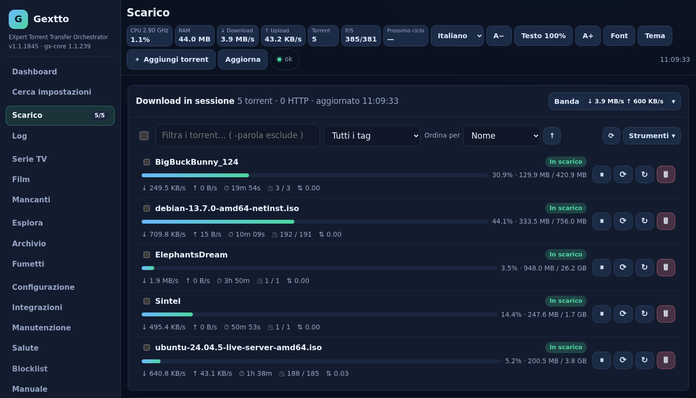
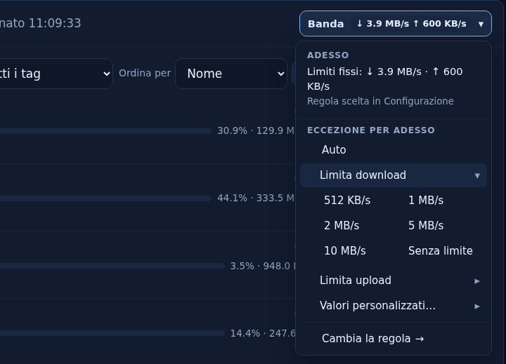
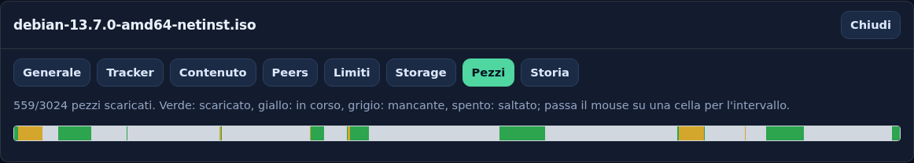
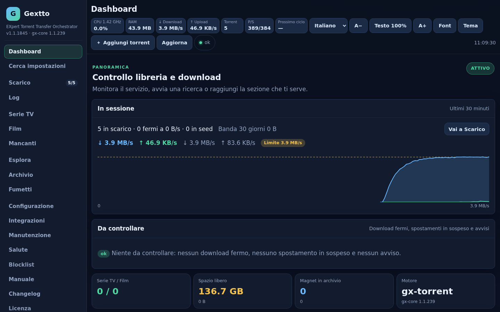
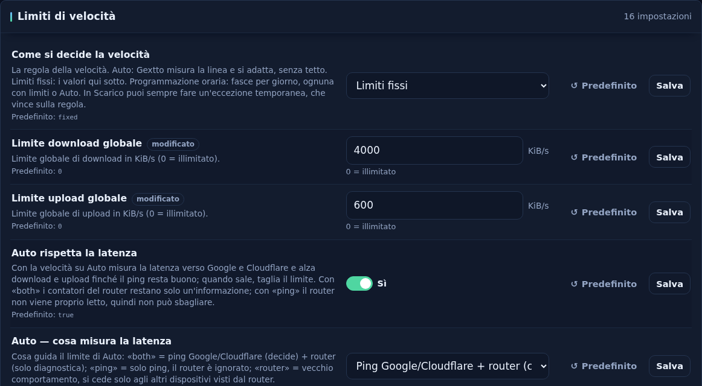
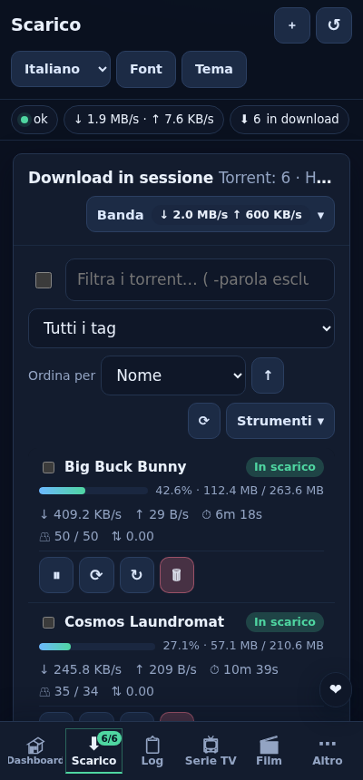

# Gextto — EXpert Torrent Transfer Orchestrator

**Di' a Gextto cosa vuoi vedere. Trova la release migliore, la scarica, la
controlla, le dà il nome giusto e la archivia nella tua libreria — poi continua
a cercarne una copia migliore.**

Gextto è un demone self-hosted di automazione media: cerca, scarica, verifica,
rinomina e archivia serie, film e fumetti. Ha un motore BitTorrent scritto in
Go, un'interfaccia web server-side e un client da terminale. Due binari, nessuna
dipendenza C, nessuna build Node.js, sei lingue.

[](LICENSE)


-informational)


> **English:** [README.md](README.md) · **Manuale:**
> [italiano](docs/MANUAL.it.md) · [English](docs/MANUAL.en.md) · **Segnalazioni:**
> [bug e richieste](https://github.com/buzzqw/gextto/issues) ·
> **Contribuire:** [guida per sviluppatori](docs/DEVELOPERS.md)

## Cosa fa

Aggiungi un titolo e Gextto fa il resto da solo: cerca nelle sorgenti che hai
configurato, dà un punteggio alle candidate, scarica la migliore, controlla i
dati e mette il file in libreria con il nome giusto. Quando esce una release
migliore sostituisce il file vecchio; quando un download si blocca ne cerca un
altro.

- Le candidate sono valutate su risoluzione, sorgente, codec, audio, HDR, lingua
  e dimensione. Uno swarm morto non batte un'alternativa che funziona, e ogni
  release scartata lascia il motivo nel log.
- La libreria è protetta da hardlink durante il seeding, da una guardia dei
  mount che distingue una condivisione smontata da file cancellati e da un
  cestino.
- Il motore è codice Go nostro: BitTorrent v1, v2 e ibrido, TCP e uTP su una
  porta, holepunching, DHT IPv6, streaming. Su uno swarm reale di Ubuntu scarica
  a 9,3–9,4 MB/s dove libtorrent arriva a 6,3–7,1 MB/s, e a riposo occupa
  60–64 MB. Lo stesso binario è [gx-torrent](https://github.com/buzzqw/gextto/releases), un
  client autonomo per Linux e Windows.
- Coda, cache e banda seguono la macchina e la linea. Su Auto la linea è tutta
  di Gextto finché nessun altro ne ha bisogno, e la cede quando serve.

### In breve

| | |
|---|---|
| **Velocità** | 9,3–9,4 MB/s su uno swarm reale di Ubuntu, contro 6,3–7,1 MB/s di libtorrent sullo stesso swarm |
| **Consumi** | 60–64 MB e 1–2 % di un core a riposo; 44–48 % di un core Intel N97 a 8–9 MB/s |
| **Protocollo** | BitTorrent v1, v2 e ibrido (BEP 52) · 34 BEP implementati e testati ([elenco](docs/bep.md)) |
| **Rete** | TCP + uTP su una porta · UPnP, NAT-PMP, PCP · holepunching BEP 55 · proxy SOCKS5/HTTP · killswitch VPN |
| **Automazione** | Serie TV, film, fumetti · Torznab (Jackett, Prowlarr) · RSS · ricerca web · sostituzione dei download bloccati |
| **Integrazioni** | Jellyfin, Plex, aMule (eD2k e Kad), Telegram, e-mail, Discord/Slack/ntfy/Gotify/Pushover, iCal |
| **Interfacce** | Web UI (SSR + HTMX, Go puro, PWA installabile) · TUI da terminale via SSH · API JSON |
| **Build** | Go puro (`CGO_ENABLED=0`) · Linux x86_64/aarch64 · gx-torrent anche su Windows |

Gira su una macchina piccola: tutti i numeri qui vengono da un Intel N97 da 4 core
e 16 GB. I controlli di salute non scrivono sul NAS, così i suoi dischi possono
dormire.

## Uno sguardo

Un'istanza di prova che scarica cinque torrent pubblici e legali: Debian, Ubuntu
Server e i film open di Blender *Big Buck Bunny*, *Sintel* ed *Elephants Dream*.



| | |
|---|---|
|  |  |
| **Banda.** Cosa vale adesso e da dove viene; un'eccezione per adesso, Auto o un limite, con un clic. | **Dettagli del torrent.** Generale, tracker, contenuto, peer, la mappa dei pezzi, limiti e storage. |
|  |  |
| **Dashboard.** La sessione a colpo d'occhio, il traffico in tempo reale e cosa va controllato. | **Configurazione.** Una sola scelta per la regola della velocità; le righe che ne dipendono compaiono solo quando servono. |



Sul telefono le stesse pagine diventano schede, i menu si aprono sul posto e le
azioni sulla selezione restano a portata di pollice. L'interfaccia web si
installa anche come app (PWA), e un client da terminale fa lo stesso lavoro via SSH.
<br clear="right">

## Installazione su Linux

Per Linux a 64 bit con systemd: Debian 12+, Ubuntu 22.04+, Fedora, openSUSE
Leap 15.6+/Tumbleweed, Arch. Da root:

```bash
curl -fsSL https://raw.githubusercontent.com/buzzqw/gextto/main/install.sh | sudo bash
```

Installa in `/opt/gextto`, tiene i dati in `/var/lib/gextto` e serve la UI
sulla porta 5000, con `gx-torrent` accanto a `gexttod` — Go puro, nient'altro da
installare per i torrent. eD2k e Kad sono facoltativi e richiedono un `amuled`
che fai girare tu ([integrazione con aMule](docs/amule.it.md)). L'installer esegue
prima il programma una volta, così una libreria mancante o una glibc vecchia
vengono segnalate subito. Per default il servizio gira come **l'utente che
lancia l'installer**; `--user gextto` usa un account di sistema isolato e
`--media-group <gruppo>` dà accesso alla libreria su un NAS altrui.

> [!IMPORTANT]
> Gextto è pensato per una rete fidata: web UI e API sono aperte per default.
> Per l'accesso dall'esterno attiva il login opzionale (*Configurazione →
> Accesso e servizi*; la LAN resta libera) e usa comunque HTTPS tramite reverse
> proxy o VPN. Le scritture da una pagina di un'altra origine vengono rifiutate
> (protezione CSRF). Leggi la [politica di sicurezza](docs/SECURITY.md) prima di
> esporlo.

### Installazione dai sorgenti

Go 1.26.8+; la build è Go puro e la web UI è incorporata. Vedi il
[manuale per sviluppatori](docs/DEVELOPERS.md).

```bash
make build                 # gexttod e gx-torrent in bin/
```

`make build` fa avanzare il numero di build **committato** e condiviso con la
CI, così checkout e release mostrano lo stesso `1.1.<n>`; `gx-torrent` ha un
contatore suo, che avanza solo quando cambia il suo codice. `make test` esegue
la suite completa, `make test-ui` quella nel browser, `make fuzz-smoke` i
fuzzer.

### Primo avvio sicuro

1. Apri `http://<server>:5000`: la prima visita avvia la **procedura guidata**
   (password, cartelle con verifica dei permessi, indexer e TMDB, primo titolo).
   Si riapre da `/?view=setup`.
2. Tieni attivo il **dry-run**, aggiungi un titolo di prova e lancia una ricerca
   manuale.
3. Controlla **Salute** e **Log**, poi attiva la modalità attiva.

Configurazione del NAS e risoluzione dei problemi: il
[manuale utente](docs/MANUAL.it.md).

### Aggiornamento e disinstallazione

Quando esce una release compare il pulsante **Aggiornamento disponibile**;
*Manutenzione → Aggiornamenti* mostra le novità e **Aggiorna ora** fa il backup
dei database, installa e ripristina la versione precedente se la nuova non
risponde. Rilanciare l'installer aggiorna anche da shell, con lo stesso
ripristino e lo stesso utente del servizio. L'elenco completo delle novità è nel
[changelog](changelog.md).

```bash
sudo bash install.sh --help       # tutte le opzioni
sudo bash install.sh --dry-run    # mostra cosa farebbe, senza cambiare nulla
sudo bash install.sh --uninstall  # ferma e rimuove il programma (tiene i dati)
sudo bash install.sh --uninstall --purge   # rimuove anche la cartella dei dati
```

`GEXTTO_DATA_DIR`, `GEXTTO_PORT`, `GEXTTO_USER`, … restano supportati;
`GEXTTO_LOCAL_ARCHIVE=/percorso/gextto-linux-x86_64.tar.gz` installa offline. Da
un checkout: `git pull --ff-only && ./scripts/update.sh`.

## Funzionalità

### Trovare e scegliere le release

- **Punteggio attento alla qualità.** Punteggi deterministici su qualità,
  sorgente, codec, audio, HDR/Dolby Vision, lingua e dimensione; i file di
  libreria di qualità superiore sono protetti; un tetto opzionale ferma gli
  upgrade. La pagina impostazioni dà il punteggio a release di riferimento con i
  pesi correnti. `ffprobe` legge la qualità reale dei file archiviati.
- **Serie TV, film, fumetti.** `ComicInfo.xml` standard per gli archivi CBZ
  (Komga, Kavita, lettori).
- **Season pack solo quando servono.** Un pack si scarica solo per riempire un
  buco reale o migliorare un episodio; uno che non aggiungerebbe nulla viene
  rifiutato prima di scaricarlo, e un pack ancora in corso (*IN CORSO n/m*) si
  legge entro gli episodi che esistono.
- **Recupero dei download bloccati.** Un download che smette di avanzare, o un
  magnet fermo in attesa dei metadati, viene sostituito da un'alternativa valida
  dopo una finestra configurabile; la release abbandonata va in blocklist.
- **Sorgenti.** Feed RSS, elenchi HTML (ext.to, TorrentGalaxy, Corsaro),
  indexer Torznab e i gestori Jackett/Prowlarr, ricerca web, FlareSolverr
  opzionale. I gestori vengono interrogati **un indexer alla volta**, ognuno al
  ritmo che regge davvero, un tracker presente in entrambi una volta sola, e un
  tracker lento perde solo i propri risultati.
- **eD2k e Kad tramite aMule, quando i torrent non trovano nulla.** Opzionale e
  spento di default: Gextto pilota un `amuled` che fai girare tu (protocollo
  External Connections, client nostro in Go). Cerchi su Kad o sui server eD2k,
  incolli link `ed2k://`, ti colleghi ai server e segui lo stato di aMule nella
  pagina eD2k; i download di aMule compaiono in Scarico accanto ai torrent e,
  completati, vengono rinominati e importati in libreria come un torrent (con
  hardlink o copia, così aMule continua a condividerli). La pagina eD2k mostra
  anche **cosa aMule sta condividendo e caricando** e permette di ricaricare le
  cartelle condivise. Il fallback automatico
  nel gap filling è un secondo interruttore separato e accetta solo un episodio
  esatto, con qualità riconosciuta e fonti sufficienti.

### Sicurezza della libreria

- **Hardlink durante il seeding**: i file completati compaiono subito in
  libreria, senza occupare spazio due volte.
- **Guardia NAS e mount**: una condivisione smontata non viene mai scambiata per
  file cancellati, un'ondata di file "mancanti" viene limitata, una condivisione
  bloccata non congela il motore; gli errori transitori si riprovano e gli
  spostamenti interrotti riprendono. L'avvio di un download resiste ai crash.
- **Cestino**: i file sostituiti da un upgrade e i dati rimossi "con i dati"
  vanno prima nel cestino, dopo che il torrent ha lasciato il motore.

### Banda e linea condivisa

- **Una regola, un'eccezione**: la regola è una sola scelta — **Auto**, limiti
  fissi o una programmazione per giorno della settimana (ogni giorno **Non attiva
  / Limite / Auto**). Dalla pagina Scarico fai un'eccezione per adesso — Auto o un
  limite, da 1 a 12 ore o finché non la togli — e vince sempre sulla regola.
  *Auto* lascia la linea senza tetto, così il suo picco reale viene imparato.
- **Auto rispetta la latenza** (attivo per default): quando la latenza verso
  Internet sale, Gextto si scansa per qualche secondo per capire di chi è la
  coda. Se è sua, si tiene la linea. Se è di qualcun altro, cede a passi e si
  riprende la linea quando gli altri hanno finito. I contatori UPnP del router,
  quando ci sono, dicono chi altro usa la linea; la pagina Download mostra il
  guardiano mentre agisce.
- **Seed che segue il tracker**: limiti di ratio, tempo e **inattività** (un seed
  che non invia nulla per N minuti si ferma) e **regole di seed** per
  sorgente/indexer e categoria: le regole di un tracker privato valgono solo per
  i suoi torrent, con lo stesso comportamento su gx-torrent e qBittorrent. Come
  si configurano:
  [limiti di seed](docs/MANUAL.it.md#limiti-di-seed-regole-per-sorgente-e-seed-inattivo).

### Integrazioni, controllo e interfacce

- **Notifiche e media server**: Telegram, e-mail, webhook (Discord, Slack,
  ntfy, Gotify, Pushover), aggiornamento delle cartelle di Jellyfin e Plex, un
  feed iCal di arrivi e date di uscita.
- **Tracciabilità**: ogni download porta un **ID di acquisizione** attraverso i
  log di ricerca, scelta, trasferimento, post-elaborazione e archivio; il
  pannello **Da controllare** della dashboard tiene ogni avviso finché il suo
  download è attivo; un grafico live della banda a 30 minuti; avvisi quando una
  sorgente continua a fallire o rallenta.
- **Interfacce**: web UI responsive installabile come PWA, navigabile da
  tastiera e verificata con axe-core; vista a poster per serie e film; oltre 20
  temi verificati per il contrasto più quelli personalizzati; una TUI completa
  da terminale per SSH che si adatta allo schermo di un telefono. Sei lingue
  (IT, EN, DE, FR, ES, PL).

La web UI ascolta su `http://<host>:5000/`. La configurazione e ogni sezione sono
descritte nel [manuale italiano](docs/MANUAL.it.md) e nell'
[English manual](docs/MANUAL.en.md).

## Numeri

Questi numeri vengono dall'installazione reale e da swarm, indexer e linea
veri. Ognuno è in [`docs/measurements.md`](docs/measurements.md) con la
macchina, la data e il comando per rifarlo.

| Area | Risultato |
|---|---|
| **Swarm reale** | **9,3–9,4 MB/s** sulla ISO di Ubuntu, contro **6,3–7,1 MB/s** di libtorrent sullo stesso swarm (una campagna di misura) |
| **Memoria del motore** | **60–64 MB** a riposo. Con 10 torrent in download verso un NAS: **~507 MB** fuori dalle due cache; la cache di scrittura si dimensiona dalla RAM libera |
| **CPU del motore** | **44–48 % di un core** a 8–9 MB/s con ~110–130 peer: **0,35–0,43 % per peer**, di cui il piece picker occupa il 9 %; 1–2 % a riposo |
| **Ricerche sugli indexer** | Jackett e Prowlarr interrogati un indexer alla volta: un ciclo di 30 titoli in **110 s**, **205 richieste e nessuna fallita**, **5.935 release** |
| **Dividere la linea** | Un download a piena linea aggiunge ~40 ms di latenza a tutta la casa. Da solo sulla linea Gextto la usa tutta (**8,5 MB/s**); con un altro dispositivo che scarica, quel dispositivo ottiene **6,8–7,3 MB/s** dei 9 MB/s della linea |
| **Riuso dei dati locali** | Un torrent che condivide file con uno già su disco prende dalla rete solo il **25 %** del file (ISO Debian e Arch), anche dopo un riavvio e in qualunque ordine si aggiungano |
| **Scritture su disco** | Scritture da 16 KiB su NFS a **81 MiB/s** con durabilità a lotti; mmap opzionale ~7,0 GB/s su tmpfs |
| **Archivio dei feed** | **447.000 release in 320 MB**, una riga per torrent; 1.000 release archiviate in **41 ms**; l'archivio standalone cerca su 100.000 release in **7,4 ms** |
| **Demone a riposo** | **~0,7 %** di CPU a riposo; **~5.000 chiamate ai metadati al giorno** per 55 serie; i controlli di salute non scrivono mai su un NAS, così i suoi dischi possono dormire |

Lo stesso documento registra cosa è stato misurato e scartato — io_uring, I/O
uTP a lotti su questo carico, una cache write-back — così le stesse idee non si
riprovano.

## Motore torrent

Gextto tiene il piano di controllo (coda, punteggi, post-elaborazione,
archiviazione) e delega i trasferimenti a un motore selezionabile
(*Configurazione → Motore torrent*); il cambio è una migrazione coordinata.

| Motore | Dove gira | Quando sceglierlo |
|---|---|---|
| **gx-torrent** (default) | Processo Go separato e supervisionato | Go puro, autonomo, v1/v2/ibrido, DHT e MSE/PE; anche standalone su Linux e Windows; niente WebTorrent/WebRTC |
| qBittorrent-nox | Demone esterno via Web API, o uno che Gextto scarica e gestisce in privato | Lo usi già o preferisci la sua UI ([guida](docs/qbittorrent-nox.md)); anche il primo passo del fallback automatico |

**Fallback automatico.** Se il motore attivo non resta in piedi, Gextto prima
riporta un `gx-torrent` aggiornato al binario precedente, poi passa a un
qBittorrent-nox gestito (scaricato al bisogno, verificato SHA-256) o a uno
esterno, e infine a uno stato di recupero con la UI attiva. Un periodo di attesa
evita il ping-pong; `GEXTTO_ENGINE=qbittorrent` (o `gx-torrent`) forza il
motore per un avvio.

### gx-core e gx-torrent

`gx-core` (`internal/gxcore`) e la sua DHT (`internal/dht`) sono codice
originale scritto in questo repository sotto EUPL-1.2, senza codice derivato da
terzi ([`THIRD-PARTY-NOTICES`](THIRD-PARTY-NOTICES) elenca solo le librerie
collegate). `gx-torrent` lo esegue come processo supervisionato che sopravvive
ai riavvii dell'orchestratore: Gextto si ricollega quando binario e opzioni
coincidono.

- **Protocollo.** BitTorrent v1, solo-v2 e ibrido (BEP 52) da `.torrent` e
  magnet (`urn:btmh:`), con verifica Merkle SHA-256. **34 BEP implementati e
  testati** — [`docs/bep.md`](docs/bep.md) è la fonte di verità: protocollo
  wire, Fast Extension, metadati, PEX con IPv6, multitracker, LSD,
  super-seeding, web seed, torrent privati, indicazioni sui dati locali,
  `lt_donthave`, tracker UDP con scrape, e la suite DHT (IPv6, scrape, ID di
  nodo sicuri, sola lettura, archivio K/V, `urn:btpk:`). Oltre i BEP: tracker
  `ws://`/`wss://` e **feed DHT** (`dht://<pubkey>`).
- **Riuso locale.** Pezzi e blocchi da 16 KiB già verificati da un altro
  torrent locale — stessa disposizione o lo stesso file v2 — vengono copiati e
  ricontrollati invece che scaricati; i torrent privati non si mescolano mai
  (BEP 27).
- **Rete.** TCP e uTP (BEP 29) in parallelo su una porta, un socket UDP per uTP
  e DHT; ritrasmissione uTP adattiva (soglia minima di latenza e backoff per
  connessione); `ut_holepunch` (BEP
  55) come client e relay; UPnP, NAT-PMP e **PCP**; un test della porta che
  distingue NAT cone da simmetrico; SOCKS5 e HTTP CONNECT; un killswitch
  `outgoing-interface` per le VPN.
- **Autogestione.** Il numero di download attivi segue il throughput; i
  torrent lenti e fermi si fanno da parte; la cache disco si dimensiona da RAM e
  classe di storage (NVMe, SSD, HDD, NFS); i download si mettono in pausa prima
  che una cartella si riempia mentre il seeding continua; le code di richiesta
  per peer si adattano e la connessione chiusa è quella più lenta e inattiva.
- **Impronta leggera per progetto.** I pezzi si scrivono direttamente e la page
  cache del sistema unisce l'I/O; `fdatasync` a lotti, mai `O_SYNC` per
  scrittura; file
  sparsi, `fallocate`, cartelle temporanee su RAM disk, mmap opzionale; percorsi
  caldi senza allocazioni (RC4 in place, bitfield a parole, uTP senza copie); la
  blocklist IP si cerca per bisezione senza allocare.
- **Streaming e sicurezza.** Finestra di riproduzione e readahead separate,
  priorità per file al volo, HTTP Range con il `Content-Type` giusto; un
  **media server DLNA/UPnP** opzionale per le TV, con la libreria del NAS e i
  suoi poster; web seed e `xs=`/`as=` protetti da SSRF; quarantena per i peer
  che mandano blocchi corrotti; diagnostica live per peer, tassi di I/O e
  Server-Sent Events.

Le statistiche del motore sono in **Salute → Motore torrent** (`/?view=health`),
in `GET /api/v1/stats` del demone e in `GET /api/torrents/session-stats`.

## gx-torrent come client autonomo

gx-torrent è anche un client completo senza Gextto, come `qbittorrent-nox` o
`transmission-daemon` — **lo stesso binario** che Gextto pilota, un Gextto più
semplice con tutto ciò che serve a un client autonomo.

- **Web API v2 di qBittorrent** (`/api/v2/...`, comprese le chiamate di
  qBittorrent 5) per Sonarr, Radarr, Lidarr, Readarr e le app mobili; la sua
  API JSON; **metriche Prometheus**
  (`/api/v1/metrics`) per Grafana o Home Assistant, e un **flusso di eventi**
  (`/api/v1/events`) per Node-RED, Home Assistant o script
  ([esempi](docs/API.md#integrating-with-other-systems)).
- **Web UI** disposta come quella di qBittorrent: temi chiaro e scuro; filtri
  per stato, categoria, tag e tracker; scelta delle colonne (24) con colonne
  ridimensionabili salvate sul server; menu contestuale completo; pannello di
  dettaglio ridimensionabile (file raggruppati per cartella, rinomina, peer);
  anteprima del magnet mentre lo scrivi; annullamento dopo una rimozione;
  scorciatoie da tastiera, trascinamento, schede adatte al telefono e una
  pagina **Statistiche** (totali di sessione e di sempre, grafico 1 h/24 h/7 g).
  Ogni pagina verificata con axe-core.
- **RSS e automazione.** Una pagina **Cercati** che
  dice per ogni titolo cosa è scaricato, in download o visto ma scartato, e
  perché ogni release verrebbe presa o rifiutata; una pagina **RSS e indexer**
  con regole PASS/FAIL ordinate, anteprima live delle corrispondenze, modelli di
  regole, test dei feed, liste di feed incollate, e un **archivio** locale di
  tutto ciò che i feed hanno restituito.
- **Gestione.** Limiti, programmazione per giorno, auto-speed sulla latenza,
  ottimizzazione con un clic, filtro IP con aggiornamento programmato, categorie
  e tag, test della porta; limiti di seed per ratio, tempo e **inattività**, e il
  **content layout** di qBittorrent (originale, crea sottocartella, nessuna
  sottocartella) all'aggiunta.
- **Notifiche** sugli stessi canali di Gextto, con un pulsante di prova.
- **Si aggiorna da solo** dalle build della CI quando cambia il suo codice,
  verificato SHA-256, con ripristino automatico.
- **Piattaforme.** Linux x86_64/aarch64 (unit systemd, `run.sh`, immagine Docker
  non privilegiata) e servizio Windows nativo su amd64/arm64.

Apri `http://<host>:8890/` per la sua procedura guidata. Riferimento completo:
il [documento tecnico di gx-torrent](docs/gx-torrent.md).

## Test

Cosa gira a ogni push (`make test`, `make test-ui`, `make fuzz-smoke` e CI):

| Livello | Cosa gira |
|---|---|
| **Unitari e integrazione** | 2.189 funzioni di test Go in 426 file: motore, DHT, uTP, storage, punteggi, post-elaborazione, API, rendering della UI. La TUI viene pilotata contro il router reale |
| **End-to-end** | 57 test Playwright pilotano il demone reale in un browser — pagine, mobile, sei lingue, sicurezza, impostazioni — compresi 14 test di accessibilità con audit WCAG axe-core |
| **Fuzzing** | 23 parser esposti alla rete (DHT, bencode, magnet, BEP 10/52, tracker, Torznab, RSS, MSE) sotto fuzzing in CI; ogni crash trovato diventa un seed committato |
| **Misure sul mondo reale** | 14 misure opzionali: swarm pubblici reali, la DHT pubblica, un peer libtorrent reale, riuso locale su ISO reali, choking e pipelining, i Jackett/Prowlarr in uso, la latenza della linea di casa |
| **Guardie statiche** | Ogni bottone della UI punta a una rotta registrata, ogni chiamata interna si risolve sul router reale, ogni impostazione è salvabile, tradotta in sei lingue e ha il suo tooltip, ogni rotta API è documentata |
| **Piattaforme e pacchetti** | La CI cross-compila motore e demone per Windows ed esegue i test di piattaforma Windows e un'installazione reale del servizio; gli installer hanno auto-test (ogni opzione, un dry-run che non cambia nulla) e l'immagine Docker standalone viene costruita e provata; CodeQL analizza ogni push |
| **Benchmark** | 45 benchmark Go sui percorsi caldi (picker, storage, uTP, archivio, riuso, logging), lanciati prima e dopo ogni modifica a un percorso dati |

## Accessibilità

Navigazione da tastiera, nomi accessibili, gestione del focus nei dialoghi,
tabelle semantiche ordinabili, annunci live, reflow responsive e temi verificati
per il contrasto, coperti da axe-core e Playwright (`cd uiweb/end2end && npm ci
&& npm run test:a11y`). Non è una certificazione legale: servono ancora prove
manuali con screen reader e tecnologie assistive
([ambito, test e limiti](docs/ACCESSIBILITY.md)).

## Documentazione

| Bisogno | Documento |
|---|---|
| Usare il servizio | [Manuale italiano](docs/MANUAL.it.md) · [English manual](docs/MANUAL.en.md) |
| Cosa è cambiato | [Changelog](changelog.md) · [English](changelog.en.md) |
| Misure e metodo | [Misure](docs/measurements.md) |
| Stato, decisioni e prossimi passi | [Evoluzione](docs/evoluzione.md) |
| Architettura e progetto | [Architettura](docs/ARCHITECTURE.md) |
| Specifiche BitTorrent (BEP) | [Conformità BEP](docs/bep.md) |
| NAS, reverse proxy, recupero | [Guida avanzata](docs/ADVANCED.en.md) |
| Integrazioni HTTP | [Riferimento API](docs/API.md) |
| Spostare un'installazione | [Guida alla migrazione](docs/MIGRATION.md) |
| Client da terminale | [Riferimento TUI](docs/tui.md) |
| Motore gx-torrent e client autonomo | [Documento tecnico di gx-torrent](docs/gx-torrent.md) · [gx-core](docs/gx-core.md) |
| eD2k e Kad tramite aMule | [Integrazione con aMule](docs/amule.it.md) |
| Backend qBittorrent-nox | [Guida](docs/qbittorrent-nox.md) |
| Compilare o contribuire | [Manuale per sviluppatori](docs/DEVELOPERS.md) |
| Sicurezza di rete e dei dati | [Politica di sicurezza](docs/SECURITY.md) |

Albero completo: l'[indice della documentazione](docs/README.md).

## Sostieni il progetto

Se Gextto ti è utile e vuoi sostenerne lo sviluppo, una donazione PayPal è
benvenuta — grazie. Un pulsante **Dona** è sempre visibile anche nella UI, in
basso a destra.

[](https://www.paypal.com/cgi-bin/webscr?cmd=_donations&business=azanzani@gmail.com&item_name=Support+Gextto+Project)

## Uso legale e corretto

Gextto è uno **strumento di automazione dei download**. Non ospita, indicizza né
distribuisce contenuti protetti da diritto d'autore.

- Si collega agli **indexer che configuri tu** (Jackett, Prowlarr, feed RSS
  pubblici). Non include alcun indice proprio.
- Ciò che scarichi è **una tua responsabilità**. Usa Gextto solo per contenuti a
  cui hai diritto di accedere — pubblico dominio, Creative Commons o media che
  possiedi.
- BitTorrent e i motori che Gextto pilota sono tecnologie neutre; questo
  progetto non incoraggia né facilita la pirateria.
- Rilasciato con licenza open source **EUPL 1.2**.

## Licenza

Gextto è distribuito con licenza [EUPL-1.2](LICENSE). Il nucleo del motore
(`gx-core`, `internal/gxcore`) e la DHT (`internal/dht`) sono codice originale
in questo repository con la stessa licenza. Vedi
[THIRD-PARTY-NOTICES](THIRD-PARTY-NOTICES) per le librerie di terzi collegate
(anche nella pagina *Licenza* della web UI).

## Ringraziamenti

Grazie a **[DeepSeek](https://www.deepseek.com/)** per il supporto e la pazienza
mentre questo progetto cresceva.

