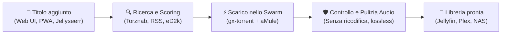
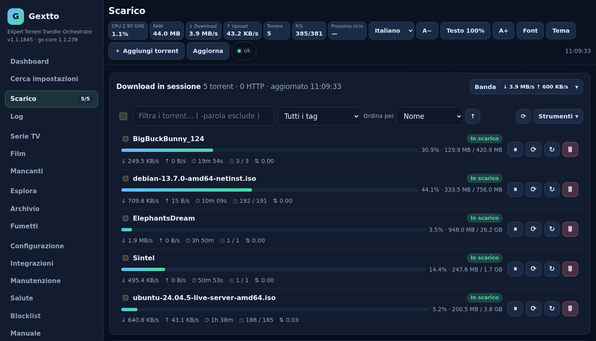
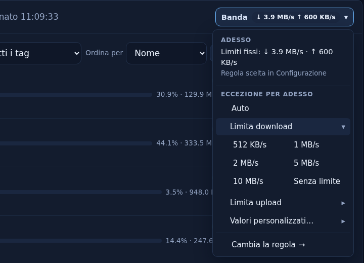
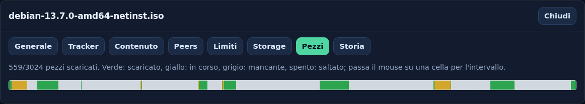
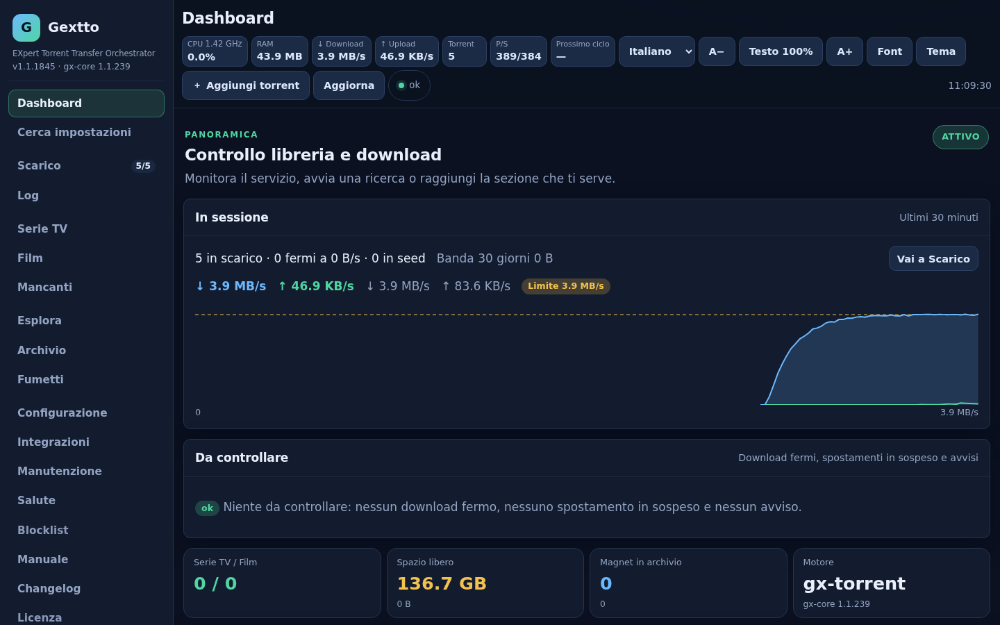
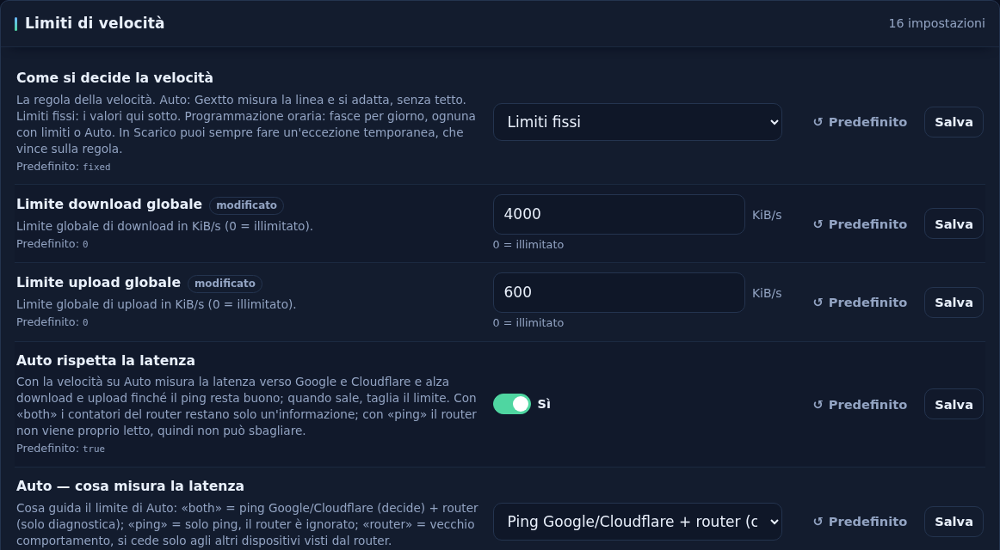
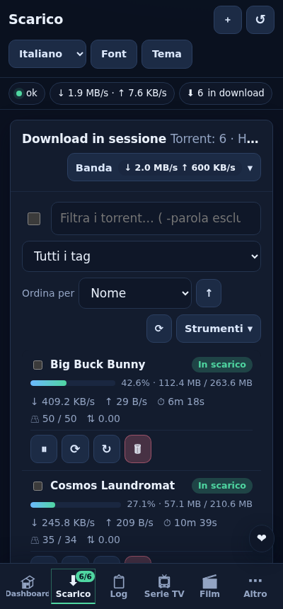

# Gextto — EXpert Torrent Transfer Orchestrator

**Di' a Gextto cosa vuoi vedere. Trova la release migliore, la scarica, la
controlla, le dà il nome giusto e la archivia nella tua libreria — poi continua
a cercarne una copia migliore.**

Gextto è un demone self-hosted di automazione media: cerca, scarica, verifica,
rinomina e archivia serie, film e fumetti. Ha un motore BitTorrent nativo scritto in
Go puro (`gx-torrent`), un'interfaccia web server-side e un client da terminale. Due
binari, nessuna dipendenza C, nessuna build Node.js, sei lingue.

[](LICENSE)


-informational)


[](https://buzzqw.github.io/gextto/)

> **English:** [README.md](README.md) · **Manuale:**
> [italiano](docs/MANUAL.it.md) · [English](docs/MANUAL.en.md) · **Segnalazioni:**
> [bug e richieste](https://github.com/buzzqw/gextto/issues) ·
> **Contribuire:** [guida per sviluppatori](docs/DEVELOPERS.md) ·
> **Sito della documentazione:** <https://buzzqw.github.io/gextto/>

## Cosa fa

Aggiungi un titolo e Gextto orchestra l'intero ciclo in autonomia: interroga le sorgenti
che hai configurato, valuta le release candidate, scarica la scelta migliore, verifica
l'integrità del file, pulisce le tracce audio e archivia il video in libreria con il nome
corretto. Quando esce una release di qualità superiore aggiorna il file in silenzio; se un
download si blocca, trova subito un'alternativa.



### I punti di forza unici

- 🤝 **Due reti, un solo file (come Shareaza)**: quando un episodio scarica sia via
  BitTorrent sia su eD2k (aMule) con la stessa dimensione, i blocchi verificati (SHA-1)
  vengono scambiati al volo tra i due motori. Chi finisce prima completa l'altro: un torrent
  fermo al 95% si sblocca con i dati di eD2k, condividendo un unico limite di banda.
  ([approfondisci](docs/amule.it.md))
- ⚡ **Motore BitTorrent nativo in Go puro (`gx-torrent`)**: codice originale e senza CGO,
  con supporto a BitTorrent v1, v2 e ibrido (BEP 52), DHT IPv6 e uTP. Occupa solo ~28 MB di
  RAM a riposo e raggiunge fino a 290 MB/s di velocità — battendo i client basati su libtorrent.
  Funziona anche come demone autonomo su Linux e Windows. ([misure](docs/measurements.md) · [elenco BEP](docs/bep.md))
- 🧹 **Pulizia audio intelligente e lossless**: elimina le tracce audio straniere
  all'importazione, conservando solo le lingue scelte senza ricodificare video o audio.
  Ogni singolo pacchetto viene confrontato con l'originale per garantire sincronia A/V perfetta.
- 📉 **Banda automatica sensibile alla latenza**: in modalità Auto sfrutta tutta la linea
  quando è libera, ma misura continuamente il ping. Se un altro dispositivo in casa gioca online
  o guarda video in streaming, Gextto cede banda istantaneamente per poi riprenderla appena la linea si libera.
- 🛡️ **Protezione totale della libreria**: hardlink a costo zero di spazio durante il seeding,
  guardia contro lo smontaggio delle condivisioni NAS (nessun falso allarme file cancellati),
  cestino di sicurezza per le sostituzioni e controlli periodici d'integrità in background.

### In breve

| Area | Caratteristiche | Dettagli |
|---|---|---|
| **Numeri** | 290 MB/s di throughput · 28 MB RSS a riposo · 0,3–0,5% CPU | [Cifre e benchmark](#numeri) |
| **Protocollo** | BitTorrent v1, v2 e ibrido (BEP 52) · 34 BEP implementati e testati | [Conformità BEP](docs/bep.md) |
| **Rete** | TCP + uTP su una sola porta · UPnP, NAT-PMP, PCP · holepunching BEP 55 · SOCKS5/HTTP · killswitch VPN | [Documento gx-torrent](docs/gx-torrent.md) |
| **Automazione** | Serie TV, film, fumetti · Torznab, RSS, listing HTML · sostituzione automatica download fermi | [Manuale utente](docs/MANUAL.it.md) |
| **Due reti** | Download simultaneo Torrent + eD2k sullo stesso file · pezzi verificati dal `.part` di aMule | [Integrazione aMule](docs/amule.it.md) |
| **Integrazioni** | Jellyfin, Plex, Jellyseerr (API v3), aMule (eD2k/Kad), Telegram, Discord, Slack, ntfy, Pushover, iCal | [Manuale utente](docs/MANUAL.it.md) |
| **Interfacce** | Web UI responsive (SSR + HTMX, PWA installabile, 20+ temi) · TUI da terminale via SSH · API JSON | [Riferimento TUI](docs/tui.md) · [API](docs/API.md) |
| **Build** | Go puro (`CGO_ENABLED=0`) · Linux x86_64/aarch64 · gx-torrent anche nativo su Windows | [Guida sviluppatori](docs/DEVELOPERS.md) |

## Uno sguardo

Un'istanza di prova che scarica sei torrent pubblici e legali: Debian, Ubuntu
Server e i film open di Blender *Big Buck Bunny*, *Sintel*, *Tears of Steel* e
*Cosmos Laundromat*. Altre schermate — libreria, configurazione, primo avvio,
manutenzione, salute, la pagina di gx-torrent e le altre lingue — sono nella
**[visita guidata](docs/TOUR.it.md)**.



| | |
|---|---|
|  |  |
| **Banda.** Cosa vale adesso e da dove viene; un'eccezione per adesso, Auto o un limite, con un clic. | **Dettagli del torrent.** Generale, tracker, contenuto, peer, la mappa dei pezzi, limiti e storage. |
|  |  |
| **Dashboard.** La sessione a colpo d'occhio, il traffico in tempo reale e cosa va controllato. | **Configurazione.** Una sola scelta per la regola della velocità; le righe che ne dipendono compaiono solo quando servono. |



Sul telefono le stesse pagine diventano schede, i menu si aprono sul posto e le
azioni sulla selezione restano a portata di pollice. L'interfaccia web si
installa come app (PWA), e un client da terminale copre le stesse operazioni via SSH.
<br clear="right">

**[Visita guidata con tutte le schermate →](docs/TOUR.it.md)**

## Installa su Linux

Per Linux a 64 bit con systemd: Debian 12+, Ubuntu 22.04+, Fedora, openSUSE
Leap 15.6+/Tumbleweed, Arch. Esegui come root:

```bash
curl -fsSL https://raw.githubusercontent.com/buzzqw/gextto/main/install.sh | sudo bash
```

Preferisci Docker? Lo [stack completo](docs/DOCKER.it.md) avvia Gextto, `gx-torrent`, indexarr, Jackett, Prowlarr, FlareSolverr e aMule insieme con `docker compose`.

L'installer configura `/opt/gextto`, mette i dati in `/var/lib/gextto` e apre la UI
sulla porta 5000, con `gx-torrent` accanto a `gexttod` — Go puro, nient'altro da
installare per i torrent. Quando disponibili, installa anche `ffmpeg`, `mediainfo` e `mkvtoolnix`
per l'analisi reale dei media e la pulizia audio senza ricodifica (`--no-media-tools` li salta).
eD2k e Kad sono opzionali e si collegano a un `amuled` gestito da te
([integrazione aMule](docs/amule.it.md)). Per impostazione predefinita il servizio gira
con l'utente che avvia l'installer; `--user gextto` usa un account di sistema dedicato.

> [!IMPORTANT]
> Gextto è pensato per una rete fidata: web UI e API sono aperte per impostazione
> predefinita. Per l'accesso dall'esterno, attiva il login opzionale
> (*Configurazione → Accesso e servizi*; la rete locale resta libera) e usa HTTPS
> tramite reverse proxy o VPN. Leggi la [politica di sicurezza](docs/SECURITY.md)
> prima di esporlo in remoto.

### Compila dai sorgenti

Go 1.26.8+; build in Go puro con UI incorporata:

```bash
make build                 # gexttod e gx-torrent in bin/
```

`make test` lancia la suite completa, `make test-ui` i test Playwright nel browser e `make fuzz-smoke` i fuzzer di rete.
Vedi la [guida per sviluppatori](docs/DEVELOPERS.md) per i dettagli.

### Primo avvio guidato

1. Apri `http://<server>:5000`: la prima visita apre la **procedura guidata**
   (password, cartelle con controllo permessi, indexer e TMDB, primo titolo).
   Riapribile in qualsiasi momento su `/?view=setup`.
2. Lascia attiva la modalità **dry-run**, aggiungi un titolo di prova e lancia una ricerca manuale.
3. Controlla le pagine **Salute** e **Log**, quindi attiva la modalità operativa.

Configurazione NAS e risoluzione problemi: il [manuale utente](docs/MANUAL.it.md) e la [guida avanzata](docs/ADVANCED.en.md).

### Aggiornamento e disinstallazione

Il pulsante **Aggiornamento disponibile** compare non appena viene pubblicata una release;
*Manutenzione → Aggiornamenti* mostra le novità e **Aggiorna ora** salva una copia dei
database, installa e ripristina in automatico la versione precedente se quella nuova non risponde.
Rilanciando l'installer da shell si aggiorna con lo stesso rollback automatico.
L'elenco completo delle modifiche è nel [changelog](changelog.md).

```bash
sudo bash install.sh --help       # tutte le opzioni
sudo bash install.sh --dry-run    # mostra cosa farebbe senza toccare nulla
sudo bash install.sh --uninstall  # arresta e rimuove il programma (lascia i dati)
sudo bash install.sh --uninstall --purge   # cancella anche la cartella dati
```

## Funzionalità

### Ricerca e acquisizione intelligente

- **Punteggio consapevole della qualità**: punteggi deterministici raggruppati per qualità video
  (4K, Full HD, HD, SD, codec) e audio (lossless, DTS/DD+, AC3/5.1, AAC/Opus, MP3),
  più canali 5.1/7.1 e formati immersivi Atmos/DTS:X. I file di qualità superiore già archiviati
  sono protetti da downgrade, e uno swarm senza fonti non supera un'alternativa attiva.
- **Profili di qualità con nome**: crea modelli riutilizzabili (risoluzione, audio minimo, lingua,
  sottotitoli, soglie di upgrade). La lista dei profili è esposta direttamente a **Jellyseerr**
  tramite il sottoinsieme `/api/v3` (`system/status`, `qualityprofile`, `rootfolder`, ricerca titoli, `queue`).
- **Gestione intelligente dei pack di stagione**: un pack viene scaricato solo se colma un buco reale;
  gli episodi non necessari vengono esclusi prima del download e i pack di stagioni ancora in corso
  (*IN CORSO n/m*) vengono importati limitatamente agli episodi disponibili.
- **Recupero automatico download bloccati**: un torrent fermo o un magnet in attesa infinita di metadati
  viene automaticamente sostituito da un'alternativa valida e temporaneamente escluso.
- **Gestione completa delle sorgenti**: indexer Torznab (Jackett, Prowlarr, indexarr), feed RSS pubblici,
  listing HTML e motori web. I gestori vengono interrogati un tracker alla volta per non saturare le richieste,
  con tracciamento di attività ed errori per ciascun feed.
- **Estrazione archivi (RAR)**: estrae automaticamente nella libreria gli archivi non compressi e compressi
  in formato RAR 5 multi-volume, mantenendo i file originali per non interrompere il seed.
- **eD2k e Kad tramite aMule**: controlla `amuled` via protocollo External Connections. Cerca su Kad,
  incolla link `ed2k://`, monitora code e file condivisi direttamente da Gextto.
  ([approfondisci](docs/amule.it.md))

→ *Documentazione completa: [Sorgenti e qualità nel manuale](docs/MANUAL.it.md#trovare-e-scegliere-le-release)*

### Sicurezza della libreria e manutenzione

- **Hardlink a costo zero**: i file completati compaiono subito in libreria senza duplicare spazio su disco
  mentre il seeding continua.
- **Guardia del mount NAS**: rileva una condivisione smontata per evitare cancellazioni a catena, riprende
  spostamenti interrotti e isola share lenti o bloccati senza fermare il motore.
- **Cestino di sicurezza**: i file sostituiti da un upgrade o rimossi finiscono prima nel cestino, al riparo da errori.
- **Nessuna sostituzione inutile**: differenze marginali di punteggio (dimensione, sottotitoli) non sostituiscono
  mai un file già archiviato se non c'è un reale miglioramento tecnico (REPACK, PROPER, codec/risoluzione superiore).
- **Controllo file danneggiati**: scansione periodica in background che verifica e decodifica i file con `ffprobe`
  e `ffmpeg`. Il controllo rapido dei soli keyframe trova troncamenti nei 4K in pochi minuti; i file corrotti
  possono essere riscaricati in automatico.
- **Finestra di manutenzione notturna**: esegue le operazioni pesanti a riposo (compattazione database,
  controllo d'integrità settimanale, scansione MediaInfo, pulizia audio).

→ *Documentazione completa: [Strumenti libreria nel manuale](docs/MANUAL.it.md#strumenti-della-libreria) · [Guida NAS avanzata](docs/ADVANCED.en.md)*

### Controllo della banda e della linea

- **Una regola, un'eccezione**: scegli tra **Auto**, limiti fissi o pianificazione settimanale.
  Dalla pagina Scarico imposti eccezioni temporanee (da 1 a 12 ore) con un solo clic.
- **Velocità Auto attenta al ping**: Gextto misura la latenza verso Internet; se rileva traffico concorrente
  (gaming, streaming), cede il passo gradualmente per poi riprendere la banda appena la linea torna libera.
- **Regole di seed per tracker**: imposta limiti di ratio, tempo o inattività globali o differenziati
  per singolo indexer/tracker, con comportamento identico su `gx-torrent` e `qBittorrent-nox`.

→ *Documentazione completa: [Velocità e seeding nel manuale](docs/MANUAL.it.md#velocita-e-banda-condivisa)*

### Integrazioni e interfacce

- **Notifiche complete**: Telegram, e-mail, webhook, canali dedicati per Discord, Slack, Gotify, ntfy, Pushover,
  Apprise e script utente, con filtri eventi e finestra antispam.
- **Sincronizzazione media server**: aggiornamento automatico delle librerie Jellyfin e Plex, più feed iCal
  con arrivi e date di trasmissione.
- **Ecosistema browser e *arr**: cattura magnet/torrent dal browser, compatibilità con estensioni qBittorrent
  (Torrent Control) ed endpoint `/api/v2` compatibile con le app dell'ecosistema *arr.
- **Interfaccia moderna e accessibile**: UI renderizzata via HTMX (installabile come PWA su smartphone),
  oltre 20 temi controllati per il contrasto, navigazione da tastiera completa (WCAG verificata con axe-core)
  e client TUI da terminale via SSH. Disponibile in sei lingue (IT, EN, DE, FR, ES, PL).

→ *Documentazione completa: [Riferimento API](docs/API.md) · [Riferimento TUI](docs/tui.md)*

## Numeri

Queste cifre vengono dall'installazione reale e da swarm, indexer e linea di casa
veri, su un Intel N97 a 4 core con 16 GB. **Il throughput è stato misurato su una
linea FTTC (100 Mbit/s down, 15 Mbit/s up): la linea faceva da limite, non il
motore; su FTTH la stessa macchina non è più limitata dalla linea.** Ogni cifra è
in [`docs/measurements.md`](docs/measurements.md) con macchina, data e comando per
riprodurla.

| Ambito | Risultato |
|---|---|
| **Confronto con altri client** | Stessi limiti in Docker, N97: a tutta velocità **290 MB/s**, davanti a Deluge e qBittorrent (239–246, misurati in una tornata precedente) e a rain, anacrolix/torrent e Transmission (30–175), con **24 MiB** di memoria propria contro 33–53. Su una linea limitata a 100 Mbit/s anacrolix/torrent è avanti del 2 % (**11,2 MB/s** contro 11,4, dentro la dispersione) e gx-torrent consuma meno CPU per GiB dei quattro che saturano la linea; al ricontrollo di 4 GiB gx-torrent è primo (**3,6 s** contro 3,9–10,2) e in upload è primo (**203 MB/s**, contro i 191 di qBittorrent). A riposo rain e anacrolix/torrent sono i più leggeri (0,01 % di un core contro 0,05); con cento torrent gx-torrent consuma lo 0,13 %, contro lo 0,01 di anacrolix, lo 0,37 di Deluge e il 2,18 di rain. [Tabelle complete](docs/measurements.md#compared-with-qbittorrent-transmission-deluge-rain-and-anacrolixtorrent) |
| **Swarm reale** | **9,3–9,4 MB/s** sulla ISO di Ubuntu, contro **6,3–7,1 MB/s** di libtorrent sullo stesso swarm (una campagna misurata) |
| **Memoria del motore** | **28–30 MB RSS** a riposo (16–18 MB anonimi), DHT attiva e filtro IP completo (172.740 regole). Con 10 torrent in download su NAS: **~507 MB** fuori dalle due cache; la cache di scrittura si dimensiona dalla RAM libera |
| **CPU del motore** | **18–37 % di un core** a 8,2–8,8 MB/s con 116–132 peer, **2,0–4.3 s di CPU per 100 MB**; **0,3–0,5 %** di un core a riposo |
| **Ricerche indexer** | Jackett e Prowlarr interrogati un indexer alla volta: un ciclo di 30 titoli in **110 s**, **205 richieste e zero errori**, **5.935 release** |
| **Banda condivisa** | Un download saturo aggiunge ~40 ms di latenza a tutta la casa. Da solo sulla linea Gextto la tiene tutta (**8,5 MB/s**); con un altro dispositivo che scarica, quel dispositivo riceve **6,8–7,3 MB/s** dei 9 MB/s della FTTC |
| **Riuso dati locali** | Un torrent che condivide file con uno già su disco prende solo il **25 %** del file dalla rete (ISO Debian e Arch), anche dopo un riavvio e in qualsiasi ordine di aggiunta |
| **Scritture su disco** | Scritture da 16 KiB su NFS a **81 MiB/s** con durabilità a lotti; mmap opzionale ~7,0 GB/s su tmpfs |
| **Archivio feed** | **447.000 release in 320 MB**, una riga per torrent; 1.000 nuove release archiviate in **36 ms** in un archivio di 50.000, e 1.000 già archiviate in **9 ms**; l'archivio standalone cerca 100.000 release in **7,4 ms** |
| **Demone a riposo** | **~0,7 %** CPU a riposo; **~5.000 chiamate metadati al giorno** per 55 serie; le sonde di salute non scrivono mai sul NAS, così i dischi possono dormire |

Lo stesso documento registra cosa è stato misurato e scartato — io_uring, I/O uTP a lotti
su questo carico, cache write-back — così le stesse idee non vengono provate due volte.

## Motore torrent

Gextto tiene il piano di controllo (coda, punteggi, post-elaborazione, archiviazione)
e delega i trasferimenti a un motore selezionabile (*Configurazione → Motore torrent*);
il passaggio tra i motori è una migrazione coordinata.

| Motore | Dove gira | Quando sceglierlo |
|---|---|---|
| **gx-torrent** (predefinito) | Processo Go separato e supervisionato | Go puro, autosufficiente, v1/v2/ibrido, DHT e MSE/PE; anche autonomo su Linux e Windows; niente WebTorrent/WebRTC |
| qBittorrent-nox | Demone esterno via Web API, oppure scaricato e avviato privatamente da Gextto | Se lo usi già o ne preferisci l'interfaccia ([guida](docs/qbittorrent-nox.md)); è anche il primo passo del ripiego automatico |

**Ripiego automatico.** Se il motore attivo non riesce a restare avviato, Gextto prima ripristina
un `gx-torrent` aggiornato alla versione precedente, poi passa a un qBittorrent-nox gestito
(scaricato su richiesta, verificato SHA-256) o esterno, e infine a uno stato di recupero con la UI attiva.
Un tempo di attesa evita oscillazioni; `GEXTTO_ENGINE=qbittorrent` (o `gx-torrent`) forza il motore per un avvio.

### gx-core e gx-torrent

`gx-core` (`internal/gxcore`) e la sua DHT (`internal/dht`) sono codice originale scritto in questo
repository con licenza EUPL-1.2, senza codice derivato da terzi
([`THIRD-PARTY-NOTICES`](THIRD-PARTY-NOTICES) elenca solo le librerie collegate).
`gx-torrent` lo esegue come processo supervisionato che sopravvive ai riavvii dell'orchestratore:
Gextto vi si ricollega se binario e opzioni coincidono.

- **Protocollo**: BitTorrent v1, solo v2 e ibrido (BEP 52) con verifica Merkle SHA-256.
  **34 BEP implementati e collaudati** ([docs/bep.md](docs/bep.md)): wire protocol, Fast Extension,
  metadati, PEX con IPv6, multitracker, LSD, super-seeding, web seed, torrent privati,
  `lt_donthave`, tracker UDP con scrape, DHT IPv6, scrape, ID sicuri e archivio K/V.
- **Riuso locale**: rileva e copia automaticamente pezzi e blocchi da 16 KiB già verificati
  su disco da un altro torrent senza riscaricarli; i torrent privati restano sempre isolati.
- **Rete**: TCP e uTP (BEP 29) su una sola porta; holepunching BEP 55 (client e relay);
  UPnP, NAT-PMP e PCP; proxy SOCKS5 e HTTP CONNECT; killswitch legato all'interfaccia VPN.
- **Efficienza delle risorse**: page cache di sistema con I/O unito, `fdatasync` a lotti, file sparsi,
  `fallocate`, percorsi caldi a zero allocazioni (RC4 in-place, uTP zero-copy), blocklist IP con ricerca binaria.
- **Streaming e DLNA**: finestre separate per riproduzione e readahead, priorità per file al volo,
  supporto HTTP Range, e un media server DLNA/UPnP opzionale per Smart TV.
- **Politiche di banda**: quote di banda per singolo torrent (stile Tixati), divisione che premia
  chi ti invia dati durante il download, filtro client contro leecher parassiti e visualizzazione del paese dei peer (DB-IP).

→ *Dettagli completi: [Documento tecnico di gx-torrent](docs/gx-torrent.md) · [Conformità BEP](docs/bep.md)*

### gx-torrent come client autonomo

`gx-torrent` può essere usato anche come client autonomo completo senza Gextto,
un'alternativa in Go puro a `qbittorrent-nox` o `transmission-daemon`:

- **Web API v2 di qBittorrent** (`/api/v2/...`): compatibile con Sonarr, Radarr, Lidarr,
  Readarr e le app mobili per smartphone.
- **Web UI completa**: temi chiaro e scuro, 24 colonne personalizzabili, gestione categorie,
  filtri tag, cassetto dei dettagli (peer, mappa pezzi, file), anteprima magnet, drag-and-drop e schede per mobile.
- **Automazione e RSS**: pagina dedicata *Serie e film*, motore di regole RSS con filtri PASS/FAIL
  ordinati e archivio locale dei feed.
- **Prometheus ed eventi**: espone `/api/v1/metrics` per Grafana/Home Assistant e `/api/v1/events`
  per integrazioni Node-RED o script da shell.
- **Piattaforme**: Linux x86_64/aarch64 (unit systemd, Dockerfile) e servizio Windows nativo (amd64/arm64).

→ *Manuale completo: [Manuale illustrato di gx-core](docs/GXCORE-MANUAL.it.md)*

## Test

Cosa gira a ogni push (`make test`, `make test-ui`, `make fuzz-smoke` e CI):

| Livello | Cosa gira |
|---|---|
| **Unitari e integrazione** | 2.189 funzioni di test Go in 426 file: motore, DHT, uTP, storage, punteggi, post-elaborazione, API, rendering della UI. La TUI viene pilotata contro il router reale |
| **End-to-end** | 57 test Playwright pilotano il demone reale in un browser — pagine, mobile, sei lingue, sicurezza, impostazioni — compresi 14 test di accessibilità con audit WCAG axe-core |
| **Fuzzing** | 23 parser esposti alla rete (DHT, bencode, magnet, BEP 10/52, tracker, Torznab, RSS, MSE) sotto fuzzing in CI; ogni crash trovato diventa un seed committato |
| **Misure sul mondo reale** | 14 misure opzionali: swarm pubblici reali, la DHT pubblica, un peer libtorrent reale, riuso locale su ISO reali, choking e pipelining, i Jackett/Prowlarr in uso, la latenza della linea di casa |
| **Guardie statiche** | Ogni bottone della UI punta a una rotta registrata, ogni chiamata interna si risolve sul router reale, ogni impostazione è salvabile, tradotta in sei lingue e ha il suo tooltip, ogni rotta API è documentata |
| **Piattaforme e pacchetti** | La CI cross-compila motore e demone per Windows ed esegue i test di piattaforma Windows e un'installazione reale del servizio; gli installer hanno auto-test (ogni opzione, un dry-run che non cambia nulla) e le immagini Docker standalone e completa vengono costruite e provate; CodeQL analizza ogni push |
| **Benchmark** | 45 benchmark Go sui percorsi caldi (picker, storage, uTP, archivio, riuso, logging), lanciati prima e dopo ogni modifica a un percorso dati |

## Accessibilità

Navigazione da tastiera, nomi accessibili, gestione del focus nei dialoghi,
tabelle semantiche ordinabili, annunci live, reflow responsive e temi verificati
per il contrasto, coperti da axe-core e Playwright (`cd uiweb/end2end && npm ci
&& npm run test:a11y`). Non è una certificazione legale: servono ancora prove
manuali con screen reader e tecnologie assistive
([ambito, test e limiti](docs/ACCESSIBILITY.md)).

## Documentazione

| Bisogno | Documento |
|---|---|
| Usare il servizio | [Manuale italiano](docs/MANUAL.it.md) · [English manual](docs/MANUAL.en.md) |
| Cosa è cambiato | [Changelog](changelog.md) · [English](changelog.en.md) |
| Misure e metodo | [Misure](docs/measurements.md) |
| Lavori aperti | [TODO](docs/todo.md) |
| Architettura e progetto | [Architettura](docs/ARCHITECTURE.md) |
| Specifiche BitTorrent (BEP) | [Conformità BEP](docs/bep.md) |
| NAS, reverse proxy, recupero | [Guida avanzata](docs/ADVANCED.en.md) |
| Integrazioni HTTP | [Riferimento API](docs/API.md) |
| Spostare un'installazione | [Guida alla migrazione](docs/MIGRATION.md) |
| Client da terminale | [Riferimento TUI](docs/tui.md) |
| Motore gx-torrent e client autonomo | [Documento tecnico di gx-torrent](docs/gx-torrent.md) · [gx-core](docs/gx-core.md) |
| eD2k e Kad tramite aMule | [Integrazione con aMule](docs/amule.it.md) · [English](docs/amule.md) |
| Backend qBittorrent-nox | [Guida](docs/qbittorrent-nox.md) |
| Compilare o contribuire | [Manuale per sviluppatori](docs/DEVELOPERS.md) |
| Sicurezza di rete e dei dati | [Politica di sicurezza](docs/SECURITY.md) |

Albero completo: l'[indice della documentazione](docs/README.md).

## Sostieni il progetto

Se Gextto ti è utile e vuoi sostenerne lo sviluppo, una donazione PayPal è
benvenuta — grazie. Un pulsante **Dona** è sempre visibile anche nella UI, in
basso a destra; la pagina di gx-torrent standalone ha lo stesso pulsante.

[](https://www.paypal.com/cgi-bin/webscr?cmd=_donations&business=azanzani@gmail.com&item_name=Support+Gextto+Project) [](https://ko-fi.com/buzzqw)

## Uso legale e corretto

Gextto è uno **strumento di automazione dei download**. Non ospita, indicizza né
distribuisce contenuti protetti da diritto d'autore.

- Si collega agli **indexer che configuri tu** (Jackett, Prowlarr, indexarr, feed
  RSS pubblici). Non include alcun indice proprio.
- Ciò che scarichi è **una tua responsabilità**. Usa Gextto solo per contenuti a
  cui hai diritto di accedere — pubblico dominio, Creative Commons o media che
  possiedi.
- BitTorrent e i motori che Gextto pilota sono tecnologie neutre; questo
  progetto non incoraggia né facilita la pirateria.
- Rilasciato con licenza open source **EUPL 1.2**.

## Licenza

Gextto è distribuito con licenza [EUPL-1.2](LICENSE). Il nucleo del motore
(`gx-core`, `internal/gxcore`) e la DHT (`internal/dht`) sono codice originale
in questo repository con la stessa licenza. Vedi
[THIRD-PARTY-NOTICES](THIRD-PARTY-NOTICES) per le librerie di terzi collegate
(anche nella pagina *Licenza* della web UI).

## Ringraziamenti

Grazie a **[DeepSeek](https://www.deepseek.com/)** per il supporto e la pazienza
mentre questo progetto cresceva.
