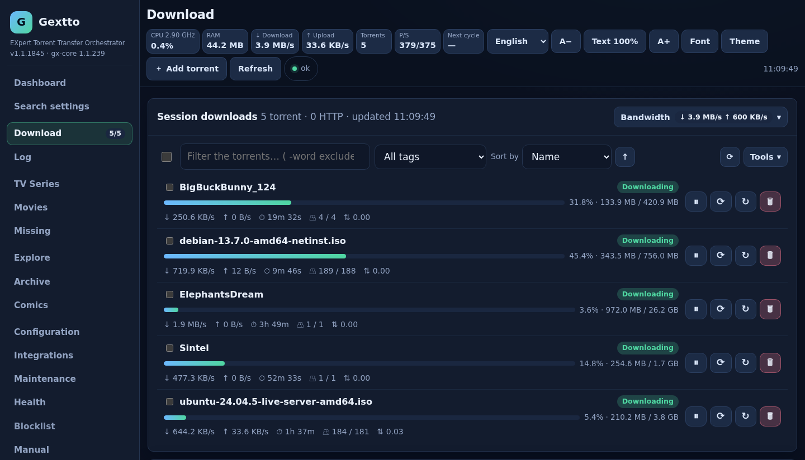
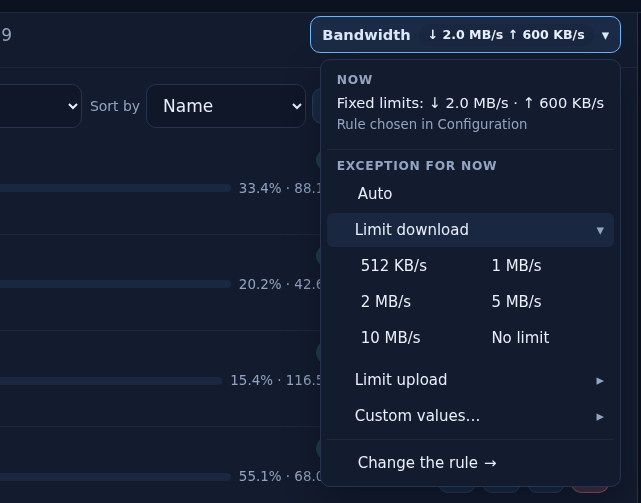
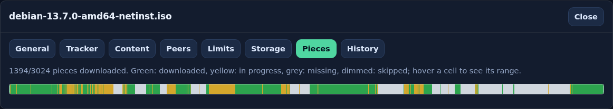
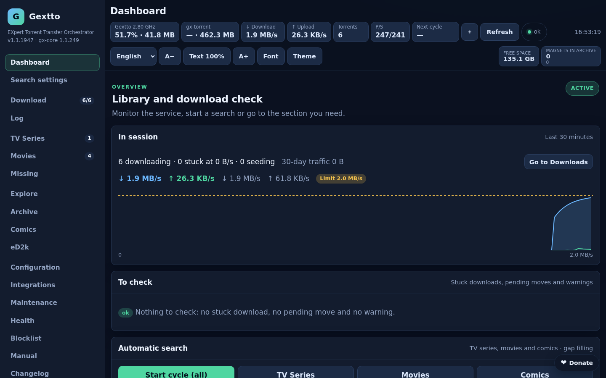
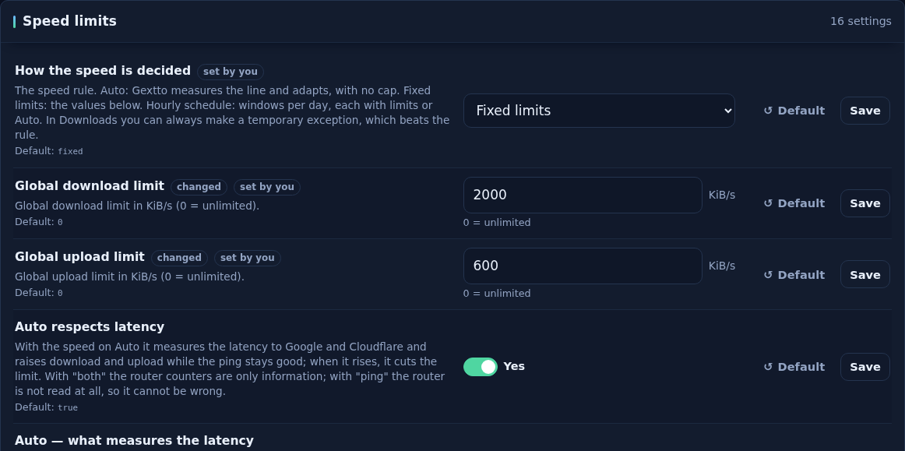
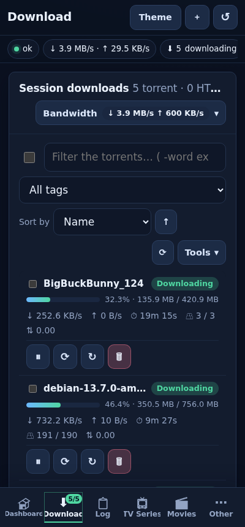

# Gextto — EXpert Torrent Transfer Orchestrator

**Tell Gextto what you want to watch. It finds the best release, downloads it,
verifies it, names it and shelves it in your library — then keeps watching for
a better copy.**

Gextto is a self-hosted media automation daemon: it searches, downloads,
verifies, renames and archives series, movies and comics. It has its own
BitTorrent engine in Go, a server-rendered web UI and a terminal client. Two
binaries, no C dependencies, no Node.js build, six languages.

[](LICENSE)


-informational)


[](https://buzzqw.github.io/gextto/)

> **Italiano:** [README.it.md](README.it.md) · **Manual:**
> [English](docs/MANUAL.en.md) · [italiano](docs/MANUAL.it.md) · **Issues:**
> [bugs and feature requests](https://github.com/buzzqw/gextto/issues) ·
> **Contribute:** [developer guide](docs/DEVELOPERS.md) ·
> **Documentation site:** <https://buzzqw.github.io/gextto/>

## What it does

Add a title and Gextto runs the chain by itself: it searches the sources you
configured, scores the candidates, downloads the winner, checks the data and
puts the file in the library under the right name. When a better release
appears it replaces the old file; when a download stalls it looks for another
one.

- Candidates are scored on resolution, source, codec, audio, HDR, language and
  size. A dead swarm cannot win over a working alternative, and every rejected
  release keeps its reason in the log.
- The library is protected by hardlinks while seeding, a mount guard that tells
  an unmounted share from deleted files, and a recycle bin.
- Foreign audio can be dropped on import: an optional setting keeps only the
  tracks in your language (Italian by default) and removes the rest, copying
  video and audio without re-encoding and checking duration and A/V sync before
  replacing the file.
- The engine is our own Go code: BitTorrent v1, v2 and hybrid, TCP and uTP on
  one port, holepunching, IPv6 DHT, streaming. It is fast on a real swarm and
  light at rest — the figures are in [Numbers](#numbers). The same binary is
  [gx-torrent](https://github.com/buzzqw/gextto/releases), a standalone client
  for Linux and Windows.
- Queue, cache and bandwidth follow the machine and the line. On Auto the whole
  line is Gextto's while nobody else needs it, and it gives way when someone
  does.

### At a glance

| | |
|---|---|
| **Numbers** | Speed, footprint, CPU, indexer cycles, disk writes: figures, machine and line in [Numbers](#numbers) |
| **Protocol** | BitTorrent v1, v2 and hybrid (BEP 52) · 34 BEPs implemented and tested ([list](docs/bep.md)) |
| **Network** | TCP + uTP on one port · UPnP, NAT-PMP, PCP · BEP 55 holepunching · SOCKS5/HTTP proxy · VPN killswitch |
| **Automation** | TV series, movies, comics · Torznab (Jackett, Prowlarr, indexarr) · RSS · web search · stuck-download replacement |
| **Integrations** | Jellyfin, Plex, Jellyseerr (v3 API subset), aMule (eD2k and Kad), Telegram, e-mail, Discord/Slack/ntfy/Gotify/Pushover/Apprise, iCal |
| **Interfaces** | Web UI (SSR + HTMX, pure Go, installable PWA) · terminal TUI over SSH · JSON API |
| **Build** | Pure Go (`CGO_ENABLED=0`) · Linux x86_64/aarch64 · gx-torrent also on Windows |

## A look

A test instance downloading six public, legal torrents: Debian, Ubuntu Server
and the Blender open movies *Big Buck Bunny*, *Sintel*, *Tears of Steel* and
*Cosmos Laundromat*. More screens — library, settings, first start,
maintenance, health, the gx-torrent page and the other languages — are in the
**[guided tour](docs/TOUR.en.md)**.



| | |
|---|---|
|  |  |
| **Bandwidth.** What applies now and where it comes from; an exception for now, Auto or a limit, in one click. | **Torrent details.** General, trackers, content, peers, the piece map, limits and storage. |
|  |  |
| **Dashboard.** The session at a glance, the live traffic and what needs checking. | **Settings.** One choice for the speed rule; the rows that depend on it appear only when they matter. |



On a phone the same pages reflow into cards, the menus open in place and the
actions on the selection stay within thumb reach. The web UI is also installable
as an app (PWA), and a terminal client covers the same work over SSH.
<br clear="right">

**[Guided tour with every screen →](docs/TOUR.en.md)**

## Install on Linux

For 64-bit Linux with systemd: Debian 12+, Ubuntu 22.04+, Fedora, openSUSE
Leap 15.6+/Tumbleweed, Arch. Run as root:

```bash
curl -fsSL https://raw.githubusercontent.com/buzzqw/gextto/main/install.sh | sudo bash
```

Prefer Docker? The [full stack](docs/DOCKER.en.md) starts Gextto, `gx-torrent`, indexarr, Jackett, Prowlarr, FlareSolverr and aMule together with `docker compose`.

It installs to `/opt/gextto`, keeps data in `/var/lib/gextto` and serves the UI
on port 5000, with `gx-torrent` alongside `gexttod` — pure Go, nothing else to
install for torrents. The installer reads `/etc/os-release` and installs the
base packages with the right names for Debian, Ubuntu, Fedora, openSUSE and
Arch; when the repositories provide them it also installs `ffmpeg`,
`mediainfo` and `mkvtoolnix`, used for the real file quality and audio-track
cleanup. `--no-media-tools` (or `GEXTTO_SKIP_MEDIA_TOOLS=1`) skips them. eD2k
and Kad are optional and need an `amuled` you run yourself
([aMule integration](docs/amule.md)). The installer runs the program once
first, so a missing library or an old glibc is reported at once. The
service runs as **the user invoking the installer** by default; `--user gextto`
uses an isolated system account and `--media-group <group>` grants access to
someone else's NAS library.

> [!IMPORTANT]
> Gextto is meant for a trusted network: the web UI and API are open by
> default. For access from outside, enable the optional login
> (*Configuration → Access and services*; the LAN stays free) and still use
> HTTPS via reverse proxy or VPN. Writes from a page of another origin are
> refused (CSRF protection). Read the [security policy](docs/SECURITY.md)
> before exposing it remotely.

### Install from source

Go 1.26.8+; the build is pure Go and the web UI is embedded. See the
[developer manual](docs/DEVELOPERS.md).

```bash
make build                 # gexttod and gx-torrent in bin/
```

`make build` advances the **committed** build number shared with CI, so a
checkout and a release show the same version: `1.2.<n>`, where the third number
is always the build (`1.2.2065`). The second number is raised **by hand**, in
`version_series`, only when a new series is started (`1.3.<n>`); Gextto does
not move it automatically. `gx-torrent` has its own counter, advanced only when
its code changes, and its own `gx_torrent.version_series` file. `make test`
runs the
full suite, `make test-ui` the browser suite, `make fuzz-smoke` the fuzzers.

### First safe run

1. Open `http://<server>:5000`: the first visit starts the **setup wizard**
   (password, folders with permission check, indexer and TMDB, first title).
   Reopenable at `/?view=setup`.
2. Keep **dry-run** on, add one test title and run a manual search.
3. Check **Health** and **Logs**, then enable active mode.

NAS setup and troubleshooting: the [user manual](docs/MANUAL.en.md).

### Update and uninstall

An **Update available** button appears when a release is published;
*Maintenance → Updates* shows the changes and **Update now** backs up the
databases, installs, and restores the previous version if the new one does not
answer. Re-running the installer updates from a shell too, with the same
rollback and the same service user. The full list of changes is in the
[changelog](changelog.en.md).

```bash
sudo bash install.sh --help       # all options
sudo bash install.sh --dry-run    # print what would happen, change nothing
sudo bash install.sh --uninstall  # stop and remove the program (keeps data)
sudo bash install.sh --uninstall --purge   # also remove the data directory
```

`GEXTTO_DATA_DIR`, `GEXTTO_PORT`, `GEXTTO_USER`, … stay supported;
`GEXTTO_LOCAL_ARCHIVE=/path/gextto-linux-x86_64.tar.gz` installs offline. From a
checkout: `git pull --ff-only && ./scripts/update.sh`.

## Features

### Finding and choosing releases

- **Quality-aware scoring.** Deterministic scores grouped into video cards
  (4K, Full HD, HD, SD, codec) and audio cards (lossless, DTS/DD+, AC3/5.1,
  AAC/Opus, MP3), plus 5.1/7.1 and Atmos/DTS:X; per-title minimum audio presets
  include the channels; higher-grade library files are protected; an optional
  ceiling stops upgrades. The settings page scores
  reference releases live with the current weights. `ffprobe` reads the real
  quality of archived media.
- **Named quality profiles.** In *Quality and upgrades* name the combinations
  you use — quality, minimum audio, language, subtitles, exclusions and
  upgrades. They are templates: choosing one in the add form, on the series or
  movie page or in *Edit selected* copies its values into the title, which stays
  editable. Profiles that already exist in a library are generated as *Default*
  plus one per combination, and the same list is served to **Jellyseerr** through
  the `/api/v3` subset (`system/status`, `qualityprofile`, `rootfolder`,
  `series`/`movie` lookup and add, `queue`). Each profile keeps its number when
  renamed or reordered.
- **TV, movies, comics.** Standard `ComicInfo.xml` for CBZ archives (Komga,
  Kavita, readers).
- **Season packs only when useful.** A pack is downloaded only to fill a real
  gap or upgrade an episode; one that would add nothing is refused before it is
  downloaded, and a pack still airing (*IN CORSO n/m*) is read within the
  episodes that exist.
- **Stuck-download recovery.** A download that stops progressing, or a magnet
  stuck waiting for metadata, is superseded by a valid alternative after a
  configurable window; the abandoned release is blocklisted (one abandoned
  for lack of seeders only for a configurable period, so it is retried if the
  swarm recovers).
- **Sources.** RSS feeds, HTML listings (ext.to, TorrentGalaxy, Corsaro),
  Torznab indexers and the Jackett/Prowlarr/indexarr managers, web search, optional
  FlareSolverr. The managers are searched **one indexer at a time**, each at the
  pace it really serves, a tracker present in more than one only once, a slow tracker
  costing only its own results.
- **eD2k and Kad through aMule, when torrents find nothing.** Optional and off by
  default: Gextto drives an `amuled` you run (External Connections protocol,
  our own Go client). Search Kad or the eD2k servers, paste `ed2k://` links,
  connect to servers and follow aMule's state on the eD2k page; aMule's
  downloads appear in **Downloads** next to the torrents and, once complete, are
  renamed and imported into the library like any torrent (by hardlink or copy,
  so aMule keeps sharing them). The eD2k page also shows **what aMule is
  sharing and uploading** and lets you reload its shared folders. The automatic
  gap-filling fallback is a second,
  separate switch and accepts only an exact episode match with a recognised
  quality and enough sources.

### Library safety

- **Hardlinks while seeding**: completed files appear in the library at once,
  with no duplicate disk use.
- **NAS and mount guard**: an unmounted share is never mistaken for deleted
  files, a burst of "missing" files is capped, a hung share cannot freeze the
  engine; transient failures retry and interrupted moves resume. Starting a
  download is crash-safe.
- **Recycle bin**: files replaced by an upgrade and data removed "with data" go
  to the trash first, after the torrent has left the engine.
- **No pointless replacements**: a score-only difference — size, subtitles,
  swarm health, a preferred group below the minimum — never replaces a file of
  the same quality, neither in the cycle nor at completion, in season packs or
  in the cleanup. A real technical gain, a REPACK/PROPER or the configured
  minimum difference still does. *Library impact* replays the archived releases
  through the same rules before anything is downloaded.
- **Library tools**: tick rows in the Series and Movies tables to change
  quality, language, subtitles, exclusions or the upgrade switch on many titles
  at once; *Maintenance → Import file* reads a video already on disk (or a
  folder), proposes series/season/episode or movie/year and archives it with the
  normal rename and MediaInfo checks.

### Bandwidth and the shared line

- **One rule, one exception**: the rule is a single choice — **Auto**, fixed
  limits or a per-weekday schedule (each day **Off / Limit / Auto**). From the
  Downloads page you make an exception for now — Auto or a limit, for 1 to 12 hours
  or until you remove it — and it always wins over the rule. *Auto* leaves the
  line uncapped so its real peak is learned.
- **Auto respects latency** (on by default): when the latency to the Internet
  rises, Gextto backs off for a few seconds to see whose queue it is. Its own:
  it keeps the line. Someone else's: it yields step by step and takes the line
  back when they are done. The router's UPnP counters, when present, tell who
  else is on the line; the Downloads page shows the guard while it acts.
- **Seeding that follows the tracker**: ratio, time and **inactivity** limits
  (a seed that uploads nothing for N minutes stops), and **seed rules** by
  source/indexer and category — a private tracker's rules apply to its torrents
  only, with the same behaviour on gx-torrent and qBittorrent. How to set them:
  [seeding limits](docs/MANUAL.en.md#seeding-limits-per-source-rules-and-idle-seeds).

### Integrations, control and interfaces

- **Notifications and media servers**: Telegram, e-mail, webhooks and the
  dedicated Discord, Slack, Gotify, ntfy, Pushover and Apprise channels, a
  custom program on any event, per-group event switches, an anti-spam window and
  a message language of its own; Jellyfin and Plex folder refreshes, an iCal
  feed of arrivals and air dates.
- **From the browser**: magnets and `.torrent` files go straight into the queue,
  with the `magnet:`/`.torrent` handlers or with any extension written for
  qBittorrent (Torrent Control for Firefox), through the qBittorrent-compatible
  `/api/v2` subset served on Gextto's own address.
- **Traceability**: every download carries an **Acquisition ID** across
  search, selection, transfer, post-processing and archive logs; the dashboard
  **To check** panel keeps each warning while its download is active; a live
  30-minute bandwidth chart; alerts when a source keeps failing or slows down.
- **Interfaces**: responsive web UI installable as a PWA, keyboard-navigable
  and axe-core checked; poster view for series and movies; 20+ contrast-checked
  themes plus custom ones; a full terminal TUI for SSH that adapts to a phone
  screen. Six languages (IT, EN, DE, FR, ES, PL).

The web UI listens on `http://<host>:5000/`. Setup and every section are covered
by the [English manual](docs/MANUAL.en.md) and the
[manuale italiano](docs/MANUAL.it.md).

## Numbers

These figures come from the live installation and from real swarms, indexers
and the home line, on a 4-core Intel N97 with 16 GB. **Throughput was measured on
an FTTC line (100 Mbit/s down, 15 Mbit/s up): the line was the limit, not the
engine; on FTTH the same setup is no longer capped by the line.** Each figure is
in [`docs/measurements.md`](docs/measurements.md) with the machine, the date and
the command to reproduce it.

| Area | Result |
|---|---|
| **Real swarm** | **9.3–9.4 MB/s** on the Ubuntu ISO, against **6.3–7.1 MB/s** for libtorrent on the same swarm (one measured campaign) |
| **Engine memory** | **29–39 MB RSS** at rest, DHT on and a full IP filter (172,740 rules). With 10 torrents downloading to a NAS: **~507 MB** outside the two caches; the write cache sizes itself from free RAM |
| **Engine CPU** | **18–37 % of one core** at 8.2–8.8 MB/s with 116–132 peers, **2.0–4.3 s of CPU per 100 MB**; **0.6–1.0 %** of one core at rest |
| **Indexer searches** | Jackett and Prowlarr searched one indexer at a time: a cycle of 30 titles in **110 s**, **205 requests and none failed**, **5,935 releases** |
| **Sharing the line** | A saturated download adds ~40 ms of latency to the whole house. Alone on the line Gextto keeps all of it (**8.5 MB/s**); with another device downloading, that device gets **6.8–7.3 MB/s** of the 9 MB/s FTTC line |
| **Reusing local data** | A torrent sharing files with one already on disk takes only **25 %** of the file from the network (Debian and Arch ISOs), also after a restart and in any adding order |
| **Disk writes** | 16 KiB writes on NFS at **81 MiB/s** with batched durability; opt-in mmap ~7.0 GB/s on tmpfs |
| **Feed archive** | **447,000 releases in 320 MB**, one row per torrent; 1,000 releases archived in **41 ms**; the standalone archive searches 100,000 releases in **7.4 ms** |
| **Daemon at rest** | **~0.7 %** CPU at rest; **~5,000 metadata calls a day** for 55 series; the health probes never write to a NAS, so its disks can sleep |

The same document records what was measured and dropped — io_uring, batched
uTP I/O on this load, a write-back cache — so the same ideas are not tried
twice.

## Torrent engine

Gextto keeps the control plane (queue, scoring, post-processing, archiving) and
delegates transfers to one selectable engine (*Configuration → Torrent engine*);
switching is a coordinated migration.

| Engine | Where it runs | When to pick it |
|---|---|---|
| **gx-torrent** (default) | Separate supervised Go process | Pure Go, self-contained, v1/v2/hybrid, DHT and MSE/PE; also standalone on Linux and Windows; no WebTorrent/WebRTC |
| qBittorrent-nox | External daemon via its Web API, or one Gextto downloads and runs privately | You already run it or prefer its UI ([setup guide](docs/qbittorrent-nox.md)); also the first step of the automatic fallback |

**Automatic fallback.** If the active engine cannot stay up, Gextto first rolls
an updated `gx-torrent` back to the previous binary, then switches to a managed
qBittorrent-nox (downloaded on demand, SHA-256 verified) or an external one, and
finally to a recovery state with the UI up. A cooldown prevents ping-pong;
`GEXTTO_ENGINE=qbittorrent` (or `gx-torrent`) forces the engine for one run.

### gx-core and gx-torrent

`gx-core` (`internal/gxcore`) and its DHT (`internal/dht`) are original code
written in this repository under EUPL-1.2, with no third-party-derived code
([`THIRD-PARTY-NOTICES`](THIRD-PARTY-NOTICES) lists only linked libraries).
`gx-torrent` runs it as a supervised process that survives orchestrator
restarts: Gextto re-attaches when binary and options match.

- **Protocol.** BitTorrent v1, v2-only and hybrid (BEP 52) from `.torrent` and
  magnet (`urn:btmh:`), with SHA-256 Merkle verification. **34 BEPs implemented
  and tested** — [`docs/bep.md`](docs/bep.md) is the source of truth: wire
  protocol, Fast Extension, metadata, PEX with IPv6, multitracker, LSD,
  super-seeding, web seeds, private torrents, local-data hints, `lt_donthave`,
  UDP trackers with scrape, and the DHT suite (IPv6, scrape, secure node IDs,
  read-only, K/V store, `urn:btpk:`). Beyond the BEPs: `ws://`/`wss://` trackers
  and **DHT feeds** (`dht://<pubkey>`).
- **Local reuse.** Pieces and 16 KiB blocks another local torrent already
  verified — same layout or the same v2 file — are copied and re-checked instead
  of downloaded; private torrents are never mixed (BEP 27).
- **Network.** TCP and uTP (BEP 29) in parallel on one port, one UDP socket for
  uTP and DHT; adaptive uTP retransmission (a latency floor and per-connection
  backoff); `ut_holepunch`
  (BEP 55) as client and relay; UPnP, NAT-PMP and **PCP**; a port check that
  tells cone from symmetric NAT; SOCKS5 and HTTP CONNECT; an
  `outgoing-interface` killswitch for VPNs.
- **Self-management.** The active-download count follows throughput; slow and
  stalled torrents step aside; the disk cache sizes itself from RAM and storage
  class (NVMe, SSD, HDD, NFS); downloads pause before a folder fills up while
  seeding goes on; per-peer request queues adapt and the slowest idle
  connection is the one pruned; the connections are sized from the machine — a
  cap per torrent and a total for the whole session (75 per core) shared among
  the running torrents, downloads first — and two seeds never stay connected.
- **Footprint by design.** Pieces are written through and the OS page cache
  coalesces I/O; batched `fdatasync`, never `O_SYNC` per write; sparse files,
  `fallocate`, RAM-disk temp folders, opt-in mmap; zero-allocation hot paths
  (in-place RC4, word-wise bitfields, zero-copy uTP); the IP blocklist is
  binary-searched with no allocation.
- **Streaming and safety.** Separate playback and readahead windows, live
  per-file priorities, HTTP Range with the right `Content-Type`; an opt-in
  **DLNA/UPnP media server** for TVs, with the NAS library and its posters;
  SSRF-safe web seeds and `xs=`/`as=`; quarantine for peers sending corrupt
  blocks; live per-peer diagnostics, I/O rates and Server-Sent Events.

Engine statistics are in **Health → Torrent engine** (`/?view=health`), in the
daemon's `GET /api/v1/stats` and in `GET /api/torrents/session-stats`.

## gx-torrent as a standalone client

gx-torrent is also a complete client without Gextto, like `qbittorrent-nox` or
`transmission-daemon` — **the same binary** Gextto drives, a simpler Gextto with
everything a standalone client needs.

- **qBittorrent Web API v2** (`/api/v2/...`, qBittorrent 5 calls included,
  with the API key and the fields the WebUIs read) for Sonarr, Radarr, Lidarr,
  Readarr and mobile managers; its own JSON API;
  **Prometheus metrics**
  (`/api/v1/metrics`) for Grafana or Home Assistant, and an **event stream**
  (`/api/v1/events`) for Node-RED, Home Assistant or scripts
  ([examples](docs/API.md#integrating-with-other-systems)).
- **Web UI** laid out like qBittorrent's: light and dark themes; status,
  category, tag and tracker filters; a column chooser (24 columns) with
  resizable columns kept on the server; a full context menu; a resizable detail
  panel (files grouped by folder, rename, peers); magnet preview while typing;
  undo after removal; keyboard shortcuts, drag-and-drop, phone-friendly cards
  and a **Statistics** page (session and all-time totals, 1 h/24 h/7 d graph).
  Every page axe-core checked.
- **RSS and automation.** A **Series & movies** page
  that says per title what is downloaded, downloading or found but not taken,
  with state filters, one primary action and why each release would be taken or
  refused; an **RSS & Indexers** page with
  ordered PASS/FAIL rules, live match previews, rule templates, feed tests,
  pasted feed lists, and a local **archive** of everything the feeds returned.
- **Operations.** Limits, the per-weekday scheduler, **automatic speed** that
  measures the line and moves download and upload (manual limits stay the
  ceiling, with optional line maxima), one-click
  optimisation, IP filter with scheduled refresh, categories and tags with a
  category manager and its save path, port test; seeding limits by ratio, time
  and **inactivity**, and qBittorrent's **content layout** (original, create
  subfolder, no subfolder) when adding. **Quality profiles** with a cutoff
  upgrade an episode already taken when a better release appears, without
  deleting the files; the optional **real episode list** from TVmaze says what
  is missing even when no release ever passed through the feeds.
- **After the download.** Move the finished data to a folder (optionally one
  subfolder per category) while it keeps seeding, or run a program with the
  torrent details in the environment; both off by default.
- **From the phone.** The page installs as an app (manifest and a service
  worker for the shared assets only) and offers a sign-out when a password is
  set.
- **Notifications** on the same channels as Gextto, plus the Apprise server,
  the dedicated Discord, Slack, Gotify, ntfy and Pushover channels and a custom
  script, with a test button.
- **Updates itself** from the CI builds when its own code changed, verified by
  SHA-256, with automatic rollback.
- **Light on the machine.** One pure-Go process, no external engine and no
  database server: **0.6–1.0 % of one core and 29–39 MB RSS at rest**, with DHT
  on and a full IP filter loaded; **18–37 % of one core** at 8.2–8.8 MB/s with
  116–132 peers, that is **2.0–4.3 s of CPU per 100 MB**. A loopback transfer
  reaches **234–274 MB/s** with about 100 MB peak RSS, and five minutes after a
  burst the memory falls from 550 MB to 35–40 MB. Figures, machine and
  commands in [`docs/measurements.md`](docs/measurements.md).
- **Platforms.** Linux x86_64/aarch64 (systemd unit, `run.sh`, unprivileged
  Docker image) and a native Windows service on amd64/arm64.

Open `http://<host>:8890/` for its setup wizard. Full reference: the
[illustrated manual](docs/GXCORE-MANUAL.en.md) and the [gx-torrent technical document](docs/gx-torrent.md).

## Tests

What runs on every push (`make test`, `make test-ui`, `make fuzz-smoke` and CI):

| Layer | What runs |
|---|---|
| **Unit and integration** | 2,189 Go test functions in 426 files: engine, DHT, uTP, storage, scoring, post-processing, API, UI rendering. The TUI is driven against the real router |
| **End-to-end** | 57 Playwright tests drive the real daemon in a browser — pages, mobile, six languages, security, settings — including 14 accessibility tests with axe-core WCAG audits |
| **Fuzzing** | 23 network-facing parsers (DHT, bencode, magnet, BEP 10/52, trackers, Torznab, RSS, MSE) fuzzed in CI; every crash found becomes a committed seed |
| **Real-world harnesses** | 14 opt-in measurements: real public swarms, the public DHT, a real libtorrent peer, local merge on real ISOs, choking and pipelining, the live Jackett/Prowlarr, the latency of the home line |
| **Static guards** | Every UI button points at a registered route, every internal call resolves on the real router, every setting is writable, translated in six languages and has its tooltip, every API route is documented |
| **Platforms and packaging** | CI cross-compiles engine and daemon for Windows and runs the Windows platform tests and a real service install; the installers are self-tested (every flag, a dry-run that changes nothing) and the standalone and full Docker images are built and smoke-tested; CodeQL scans every push |
| **Benchmarks** | 45 Go benchmarks on the hot paths (picker, storage, uTP, archive, merge, logging), run before and after every data-path change |

## Accessibility

Keyboard navigation, accessible names, dialog focus management, semantic
sortable tables, live announcements, responsive reflow and contrast-checked
themes, covered by axe-core and Playwright (`cd uiweb/end2end && npm ci && npm
run test:a11y`). This is not a legal certification: manual screen-reader and
assistive-technology testing is still required
([scope, tests and limits](docs/ACCESSIBILITY.md)).

## Documentation

| Need | Document |
|---|---|
| Operate the service | [English manual](docs/MANUAL.en.md) · [Manuale italiano](docs/MANUAL.it.md) |
| What changed | [Changelog](changelog.en.md) |
| Measurements and method | [Measurements](docs/measurements.md) |
| State, decisions and what is next | [Evolution](docs/evoluzione.md) |
| Architecture and design | [Architecture](docs/ARCHITECTURE.md) |
| BitTorrent specifications (BEPs) | [BEP compliance](docs/bep.md) |
| NAS, reverse proxy, recovery | [Advanced guide](docs/ADVANCED.en.md) |
| HTTP integrations | [API reference](docs/API.md) |
| Move an existing installation | [Migration guide](docs/MIGRATION.md) |
| Terminal client | [TUI reference](docs/tui.md) |
| gx-torrent engine and standalone client | [gx-torrent technical document](docs/gx-torrent.md) · [gx-core](docs/gx-core.md) |
| eD2k and Kad through aMule | [aMule integration](docs/amule.md) |
| qBittorrent-nox backend | [Setup guide](docs/qbittorrent-nox.md) |
| Build or contribute | [Developer manual](docs/DEVELOPERS.md) |
| Network and data safety | [Security policy](docs/SECURITY.md) |

Full tree: the [documentation index](docs/README.md).

## Support the project

If Gextto is useful and you would like to support its development, a PayPal
donation is welcome — thank you. A **Donate** button is also always visible in
the UI, bottom right.

[](https://www.paypal.com/cgi-bin/webscr?cmd=_donations&business=azanzani@gmail.com&item_name=Support+Gextto+Project)

## Legal and fair use

Gextto is a **download automation tool**. It does not host, index or distribute
any copyrighted content.

- It connects to **indexers you configure** (Jackett, Prowlarr, indexarr, public
  RSS feeds). It ships no index of its own.
- What you download is **your responsibility**. Use Gextto only for content you
  have the right to access — public domain, Creative Commons, or media you own.
- BitTorrent and the engines Gextto drives are neutral technology; this project
  does not encourage or facilitate piracy.
- Released under the **EUPL 1.2** open-source licence.

## License

Gextto is licensed under the [EUPL-1.2](LICENSE). The engine core (`gx-core`,
`internal/gxcore`) and the DHT (`internal/dht`) are original code in this
repository under the same licence. See [THIRD-PARTY-NOTICES](THIRD-PARTY-NOTICES)
for the linked third-party libraries (also on the web UI *Licence* page).

## Acknowledgements

Thanks to **[DeepSeek](https://www.deepseek.com/)** for its support and patience
while this project grew.

