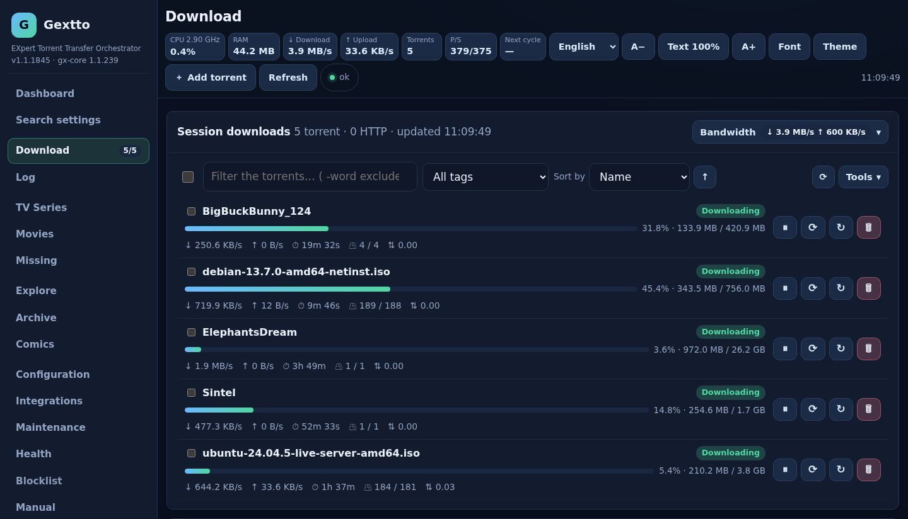
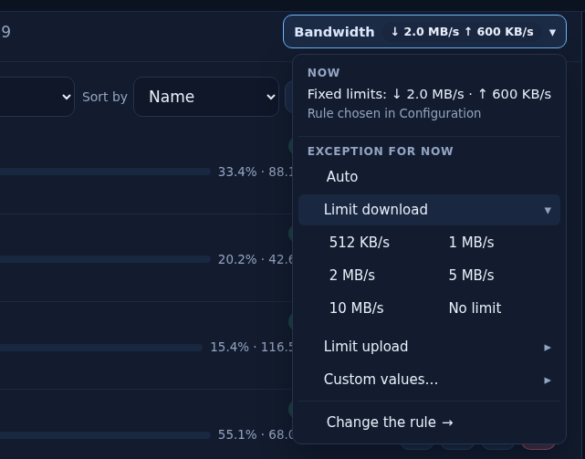
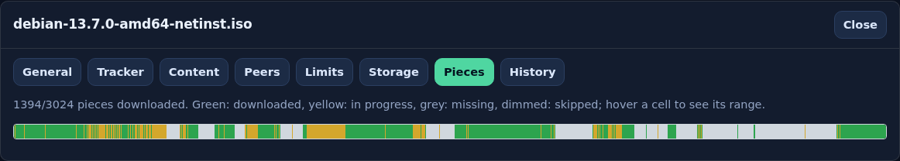
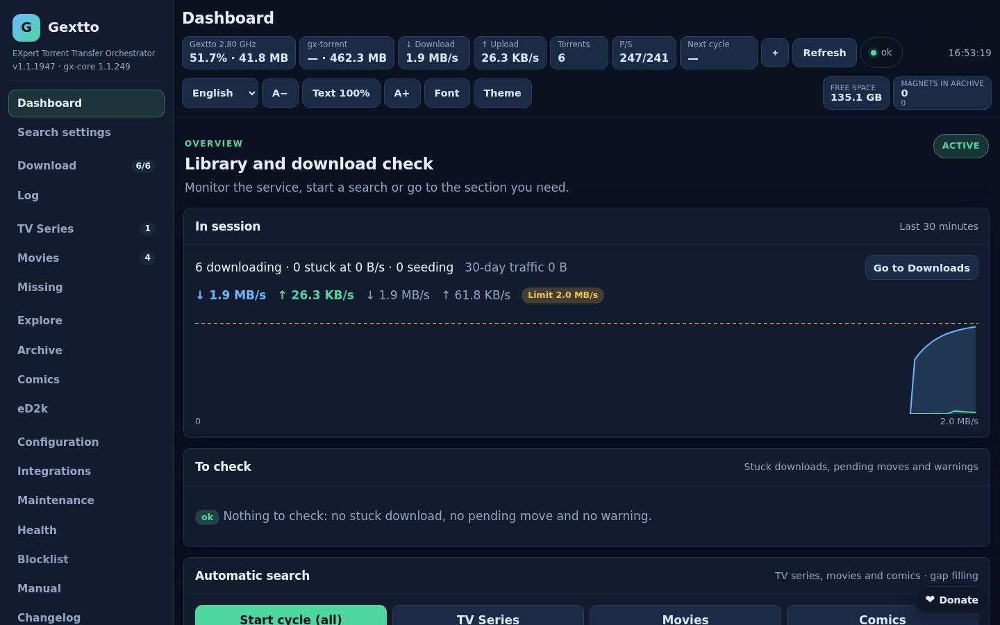
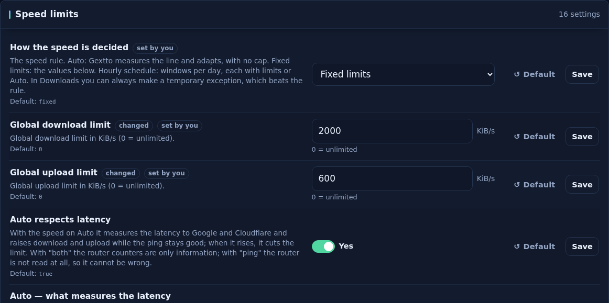
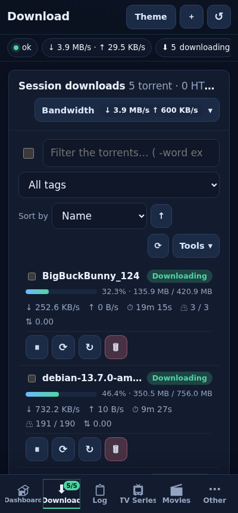

# Gextto — EXpert Torrent Transfer Orchestrator

**Tell Gextto what you want to watch. It finds the best release, downloads it,
verifies it, names it and shelves it in your library — then keeps watching for
a better copy.**

Gextto is a self-hosted media automation daemon: it searches, downloads,
verifies, renames and archives series, movies and comics. It features its own
pure-Go BitTorrent engine (`gx-torrent`), a server-rendered web UI and a terminal
client. Two binaries, no C dependencies, no Node.js build, six languages.

[](LICENSE)


-informational)


[](https://buzzqw.github.io/gextto/)

> **Italiano:** [README.it.md](README.it.md) · **Manual:**
> [English](docs/MANUAL.en.md) · [italiano](docs/MANUAL.it.md) · **Issues:**
> [bugs and feature requests](https://github.com/buzzqw/gextto/issues) ·
> **Contribute:** [developer guide](docs/DEVELOPERS.md) ·
> **Documentation site:** <https://buzzqw.github.io/gextto/>

## What it does

Add a title and Gextto orchestrates the entire lifecycle autonomously: it queries your
configured sources, scores candidate releases, downloads the best match, verifies file
integrity, cleans audio tracks, and shelves the media into your library with proper naming.
When a better quality release appears, it upgrades seamlessly; if a swarm stalls, it recovers
automatically.


### Key superpowers

- 🤝 **Two networks, one file (Shareaza-style)**: When an episode downloads on both
  BitTorrent and eD2k (aMule) with matching file size, verified blocks (SHA-1) are shared
  between engines on the fly. Whichever finishes first completes the other, and a torrent
  stuck at 95% recovers using eD2k sources while sharing a single speed limit.
  ([read more](docs/amule.md))
- ⚡ **Pure-Go BitTorrent engine (`gx-torrent`)**: Original, zero-CGO implementation
  supporting BitTorrent v1, v2 and hybrid (BEP 52), IPv6 DHT, and uTP. Operates at ~28 MB RSS
  at rest and up to 290 MB/s throughput — outperforming libtorrent-based clients. Also runs as
  a standalone daemon on Linux and Windows. ([measurements](docs/measurements.md) · [BEP list](docs/bep.md))
- 🧹 **Lossless smart audio cleanup**: Drops unwanted foreign audio tracks on import,
  preserving only your preferred languages without re-encoding video or audio. Every packet
  is compared with the original to guarantee 100% audio/video sync and zero quality loss.
- 📉 **Latency-aware automatic bandwidth**: Auto mode takes the full line when idle,
  but continuously probes ping latency. If someone in the house streams or games, Gextto yields
  instantly and reclaims bandwidth once the line clears.
- 🛡️ **Bulletproof library safety**: Zero duplicate storage using hardlinks during seeding,
  NAS mount-loss protection to avoid accidental deletions, an automated recycle bin for upgrades,
  and periodic background file integrity checks with automatic replacement.

### At a glance

| Area | Highlights | Details |
|---|---|---|
| **Numbers** | 290 MB/s throughput · 28 MB RSS at rest · 0.3–0.5% CPU | [Benchmark figures](#numbers) |
| **Protocol** | BitTorrent v1, v2 & hybrid (BEP 52) · 34 BEPs implemented and tested | [BEP compliance](docs/bep.md) |
| **Network** | TCP + uTP on one port · UPnP, NAT-PMP, PCP · BEP 55 holepunching · SOCKS5/HTTP · VPN killswitch | [gx-torrent doc](docs/gx-torrent.md) |
| **Automation** | TV series, movies, comics · Torznab, RSS, HTML listings · stuck-download replacement | [User manual](docs/MANUAL.en.md) |
| **Two networks** | Simultaneous Torrent + eD2k downloads on matching files · verified pieces from aMule `.part` | [aMule integration](docs/amule.md) |
| **Integrations** | Jellyfin, Plex, Jellyseerr (v3 API), aMule (eD2k/Kad), Telegram, Discord, Slack, ntfy, Pushover, iCal | [User manual](docs/MANUAL.en.md) |
| **Interfaces** | Responsive web UI (SSR + HTMX, installable PWA, 20+ themes) · terminal TUI over SSH · JSON API | [TUI reference](docs/tui.md) · [API](docs/API.md) |
| **Build** | Pure Go (`CGO_ENABLED=0`) · Linux x86_64/aarch64 · gx-torrent also native on Windows | [Developer manual](docs/DEVELOPERS.md) |

## A look

A test instance downloading six public, legal torrents: Debian, Ubuntu Server
and the Blender open movies *Big Buck Bunny*, *Sintel*, *Tears of Steel* and
*Cosmos Laundromat*. More screens — library, settings, first start,
maintenance, health, the gx-torrent page and the other languages — are in the
**[guided tour](docs/TOUR.en.md)**.



| | |
|---|---|
|  |  |
| **Bandwidth.** What applies now and where it comes from; an exception for now, Auto or a limit, in one click. | **Torrent details.** General, trackers, content, peers, the piece map, limits and storage. |
|  |  |
| **Dashboard.** The session at a glance, the live traffic and what needs checking. | **Settings.** One choice for the speed rule; the rows that depend on it appear only when they matter. |



On a phone the same pages reflow into cards, the menus open in place and the
actions on the selection stay within thumb reach. The web UI is also installable
as an app (PWA), and a terminal client covers the same work over SSH.
<br clear="right">

**[Guided tour with every screen →](docs/TOUR.en.md)**

## Install on Linux

For 64-bit Linux with systemd: Debian 12+, Ubuntu 22.04+, Fedora, openSUSE
Leap 15.6+/Tumbleweed, Arch. Run as root:

```bash
curl -fsSL https://raw.githubusercontent.com/buzzqw/gextto/main/install.sh | sudo bash
```

Prefer Docker? The [full stack](docs/DOCKER.en.md) starts Gextto, `gx-torrent`, indexarr, Jackett, Prowlarr, FlareSolverr and aMule together with `docker compose`.

The installer sets up `/opt/gextto`, data in `/var/lib/gextto`, and serves the UI
on port 5000, with `gx-torrent` alongside `gexttod` — pure Go, nothing else to
install for torrents. When available, it installs `ffmpeg`, `mediainfo` and `mkvtoolnix`
for real media analysis and lossless audio-track cleanup (`--no-media-tools` skips them).
eD2k and Kad are optional and connect to an `amuled` you run yourself
([aMule integration](docs/amule.md)). By default, the service runs as the invoking user;
`--user gextto` uses a dedicated system account.

> [!IMPORTANT]
> Gextto is meant for a trusted network: the web UI and API are open by
> default. For access from outside, enable the optional login
> (*Configuration → Access and services*; the LAN stays free) and still use
> HTTPS via reverse proxy or VPN. Read the [security policy](docs/SECURITY.md)
> before exposing it remotely.

### Install from source

Go 1.26.8+; pure Go build, embedded web UI:

```bash
make build                 # gexttod and gx-torrent in bin/
```

`make test` runs the full test suite, `make test-ui` the browser suite, and `make fuzz-smoke` the network fuzzers.
See the [developer manual](docs/DEVELOPERS.md) for details.

### First safe run

1. Open `http://<server>:5000`: the first visit opens the **setup wizard**
   (password, folders with permission check, indexer and TMDB, first title).
   Reopenable at `/?view=setup`.
2. Keep **dry-run** on, add one test title and run a manual search.
3. Check **Health** and **Logs**, then enable active mode.

NAS setup and troubleshooting: the [user manual](docs/MANUAL.en.md) and [advanced guide](docs/ADVANCED.en.md).

### Update and uninstall

An **Update available** button appears when a release is published;
*Maintenance → Updates* shows the changes and **Update now** backs up databases,
installs the update, and rolls back automatically if the new version fails health checks.
Re-running the installer updates from a shell with the same rollback.
See the [changelog](changelog.en.md) for full change history.

```bash
sudo bash install.sh --help       # all options
sudo bash install.sh --dry-run    # print what would happen, change nothing
sudo bash install.sh --uninstall  # stop and remove the program (keeps data)
sudo bash install.sh --uninstall --purge   # also remove the data directory
```

## Features

### Smart search and acquisition

- **Quality-aware scoring**: Deterministic scores grouped into video cards
  (4K, Full HD, HD, SD, codec) and audio cards (lossless, DTS/DD+, AC3/5.1, AAC/Opus, MP3),
  plus 5.1/7.1 and Atmos/DTS:X. Higher-grade library files are protected from downgrade,
  and dead swarms cannot win over active ones.
- **Named quality profiles**: Create reusable profiles (resolution, audio presets, language,
  subtitles, upgrade cutoffs). The profile list is served directly to **Jellyseerr** through the
  `/api/v3` subset (`system/status`, `qualityprofile`, `rootfolder`, `series`/`movie` lookup, `queue`).
- **Season pack intelligence**: Packs are downloaded only when they fill real missing gaps;
  unneeded episodes are excluded before downloading, and airing packs (*IN CORSO n/m*) are safely
  imported for available episodes.
- **Stuck-download auto-recovery**: A download that stalls or a magnet waiting endlessly for metadata
  is automatically superseded by a valid alternative and temporarily blocklisted.
- **Comprehensive source management**: Torznab indexers (Jackett, Prowlarr, indexarr), public RSS feeds,
  HTML listings and web search. Indexer managers are queried one tracker at a time to prevent rate-limit
  choking, with per-feed activity and failure tracking.
- **Archive extraction (RAR)**: Automatically unpacks uncompressed and RAR 5 compressed multi-volume
  archives directly into the library, preserving the original archive for continuous seeding.
- **eD2k and Kad through aMule**: Drives `amuled` via the External Connections protocol. Search Kad,
  paste `ed2k://` links, monitor downloads and share lists directly from Gextto.
  ([read more](docs/amule.md))

→ *Full documentation: [Sources and Quality in the User Manual](docs/MANUAL.en.md#finding-and-choosing-releases)*

### Library safety and maintenance

- **Zero-waste seeding**: Uses hardlinks so completed downloads appear in your media library instantly
  without duplicating disk space while seeding continues.
- **NAS and mount guard**: Detects unmounted network shares to prevent accidental deletion storms,
  resumes interrupted moves, and isolates hung storage without stalling the engine.
- **Recycle bin**: Upgraded or deleted media moves to a safety bin first, protecting against accidental loss.
- **No pointless replacements**: Score-only differences (file size, subtitles) never trigger an upgrade
  unless real technical gain (REPACK, PROPER, higher resolution/codec) is achieved.
- **Damaged-file watchdog**: Periodic background scans probe and decode archived videos with `ffprobe`
  and `ffmpeg`. 4K keyframe check spots corruption in minutes; damaged files can be automatically replaced
  and re-downloaded.
- **Night maintenance window**: Runs heavy tasks when idle (database compaction, weekly integrity checks,
  MediaInfo scans, audio cleanup).

→ *Full documentation: [Library Safety and Maintenance](docs/MANUAL.en.md#file-integrity-check) · [Advanced NAS Guide](docs/ADVANCED.en.md)*

### Bandwidth and latency control

- **One rule, one exception**: Choose between **Auto**, fixed speed limits, or a weekly schedule.
  From the Downloads page, set temporary exceptions (1 to 12 hours) in a single click.
- **Latency-aware Auto mode**: Gextto measures ping round-trip times to the Internet; when someone else
  uses the line, it backs off gracefully to keep interactive traffic and gaming responsive, then reclaims speed.
- **Tracker-aware seeding rules**: Configure ratio, time, and inactivity limits globally or per indexer/tracker,
  with identical behavior on both `gx-torrent` and `qBittorrent-nox`.

→ *Full documentation: [Speed and Seeding Rules](docs/MANUAL.en.md#speed-and-bandwidth)*

### Integrations and interfaces

- **Rich notifications**: Telegram, e-mail, webhooks, Discord, Slack, Gotify, ntfy, Pushover,
  Apprise, and custom scripts, with fine-grained event filtering and anti-spam windows.
- **Media server sync**: Automatic folder refresh triggers for Jellyfin and Plex, plus an iCal feed of arrivals and air dates.
- **Browser & *arr ecosystem**: Direct magnet/torrent capture via browser handlers, support for qBittorrent
  extensions (e.g. Torrent Control), and a qBittorrent-compatible `/api/v2` endpoint.
- **Accessible & modern UI**: Server-rendered HTMX interface (PWA installable on mobile), 20+ contrast-checked
  themes, keyboard navigation (axe-core WCAG verified), and a full terminal TUI over SSH. Available in six languages
  (IT, EN, DE, FR, ES, PL).

→ *Full documentation: [API Reference](docs/API.md) · [TUI Reference](docs/tui.md)*

## Numbers

These figures come from the live installation and from real swarms, indexers
and the home line, on a 4-core Intel N97 with 16 GB. **Throughput was measured on
an FTTC line (100 Mbit/s down, 15 Mbit/s up): the line was the limit, not the
engine; on FTTH the same setup is no longer capped by the line.** Each figure is
in [`docs/measurements.md`](docs/measurements.md) with the machine, the date and
the command to reproduce it.

| Area | Result |
|---|---|
| **Compared with other clients** | Same limits in Docker, N97: at full speed **290 MB/s**, ahead of Deluge and qBittorrent (239–246, measured in an earlier round) and of rain, anacrolix/torrent and Transmission (30–175), with **24 MiB** of own memory against 33–53. On a shaped 100 Mbit/s line anacrolix/torrent is 2 % ahead (**11.2 MB/s** against 11.4, inside the spread), and gx-torrent spends the least CPU per GiB of the four that reach the line; at a recheck of 4 GiB gx-torrent is first (**3.6 s** against 3.9–10.2) and on upload it is first too (**203 MB/s**, against qBittorrent's 191). At rest rain and anacrolix/torrent are the lightest (0.01 % of a core against 0.05); with a hundred torrents gx-torrent spends 0.13 %, against anacrolix's 0.01, Deluge's 0.37 and rain's 2.18. [Full tables](docs/measurements.md#compared-with-qbittorrent-transmission-deluge-rain-and-anacrolixtorrent) |
| **Real swarm** | **9.3–9.4 MB/s** on the Ubuntu ISO, against **6.3–7.1 MB/s** for libtorrent on the same swarm (one measured campaign) |
| **Engine memory** | **28–30 MB RSS** at rest (16–18 MB anonymous), DHT on and a full IP filter (172,740 rules). With 10 torrents downloading to a NAS: **~507 MB** outside the two caches; the write cache sizes itself from free RAM |
| **Engine CPU** | **18–37 % of one core** at 8.2–8.8 MB/s with 116–132 peers, **2.0–4.3 s of CPU per 100 MB**; **0.3–0.5 %** of one core at rest |
| **Indexer searches** | Jackett and Prowlarr searched one indexer at a time: a cycle of 30 titles in **110 s**, **205 requests and none failed**, **5,935 releases** |
| **Sharing the line** | A saturated download adds ~40 ms of latency to the whole house. Alone on the line Gextto keeps all of it (**8.5 MB/s**); with another device downloading, that device gets **6.8–7.3 MB/s** of the 9 MB/s FTTC line |
| **Reusing local data** | A torrent sharing files with one already on disk takes only **25 %** of the file from the network (Debian and Arch ISOs), also after a restart and in any adding order |
| **Disk writes** | 16 KiB writes on NFS at **81 MiB/s** with batched durability; opt-in mmap ~7.0 GB/s on tmpfs |
| **Feed archive** | **447,000 releases in 320 MB**, one row per torrent; 1,000 new releases archived in **36 ms** into an archive of 50,000, and 1,000 already archived in **9 ms**; the standalone archive searches 100,000 releases in **7.4 ms** |
| **Daemon at rest** | **~0.7 %** CPU at rest; **~5,000 metadata calls a day** for 55 series; the health probes never write to a NAS, so its disks can sleep |

The same document records what was measured and dropped — io_uring, batched
uTP I/O on this load, a write-back cache — so the same ideas are not tried
twice.

## Torrent engine

Gextto keeps the control plane (queue, scoring, post-processing, archiving) and
delegates transfers to one selectable engine (*Configuration → Torrent engine*);
switching is a coordinated migration.

| Engine | Where it runs | When to pick it |
|---|---|---|
| **gx-torrent** (default) | Separate supervised Go process | Pure Go, self-contained, v1/v2/hybrid, DHT and MSE/PE; also standalone on Linux and Windows; no WebTorrent/WebRTC |
| qBittorrent-nox | External daemon via its Web API, or one Gextto downloads and runs privately | You already run it or prefer its UI ([setup guide](docs/qbittorrent-nox.md)); also the first step of the automatic fallback |

**Automatic fallback.** If the active engine cannot stay up, Gextto first rolls
an updated `gx-torrent` back to the previous binary, then switches to a managed
qBittorrent-nox (downloaded on demand, SHA-256 verified) or an external one, and
finally to a recovery state with the UI up. A cooldown prevents ping-pong;
`GEXTTO_ENGINE=qbittorrent` (or `gx-torrent`) forces the engine for one run.

### gx-core and gx-torrent

`gx-core` (`internal/gxcore`) and its DHT (`internal/dht`) are original code
written in this repository under EUPL-1.2, with no third-party-derived code
([`THIRD-PARTY-NOTICES`](THIRD-PARTY-NOTICES) lists only linked libraries).
`gx-torrent` runs it as a supervised process that survives orchestrator
restarts: Gextto re-attaches when binary and options match.

- **Protocol**: BitTorrent v1, v2-only and hybrid (BEP 52) with SHA-256 Merkle verification.
  **34 BEPs implemented and tested** ([docs/bep.md](docs/bep.md)): wire protocol, Fast Extension,
  metadata, PEX with IPv6, multitracker, LSD, super-seeding, web seeds, private torrents,
  `lt_donthave`, UDP trackers with scrape, DHT IPv6, scrape, secure IDs, and K/V store.
- **Local reuse**: Automatically detects and reuses local pieces and 16 KiB blocks already
  verified on disk by another torrent without redownloading; private torrents are kept strictly isolated.
- **Network**: TCP and uTP (BEP 29) multiplexed on a single port; BEP 55 holepunching (client and relay);
  UPnP, NAT-PMP, and PCP; SOCKS5 and HTTP CONNECT proxy; interface-bound VPN killswitch.
- **Resource efficiency**: OS page cache coalescing, batched `fdatasync`, sparse files, `fallocate`,
  zero-allocation hot paths (in-place RC4, zero-copy uTP), binary-searched IP blocklist.
- **Streaming and DLNA**: Separate playback and readahead windows, live per-file priorities, HTTP Range
  seeking, and an opt-in DLNA/UPnP media server for smart TVs.
- **Bandwidth policies**: Per-torrent bandwidth shares (Tixati-style), trading split favoring peers
  sending data, out-of-the-box client filtering against leechers, and local GeoIP country lookup (DB-IP).

→ *Full details: [gx-torrent Technical Document](docs/gx-torrent.md) · [BEP Compliance](docs/bep.md)*

### gx-torrent as a standalone client

`gx-torrent` can also be used as a lightweight, full-featured standalone client without Gextto,
serving as a pure-Go alternative to `qbittorrent-nox` or `transmission-daemon`:

- **qBittorrent Web API v2** (`/api/v2/...`): Fully compatible with Sonarr, Radarr, Lidarr,
  Readarr, and mobile managers.
- **Rich Web UI**: Dark and light themes, 24 customizable columns, category manager, tag filters,
  detail drawer (peers, piece map, files), magnet preview, drag-and-drop, and mobile-friendly cards.
- **Automation & RSS**: Dedicated *Series & movies* status page, rule-based RSS engine with PASS/FAIL
  filters, and local feed archive.
- **Prometheus & Events**: Exposes `/api/v1/metrics` for Grafana/Home Assistant and `/api/v1/events`
  for Node-RED or shell integrations.
- **Platforms**: Linux x86_64/aarch64 (systemd unit, Dockerfile) and a native Windows service (amd64/arm64).

→ *Full manual: [Illustrated gx-core Manual](docs/GXCORE-MANUAL.en.md)*

## Tests

What runs on every push (`make test`, `make test-ui`, `make fuzz-smoke` and CI):

| Layer | What runs |
|---|---|
| **Unit and integration** | 2,189 Go test functions in 426 files: engine, DHT, uTP, storage, scoring, post-processing, API, UI rendering. The TUI is driven against the real router |
| **End-to-end** | 57 Playwright tests drive the real daemon in a browser — pages, mobile, six languages, security, settings — including 14 accessibility tests with axe-core WCAG audits |
| **Fuzzing** | 23 network-facing parsers (DHT, bencode, magnet, BEP 10/52, trackers, Torznab, RSS, MSE) fuzzed in CI; every crash found becomes a committed seed |
| **Real-world harnesses** | 14 opt-in measurements: real public swarms, the public DHT, a real libtorrent peer, local merge on real ISOs, choking and pipelining, the live Jackett/Prowlarr, the latency of the home line |
| **Static guards** | Every UI button points at a registered route, every internal call resolves on the real router, every setting is writable, translated in six languages and has its tooltip, every API route is documented |
| **Platforms and packaging** | CI cross-compiles engine and daemon for Windows and runs the Windows platform tests and a real service install; the installers are self-tested (every flag, a dry-run that changes nothing) and the standalone and full Docker images are built and smoke-tested; CodeQL scans every push |
| **Benchmarks** | 45 Go benchmarks on the hot paths (picker, storage, uTP, archive, merge, logging), run before and after every data-path change |

## Accessibility

Keyboard navigation, accessible names, dialog focus management, semantic
sortable tables, live announcements, responsive reflow and contrast-checked
themes, covered by axe-core and Playwright (`cd uiweb/end2end && npm ci && npm
run test:a11y`). This is not a legal certification: manual screen-reader and
assistive-technology testing is still required
([scope, tests and limits](docs/ACCESSIBILITY.md)).

## Documentation

| Need | Document |
|---|---|
| Operate the service | [English manual](docs/MANUAL.en.md) · [Manuale italiano](docs/MANUAL.it.md) |
| What changed | [Changelog](changelog.en.md) · [Italiano](changelog.md) |
| Measurements and method | [Measurements](docs/measurements.md) |
| Open work | [TODO](docs/todo.md) |
| Architecture and design | [Architecture](docs/ARCHITECTURE.md) |
| BitTorrent specifications (BEPs) | [BEP compliance](docs/bep.md) |
| NAS, reverse proxy, recovery | [Advanced guide](docs/ADVANCED.en.md) |
| HTTP integrations | [API reference](docs/API.md) |
| Move an existing installation | [Migration guide](docs/MIGRATION.md) |
| Terminal client | [TUI reference](docs/tui.md) |
| gx-torrent engine and standalone client | [gx-torrent technical document](docs/gx-torrent.md) · [gx-core](docs/gx-core.md) |
| eD2k and Kad through aMule | [aMule integration](docs/amule.md) |
| qBittorrent-nox backend | [Setup guide](docs/qbittorrent-nox.md) |
| Build or contribute | [Developer manual](docs/DEVELOPERS.md) |
| Network and data safety | [Security policy](docs/SECURITY.md) |

Full tree: the [documentation index](docs/README.md).

## Support the project

If Gextto is useful and you would like to support its development, a PayPal
donation is welcome — thank you. A **Donate** button is also always visible in
the UI, bottom right; the standalone gx-torrent page has the same button.

[](https://www.paypal.com/cgi-bin/webscr?cmd=_donations&business=azanzani@gmail.com&item_name=Support+Gextto+Project) [](https://ko-fi.com/buzzqw)

## Legal and fair use

Gextto is a **download automation tool**. It does not host, index or distribute
any copyrighted content.

- It connects to **indexers you configure** (Jackett, Prowlarr, indexarr, public
  RSS feeds). It ships no index of its own.
- What you download is **your responsibility**. Use Gextto only for content you
  have the right to access — public domain, Creative Commons, or media you own.
- BitTorrent and the engines Gextto drives are neutral technology; this project
  does not encourage or facilitate piracy.
- Released under the **EUPL 1.2** open-source licence.

## License

Gextto is licensed under the [EUPL-1.2](LICENSE). The engine core (`gx-core`,
`internal/gxcore`) and the DHT (`internal/dht`) are original code in this
repository under the same licence. See [THIRD-PARTY-NOTICES](THIRD-PARTY-NOTICES)
for the linked third-party libraries (also on the web UI *Licence* page).

## Acknowledgements

Thanks to **[DeepSeek](https://www.deepseek.com/)** for its support and patience
while this project grew.
