# gx-core — user manual

**gx-core** is the complete BitTorrent client inside `gx-torrent`: the same
application Gextto uses as its engine, but **without Gextto**. It opens in the
browser, is configured in a few minutes and already does everything a client
needs: torrents, queue, categories, tags, RSS, Series & movies, archive,
search, statistics, streaming, DLNA and a qBittorrent-compatible API.

> [!TIP]
> This manual is illustrated with a real **Docker** environment: four legal
> torrents (Big Buck Bunny, Sintel, Tears of Steel, Cosmos Laundromat),
> categories, tags, one followed title and transfers in progress. The images
> come from the real interface, not from mockups.

## 1. Start in three minutes

gx-torrent ships as a **standalone archive** (`gx-torrent-linux-<arch>.tar.gz` on
the releases page): it holds the binary, `run.sh` to start it and
`install-service.sh` to install it as a systemd service.

```bash
tar xzf gx-torrent-linux-x86_64.tar.gz
cd gx-torrent
./run.sh                              # direct start, data in a folder beside it
# or: sudo ./install-service.sh       # systemd service, data in /var/lib/gx-torrent
```

Open `http://YOUR-SERVER:8890/`: the first visit shows the wizard.

### With Docker

There is no published image: the container is **built from the sources**, so
download the repository (or the source archive of a release) first and run the
commands from the folder that holds the `Dockerfile`. The `Dockerfile` alone is
not enough, because the build compiles the daemon from the checkout.

```bash
git clone https://github.com/buzzqw/gextto.git
cd gextto
docker build -t gx-torrent .
docker run -d --name gx-torrent \
  -p 8080:8080 -p 6881:6881 -p 6881:6881/udp \
  -v gx-torrent-data:/data \
  gx-torrent
```

With the container the page answers on `http://YOUR-SERVER:8080/`.

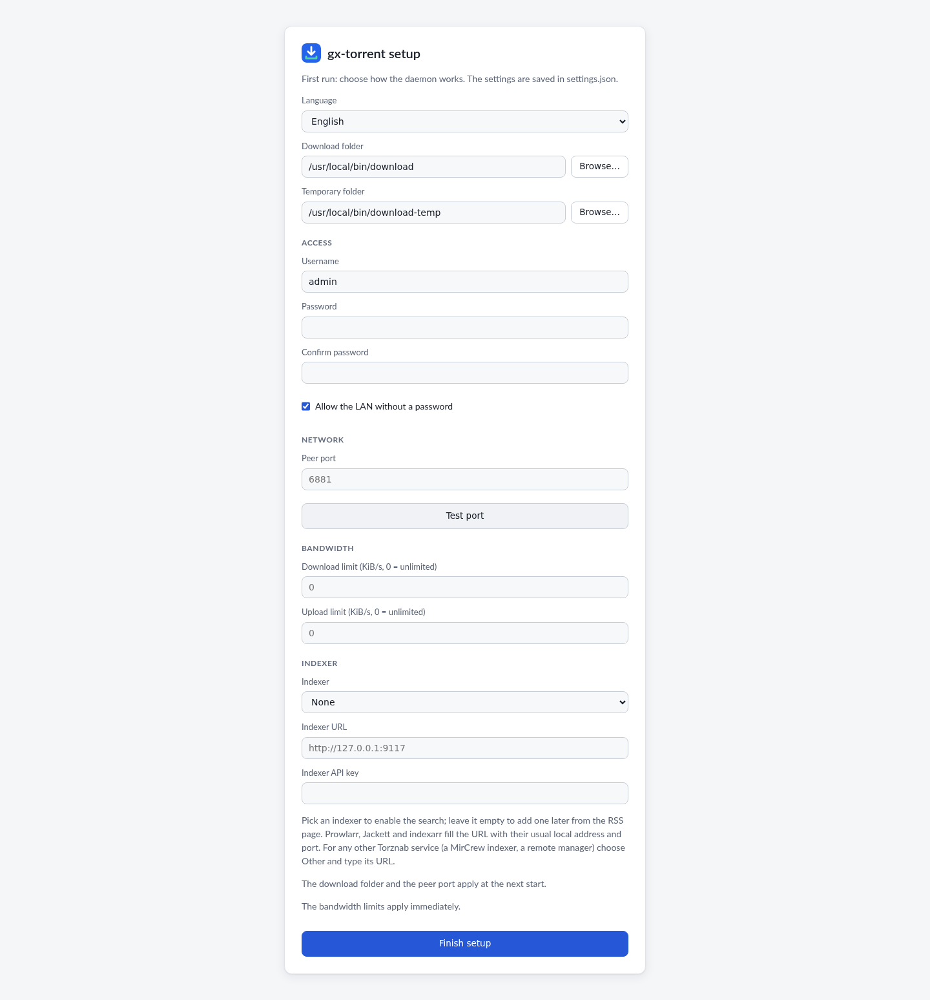

Choose the language, the download folder, the peer port and, if you want, a
password. The same wizard can add a Torznab indexer (Prowlarr, Jackett,
indexarr or another endpoint). Everything else already has sensible defaults.

## 2. The Torrents page

The main screen is a dense but readable list: state, size, progress, seeds and
peers, speed, ETA, ratio, category and tags. The top bar shows the traffic; the
status bar has the global controls.

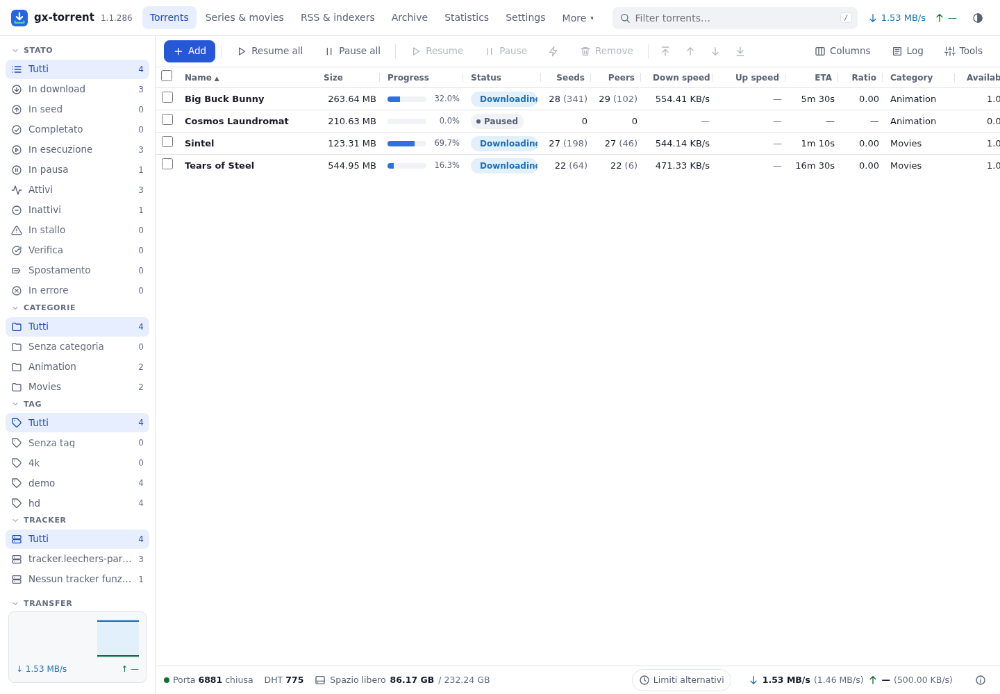

- **Add** opens magnets, `.torrent` URLs and files, with destination, category,
  tags, pause, sequential, first/last piece, limits and content layout.
- **Pause all / Resume all** stop or restart the whole session.
- Columns can be chosen and resized; the choice is remembered.
- The sidebar filters by state, category, tag and tracker. At the bottom of the
  sidebar is the interface **language** (English, Italiano, Deutsch, Français,
  Español, Polski): you change it from there, the page reloads already
  translated and the choice stays saved like the field in the settings.
- The context menu has queue, limits, move, rename, verify, reannounce,
  super-seeding and remove.

### Torrent details

Click a name to open the panel below. **General** brings together state,
pieces, space, dates, limits, seeding and web seeds.

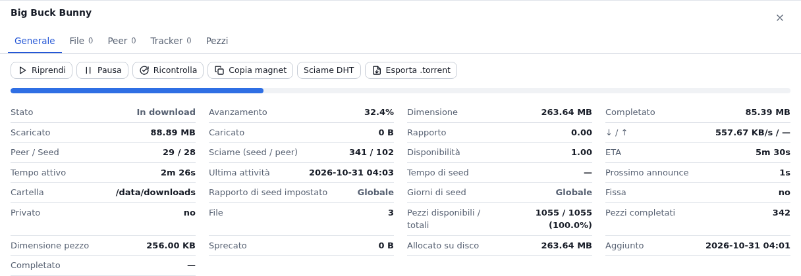

**Files** shows per-file progress, priority (Skip, Normal, High, Maximum),
grouping by folder, rename and **HTTP streaming**.

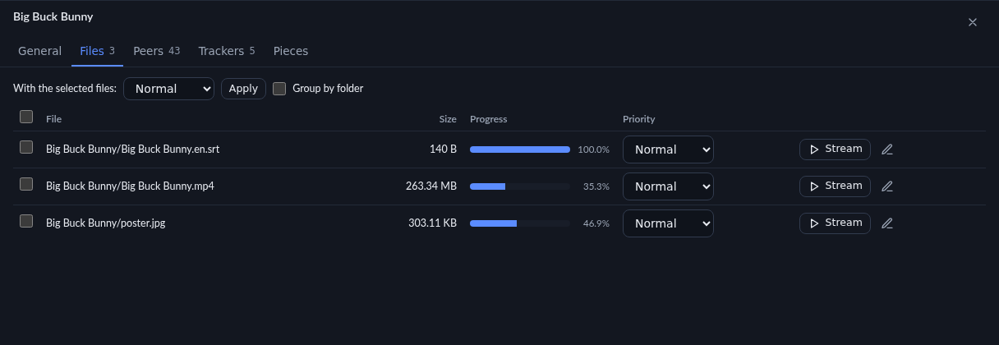

**Peers** shows client, transport, encryption and flags; from here you add peers
and ban an address. **Trackers** shows status, swarm and next announce;
**Pieces** is the coloured piece map.

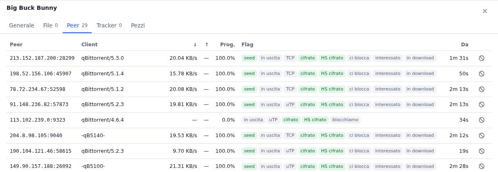

## 3. Add and create

The add dialog takes several magnets or URLs at once; dropping a `.torrent`
anywhere on the page opens it already filled in.

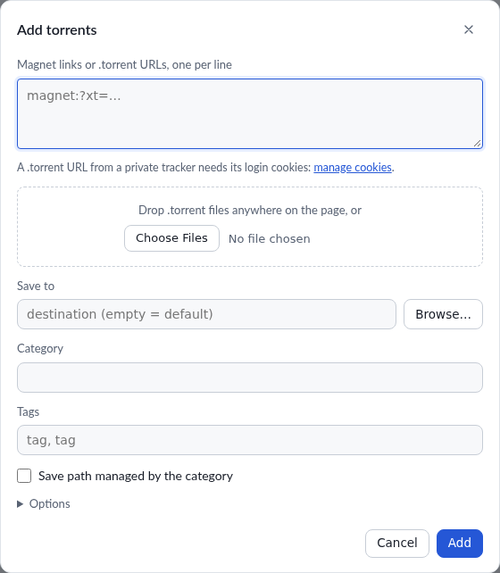

From **Tools → Create .torrent** you build a torrent from a file or folder on
the server, with piece size, private flag, comment, trackers and web seeds.

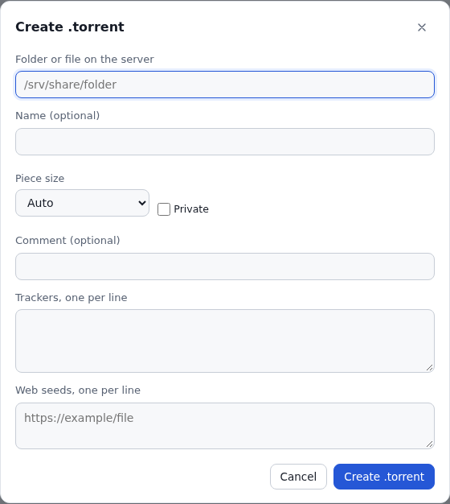

## 4. Series & movies: what is really missing

**Series & movies** turns the client into an acquisition tool. Every title says
in words what you have: *Downloaded*, *Downloading*, *Found, not downloaded*.
The progress bar is over the episodes **found so far**; enable the real episode
list and the denominator becomes the actual series.

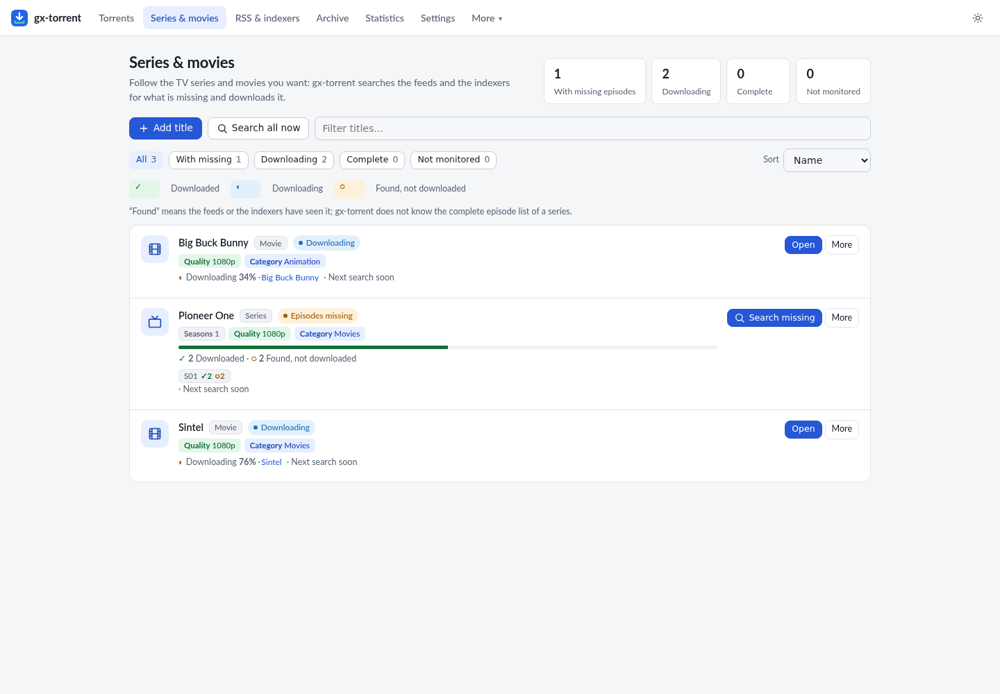

- State filters: all, with missing, downloading, complete, not monitored.
- One primary action per row; everything else is in the **More** menu.
- **Why not?** opens the releases found and each verdict.
- **Episodes** opens the per-season grid with the state of every episode.
- **Search**, in the *Add title* dialog, lists under every name the episodes
  already in the archive with their resolution and language: picking one fills
  the title and the language from that release.
- A title's quality is chosen **only through the profile**: the dialog has a
  single *Quality profile* field and, below it, a **Create or edit profiles**
  link that opens the *Library* tab of the settings. Without a profile the title
  accepts any resolution.

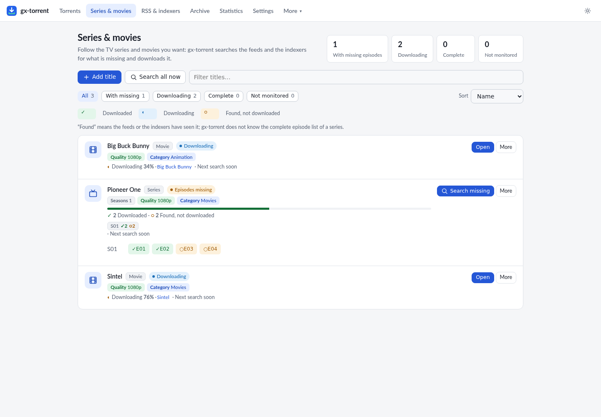

### Quality profiles and upgrades

In **Settings → Library → Quality profiles** you create a profile with the
accepted resolutions (360p…2160p) and a **cutoff**; it is the only way to set a
title's quality. With a cutoff, an episode already downloaded at
720p is replaced by a 1080p release when it appears: the new torrent enters, the
old one leaves the session and **the files stay**.

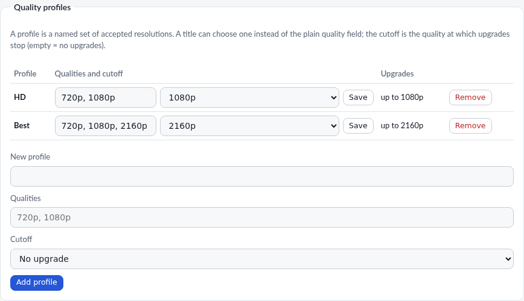

### Real episode list (optional)

In **Settings → Series and movies** you can enable **TVmaze**: the series title
is sent to `api.tvmaze.com` and gx-core knows the episodes that already aired,
even if no release ever passed through the feeds. It is off by default; without
a match the page keeps using what the feeds and indexers saw and says so on the
row.

## 5. RSS, archive and search

**RSS & indexers** manages feeds, ordered PASS/FAIL rules, Torznab indexers and
the local archive. An indexer can be checked with **Test** already in the
window where you add or edit it, before saving. Rules have a live preview, feed
tests, import/export and actions (folder, category, tags, pause, sequential,
first/last, top).
**Archive** makes everything the feeds returned searchable, even when it was not
downloaded. **Search** queries the indexers in parallel and shows size, seeds,
peers, age and indexer; each result is added at once or with the options
(destination, category, tags).

## 6. Statistics and settings

**Statistics** shows the 1 h / 24 h / 7 d graph, session and all-time totals,
disk and cache, network, queue and the busiest torrents.

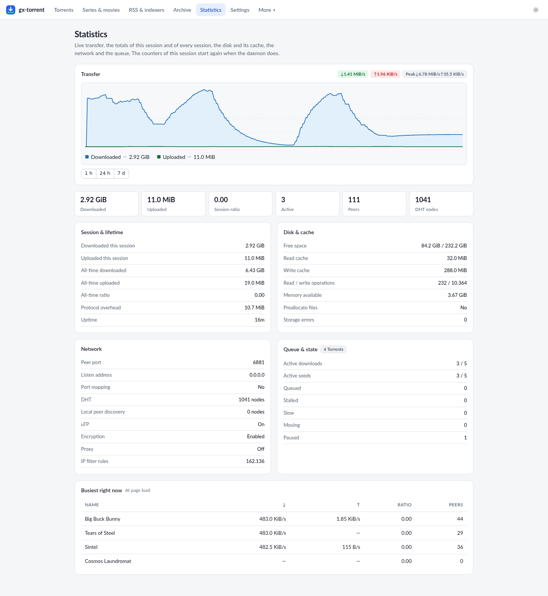

**Settings** is split into seven tabs — **Folders & files**, **Network**,
**Bandwidth**, **Queue**, **Library**, **Interface** and **System** — so each
group of options opens on its own instead of a single long scroll: folders and
completion actions, network and protocols, speed limits and the per-day
scheduler, queue and cache, categories and quality profiles with DLNA, language
and notifications, maintenance and updates. The search box at the top still
looks in every tab at once; **Save** stays at the bottom and saves the whole
page, including the groups of the tabs that are closed. After a save or an
action inside a tab (adding a category, saving a profile, testing the port,
sending a test notification) the page stays on that tab and confirms with a
message in the bottom-right corner, so the button visibly did something.

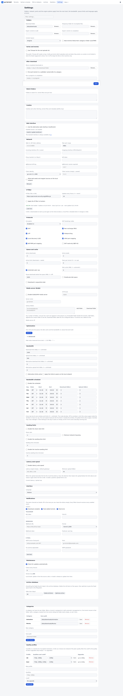

Category management and its path are on the same page: that is what makes
automatic torrent management really work.

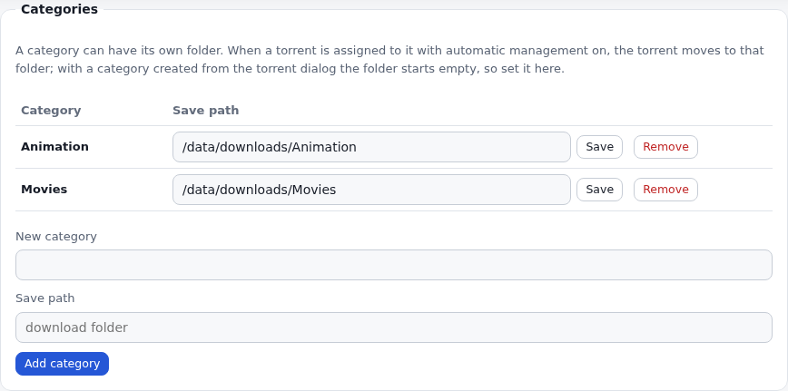

### Automatic speed (measures the line)

In **Settings → Bandwidth → Automatic speed (measures the line)** you let
gx-torrent find the speed instead of fixing it: it probes the round-trip latency
towards Google and Cloudflare (or a host you choose) and moves **download and
upload together**, lowering them when the line queues and raising them again
when the latency drops. A manual limit stays the ceiling, and the real maximum
speeds of the line, if you know them, let it reach the right point sooner; with
those maxima at 0 it discovers them by itself. **Optimize** in the same tab
zeros the two limits and turns automatic speed on. It is off by default.

### Notifications

In **Settings → Interface → Notifications** the client tells you what happens on
the same channels as Gextto and indexarr: **Telegram**, a generic **webhook**
(JSON, Discord, Slack, Gotify, ntfy or Pushover format), **Discord**, **Slack**,
**Gotify**, **ntfy**, **Pushover**, an **Apprise** server, **e-mail** and a
**custom script**. Fill in the ones you use and leave the others empty: every
filled channel receives every enabled event, and a slow service does not hold up
the others. Three switches choose the events — *Download complete*, *Feed added
torrents*, *Feed error* — and **Send test** tries all the saved channels at once.
The script receives the event in the `GX_TORRENT_*` variables (app, event, title
and message), never on the command line.

## 7. What it costs in CPU and RAM

Engine, queue, web page, RSS and the qBittorrent-compatible API are one pure-Go
process: no external engine, no C library, no database server. These figures are
the whole daemon, measured on an **Intel N97 mini-PC** (4 cores, 16 GB RAM) on
26–30 October 2026, with DHT on and a full IP filter loaded (172,740 rules):

| Situation | CPU | Memory (RSS) |
| --- | --- | --- |
| At rest | **0.6–1.0 %** of one core | **29–39 MB** |
| Downloading from public swarms at 8.2–8.8 MB/s with 116–132 peers | **18–37 %** of one core, **2.0–4.3 s of CPU per 100 MB** | — |
| Loopback transfer (seed and leecher on the same host) | **7.5–8.3 s of CPU per 1.09 GiB** for both sides | **≈ 100 MB peak** |
| Five minutes after a burst, with no transfer | — | **550 MB → 35–40 MB** |

At rest the CPU is mostly real network work — the DHT and incoming peer
handshakes — not internal polling. The connection cap is sized from the machine
(55 peers per torrent and 300 in total on this 4-core host), and the buffers of
the pieces return after a burst instead of staying reserved. Machine, date and
the command for every figure are in
[`measurements.md`](measurements.md).

## 8. From the phone

The page is responsive and installable as an app: the manifest and the service
worker cache only the shared assets, never an authenticated page or an API
answer. When a password is set, **Sign out** appears.

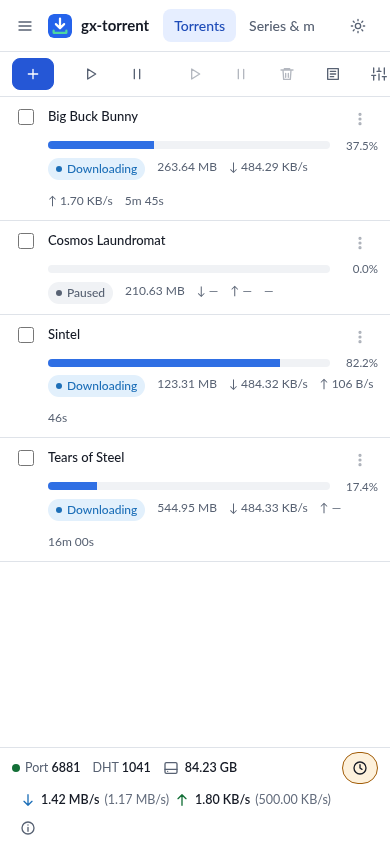

## 9. Integrations

gx-core exposes the **qBittorrent-compatible API** (`/api/v2`) for Sonarr,
Radarr, Lidarr, Readarr, Prowlarr and mobile apps. In **Settings → Network** you
set the **API key** (`X-Api-Key` or Bearer) and the version reported by
`app/version` (default `4.6.7`). The native `/api/v1`, Prometheus and SSE remain
available for scripts and automations. A feed keeps its identifier when you
rename it, move it or give it a new address, rules report their last match and
the episodes already taken, and the tags set by a client stay: apps that read
these fields find them filled. Compatibility is broad but not a 100% clone: the
limits are in [`gx-core.md`](gx-core.md) §6.

## 10. Security

- The page listens on `0.0.0.0:8080` in the container; login is optional but
  recommended if you expose it beyond the LAN.
- CSRF, DNS rebinding and “what counts as LAN” are handled server-side; trusted
  proxies must be declared.
- The API key and token are secrets: keep them out of public URLs.
- Web seeds and magnet sources cannot reach the local network unless you allow
  it.

## 11. Reproducing this manual’s environment

The images come from a `gx-torrent` container with four public, legal torrents,
a couple of categories and one followed title. The steps are those of chapter
1; torrents are added from **Add** or the API:

```bash
curl -X POST --data-urlencode \
  'urls=https://webtorrent.io/torrents/big-buck-bunny.torrent' \
  http://127.0.0.1:8080/api/v2/torrents/add
```

No personal data, no private trackers, no copyrighted content.

## 12. Supporting the project

gx-torrent is free and has no advertising. If it is useful to you, the
**Donate** button is always in the bottom-right corner of the interface pages:
it opens PayPal in a new tab and the donation goes to development. On a phone
the button keeps only the heart. The same link is in the README.
