# gx-core — manuale d’uso

**gx-core** è il client BitTorrent completo che vive dentro `gx-torrent`: la
stessa applicazione che Gextto usa come motore, ma **senza Gextto**. Si apre dal
browser, si configura in pochi minuti e fa già tutto quello che serve: torrent,
coda, categorie, tag, RSS, Serie e film, archivio, ricerca, statistiche,
streaming, DLNA e API compatibile con qBittorrent.

> [!TIP]
> Questo manuale è illustrato con un ambiente **Docker** reale: quattro torrent
> legali (Big Buck Bunny, Sintel, Tears of Steel, Cosmos Laundromat), categorie,
> tag, un titolo seguito e trasferimenti in corso. Le immagini sono state prese
> dall’interfaccia vera, non da mockup.

## 1. Avvio in tre minuti

gx-torrent esce come **archivio autonomo** (`gx-torrent-linux-<arch>.tar.gz`
nella pagina delle release): dentro ci sono il binario, `run.sh` per avviarlo e
`install-service.sh` per installarlo come servizio systemd.

```bash
tar xzf gx-torrent-linux-x86_64.tar.gz
cd gx-torrent
./run.sh                              # avvio diretto, dati in una cartella accanto
# oppure: sudo ./install-service.sh   # servizio systemd, dati in /var/lib/gx-torrent
```

Apri `http://IP-DEL-SERVER:8890/`: al primo accesso compare la procedura guidata.

### Con Docker

L’immagine non è pubblicata: il contenitore si **costruisce dai sorgenti**,
quindi scarica prima il repository (o l’archivio dei sorgenti di una release) e
lancia i comandi dalla cartella che contiene il `Dockerfile`. Il solo
`Dockerfile` non basta, perché durante la build il demone viene compilato dal
codice del repository.

```bash
git clone https://github.com/buzzqw/gextto.git
cd gextto
docker build -t gx-torrent .
docker run -d --name gx-torrent \
  -p 8080:8080 -p 6881:6881 -p 6881:6881/udp \
  -v gx-torrent-data:/data \
  gx-torrent
```

Con il contenitore la pagina risponde su `http://IP-DEL-SERVER:8080/`.

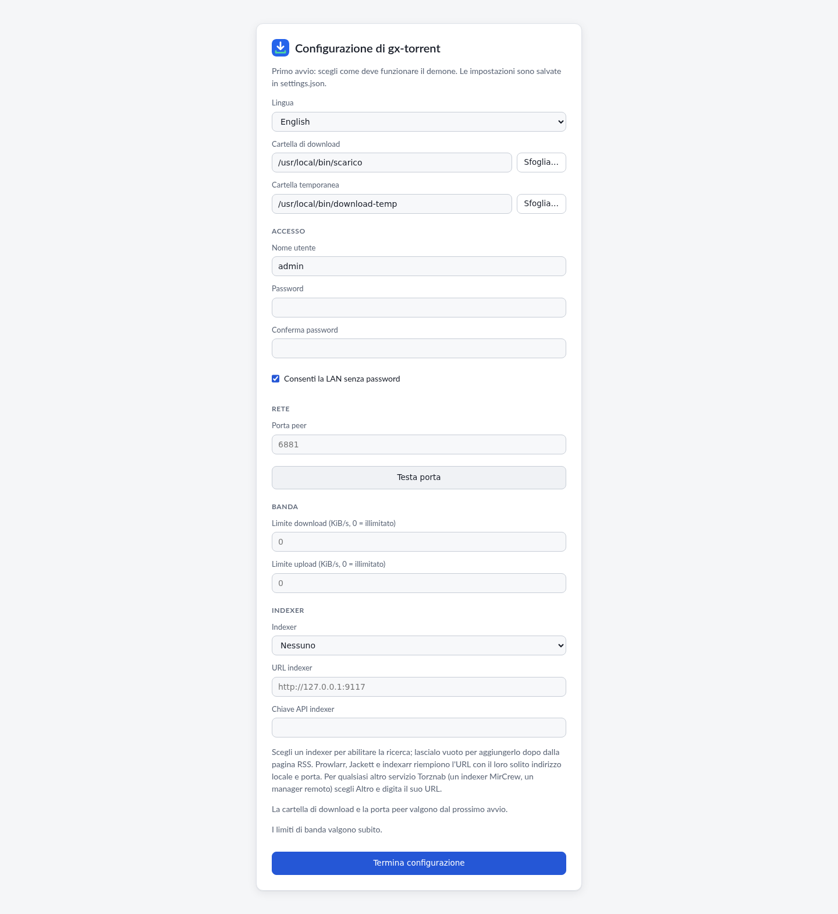

Scegli lingua, cartella dei download, porta peer e, se vuoi, la password. La
stessa procedura può aggiungere un indexer Torznab (Prowlarr, Jackett, indexarr
o un altro endpoint). Tutto il resto ha già valori sensati.

## 2. La pagina Torrent

La schermata principale è una lista densa ma leggibile: stato, dimensione,
progresso, seed/peer, velocità, ETA, rapporto, categoria e tag. La barra in
alto mostra il traffico; in basso ci sono i comandi globali.

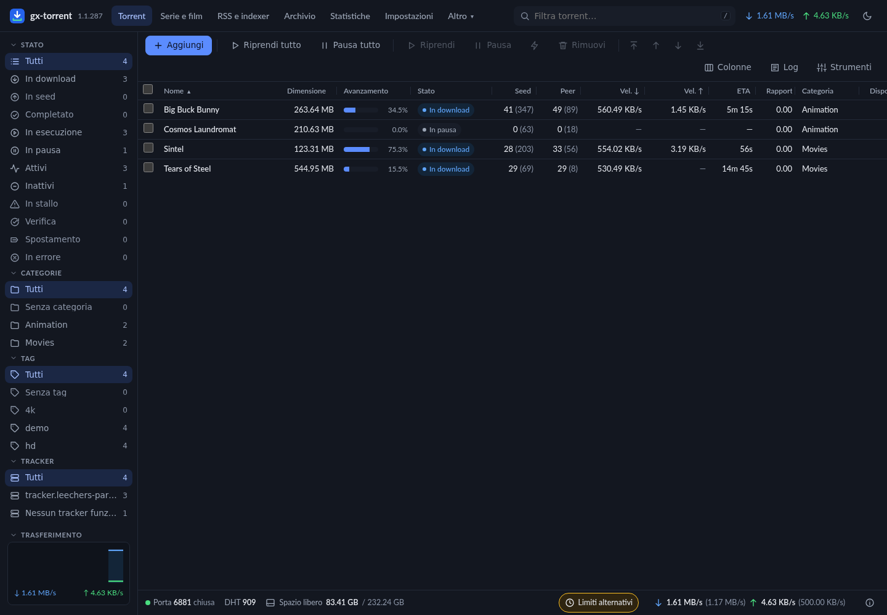

- **Aggiungi** apre magnet, URL `.torrent` e file, con destinazione, categoria,
  tag, pausa, sequenziale, primo/ultimo pezzo, limiti e content layout.
- **Pausa tutto / Riprendi tutto** fermano o riavviano l’intera sessione.
- Le colonne si scelgono e si ridimensionano; la scelta resta.
- Il filtro laterale divide per stato, categoria, tag e tracker. In fondo alla
  barra laterale c’è la **lingua** dell’interfaccia (English, Italiano,
  Deutsch, Français, Español, Polski): si cambia da lì, la pagina si ricarica
  già tradotta e la scelta resta salvata come quella nelle impostazioni.
- Il menu contestuale ha coda, limiti, sposta, rinomina, verifica, reannounce,
  super-seeding e rimozione.

### Dettaglio di un torrent

Clicca un nome per aprire il pannello in basso. La scheda **Generale** riunisce
stato, pezzi, spazio, date, limiti, seed e web seed.

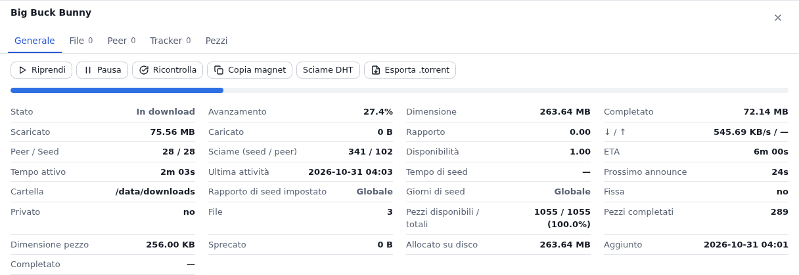

**File** mostra l’avanzamento per file, la priorità (Skip, Normal, High,
Maximum), il raggruppamento per cartella, la rinomina e lo **streaming HTTP**.

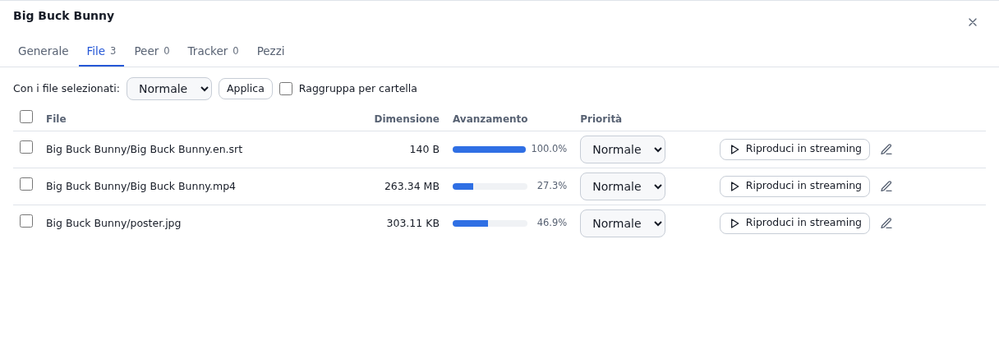

**Peer** mostra client, trasporto, cifratura e flags; da qui si aggiungono peer
e si banna un indirizzo. **Tracker** mostra stato, swarm e prossimo annuncio;
**Pezzi** è la mappa colorata del torrent.

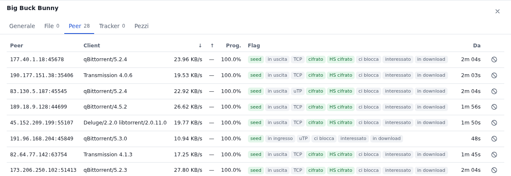

## 3. Aggiungere e creare

La finestra di aggiunta accetta più magnet o URL insieme; il trascinamento di
un `.torrent` sulla pagina la apre già compilata.

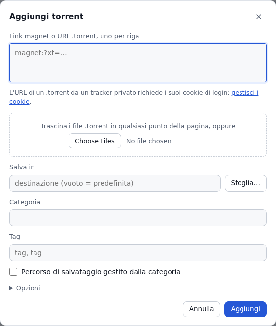

Da **Strumenti → Crea .torrent** si crea un torrent da un file o una cartella
del server, con dimensione dei pezzi, flag privato, commento, tracker e web
seed.

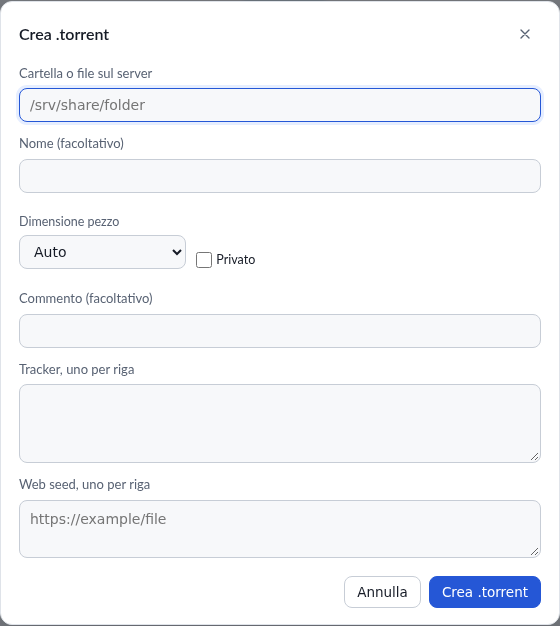

## 4. Serie e film: cosa manca davvero

**Serie e film** è la pagina che trasforma il client in un acquisitore. Ogni
titolo dice in parole cosa hai: *Scaricato*, *In download*, *Trovato, non
scaricato*. La barra di avanzamento è calcolata sugli episodi **trovati
finora**; se attivi l’elenco episodi reale, il denominatore diventa la serie
vera.

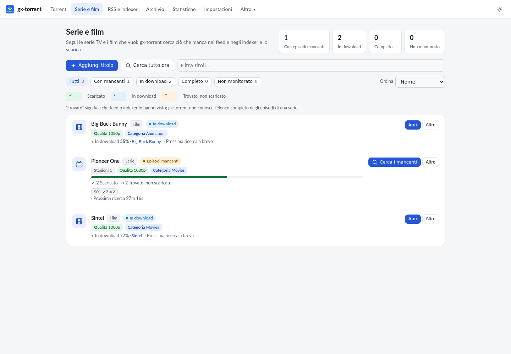

- Filtri per stato: tutti, con mancanti, in download, completi, non monitorati.
- Una sola azione principale per riga; tutto il resto è nel menu **Altro**.
- **Perché no?** apre le release trovate e il verdetto di ciascuna.
- **Episodi** apre la griglia per stagione, con lo stato di ogni episodio.
- **Cerca**, nella finestra *Aggiungi titolo*, elenca sotto ogni nome le puntate
  già in archivio con risoluzione e lingua: sceglierne una compila titolo,
  qualità e lingua da quella release.

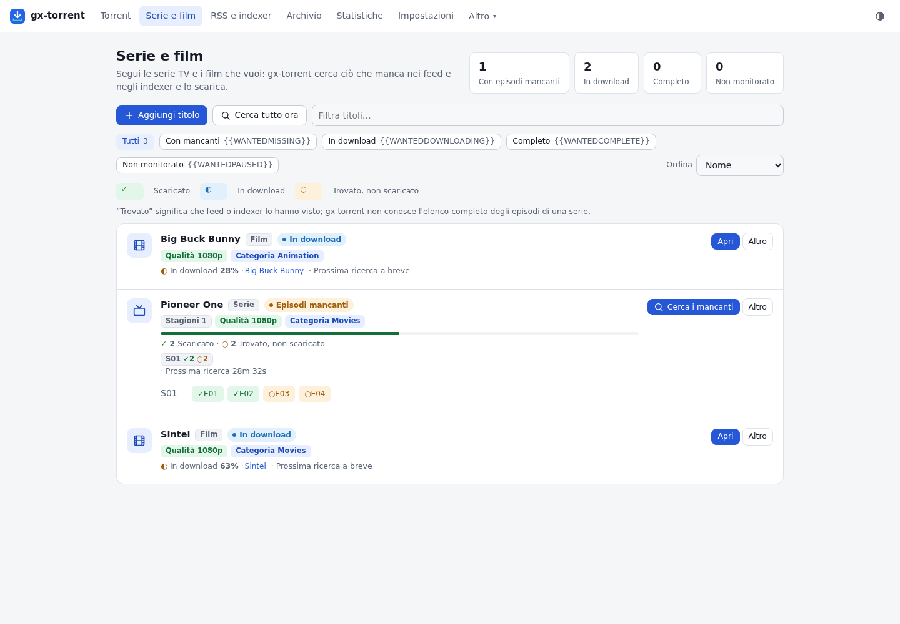

### Profili di qualità e aggiornamenti

In **Impostazioni → Profili di qualità** si crea un profilo con le risoluzioni
accettate (360p…2160p) e una **soglia**. Un titolo può scegliere il profilo al
posto del campo qualità. Con la soglia, un episodio già scaricato a 720p viene
sostituito da una release 1080p quando arriva: il nuovo torrent entra, il
vecchio esce dalla sessione e **i file restano**.

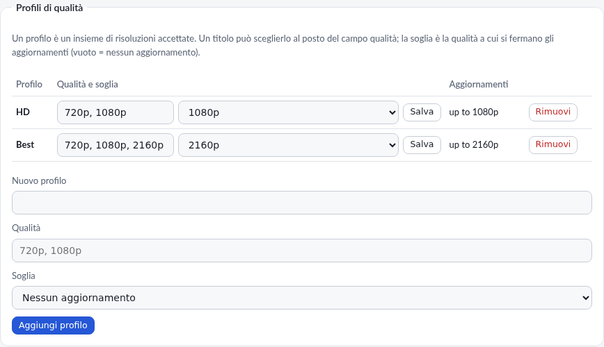

### Elenco episodi reale (opzionale)

In **Impostazioni → Serie e film** si può attivare **TVmaze**: il titolo della
serie viene inviato a `api.tvmaze.com` e gx-core conosce gli episodi già andati
in onda, anche se nessuna release è mai passata dai feed. È spento per default;
senza corrispondenza la pagina continua con quello che hanno visto feed e
indexer e lo dice sulla riga.

## 5. RSS, archivio e ricerca

**RSS e indexer** gestisce feed, regole ordinate PASS/FAIL, indexer Torznab e
l’archivio locale. Un indexer si può provare con **Prova** già nella finestra in
cui lo si aggiunge o modifica, prima di salvarlo. Le regole hanno anteprima live, test dei feed, import/export
e azioni (cartella, categoria, tag, pausa, sequenziale, primo/ultimo, top).
**Archivio** rende ricercabile tutto ciò che i feed hanno restituito, anche
quando non è stato scaricato. **Cerca** interroga gli indexer in parallelo e
mostra dimensione, seed, peer, età e indexer; ogni risultato si aggiunge subito
o con le opzioni (destinazione, categoria, tag).

## 6. Statistiche e impostazioni

**Statistiche** mostra il grafico 1 h / 24 h / 7 g, i totali di sessione e di
sempre, disco e cache, rete, coda e torrent più attivi.

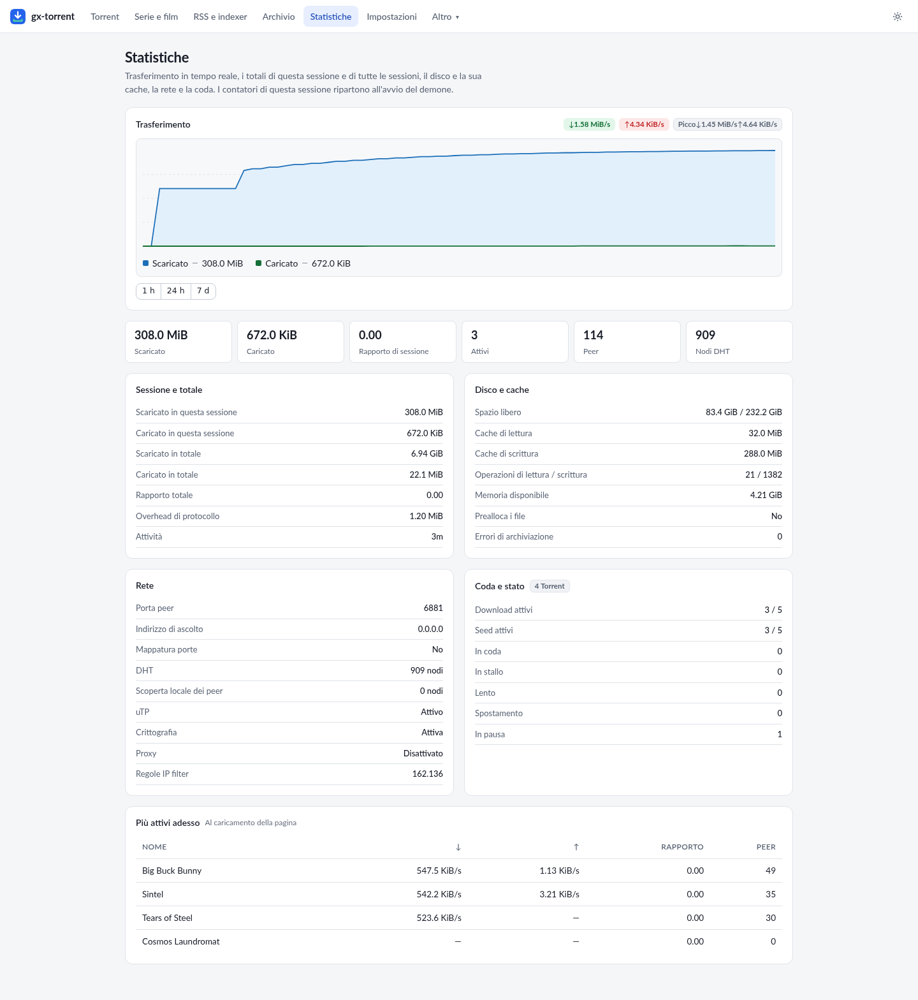

**Impostazioni** è divisa in sette schede — **Cartelle e file**, **Rete**,
**Banda**, **Coda**, **Libreria**, **Interfaccia** e **Sistema** — così ogni
gruppo di opzioni si apre da solo invece di scorrere un unico elenco lungo:
cartelle e azioni a fine download, rete e protocolli, limiti di velocità e
scheduler per giorno, coda e cache, categorie e profili di qualità con DLNA,
lingua e notifiche, manutenzione e aggiornamento. La ricerca in alto cerca in
tutte le schede insieme; il pulsante **Salva** resta in fondo e salva comunque
tutta la pagina, anche i gruppi delle schede chiuse.

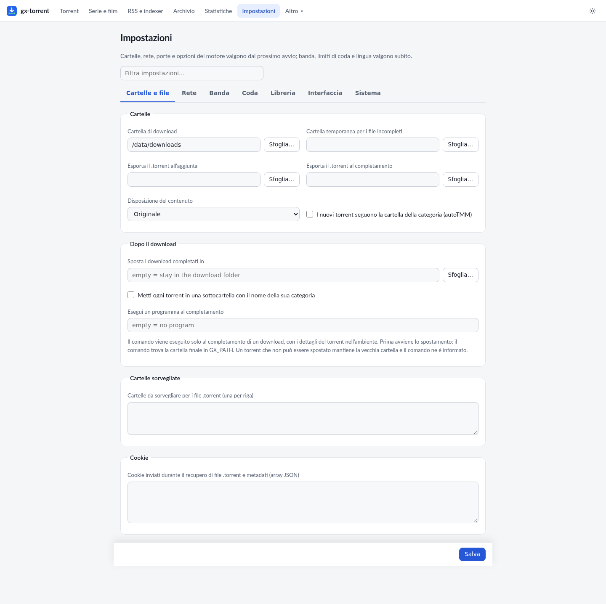

La gestione delle categorie e il loro percorso è nella stessa pagina: è ciò che
fa funzionare davvero la gestione automatica dei torrent.

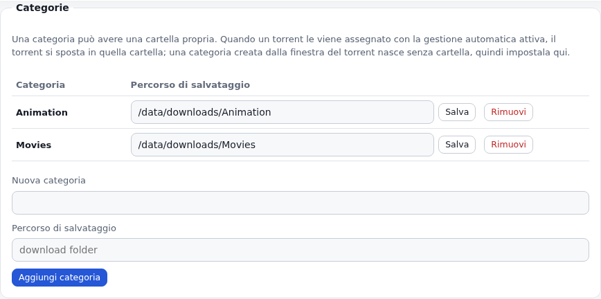

### Velocità automatica (misura la linea)

In **Impostazioni → Banda → Velocità automatica (misura la linea)** lasci che sia
gx-torrent a trovare la velocità invece di fissarla: sonda la latenza di andata
e ritorno verso Google e Cloudflare (o un host scelto) e muove **download e
upload insieme**, abbassandoli quando la linea si mette in coda e rialzandoli
quando la latenza scende. Un limite manuale resta il tetto, e i massimi reali
della linea, se li conosci, gli fanno raggiungere prima il punto giusto; con i
massimi a 0 li scopre da solo. **Ottimizza** nella stessa scheda azzera i due
limiti e accende la velocità automatica. È spenta per default.

### Notifiche

In **Impostazioni → Interfaccia → Notifiche** il client ti dice cosa succede
sugli stessi canali di Gextto e indexarr: **Telegram**, un **webhook** generico
(formato JSON, Discord, Slack, Gotify, ntfy o Pushover), **Discord**, **Slack**,
**Gotify**, **ntfy**, **Pushover**, un server **Apprise**, l’**e-mail** e uno
**script personale**. Compila quelli che usi e lascia vuoti gli altri: ogni
canale compilato riceve ogni evento attivo, e un servizio lento non trattiene
gli altri. Tre interruttori scelgono gli eventi — *Download completato*, *Feed
ha aggiunto torrent*, *Errore del feed* — e **Invia prova** prova in una volta
tutti i canali salvati. Lo script riceve l’evento nelle variabili
`GX_TORRENT_*` (app, evento, titolo e messaggio), mai sulla riga di comando.

## 7. Quanto costa in CPU e RAM

Motore, coda, pagina, RSS e API compatibile con qBittorrent sono un solo
processo Go: nessun motore esterno, nessuna libreria C, nessun server di
database. Questi numeri sono l’intero demone, misurati su un **mini-PC Intel N97**
(4 core, 16 GB di RAM) il 26–30 ottobre 2026, con DHT attiva e un filtro IP
completo caricato (172.740 regole):

| Situazione | CPU | Memoria (RSS) |
| --- | --- | --- |
| A riposo | **0,6–1,0 %** di un core | **29–39 MB** |
| In download da sciami pubblici a 8,2–8,8 MB/s con 116–132 peer | **18–37 %** di un core, **2,0–4,3 s di CPU per 100 MB** | — |
| Trasferimento in loopback (seed e leecher sullo stesso host) | **7,5–8,3 s di CPU per 1,09 GiB** per entrambi i lati | **≈ 100 MB di picco** |
| Cinque minuti dopo un picco, senza trasferimenti | — | **550 MB → 35–40 MB** |

A riposo il processore fa soprattutto lavoro di rete vero — DHT e handshake dei
peer in arrivo — non polling interno. Il tetto di connessioni è dimensionato
sulla macchina (55 peer per torrent e 300 in totale su questo host a 4 core), e
i buffer dei pezzi tornano dopo un picco invece di restare riservati. Macchina,
data e comando di ogni numero sono in [`measurements.md`](measurements.md).

## 8. Dal telefono

La pagina è responsive e installabile come app: manifest e service worker
mettono in cache solo le risorse condivise, mai pagine o risposte autenticate.
Quando c’è una password compare **Esci**.

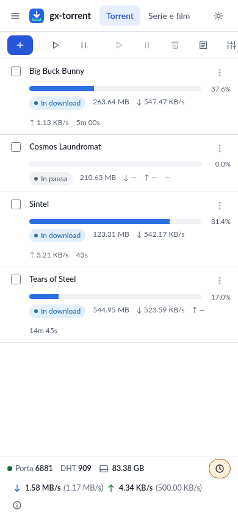

## 9. Integrazioni

gx-core espone l’**API compatibile con qBittorrent** (`/api/v2`) per Sonarr,
Radarr, Lidarr, Readarr, Prowlarr e le app mobili. In **Impostazioni → Rete** si
impostano l’**API key** (`X-Api-Key` o Bearer) e la versione riportata da
`app/version` (default `4.6.7`). L’API nativa `/api/v1`, Prometheus e SSE
restano disponibili per script e automazioni. Un feed conserva il suo
identificativo quando lo rinomini, lo sposti o ne cambi l’indirizzo, le regole
riportano l’ultima corrispondenza e gli episodi già presi, e i tag impostati da
un client restano: le app che leggono questi dati li trovano pieni. La
compatibilità è ampia ma non è un clone al 100%: i limiti sono in
[`gx-core.md`](gx-core.md) §6.

## 10. Sicurezza

- La pagina ascolta su `0.0.0.0:8080` nel container; il login è opzionale ma
  consigliato se la esponi oltre la LAN.
- CSRF, DNS rebinding e “cosa conta come LAN” sono gestiti lato server; i proxy
  fidati vanno dichiarati.
- L’API key e il token sono segreti: non metterli in URL pubblici.
- I web seed e le sorgenti magnet non raggiungono la rete locale se non lo
  consenti esplicitamente.

## 11. Riprodurre l’ambiente di questo manuale

L’ambiente delle immagini è un container `gx-torrent` con quattro torrent
pubblici e legali, un paio di categorie e un titolo seguito. I passi sono quelli
del capitolo 1; i torrent si aggiungono da **Aggiungi** o dall’API:

```bash
curl -X POST --data-urlencode \
  'urls=https://webtorrent.io/torrents/big-buck-bunny.torrent' \
  http://127.0.0.1:8080/api/v2/torrents/add
```

Nessun dato personale, nessun tracker privato, nessun contenuto protetto.
