# Gextto — guided tour

> **Italiano:** [TOUR.it.md](TOUR.it.md) · Back to the [README](https://github.com/buzzqw/gextto/blob/main/README.md)

The main screens of Gextto and of its engine, gx-torrent. Every image comes from
a test instance downloading public, legal torrents (Debian, Ubuntu Server and
the Blender open movies *Big Buck Bunny*, *Sintel*, *Tears of Steel* and
*Cosmos Laundromat*), with a small library of a Creative Commons series and
public-domain films. The images are generated with `make screenshots`; peer
addresses are masked.

## Dashboard

The session at a glance: what is downloading, the live traffic against the
limit in force, what needs checking and the buttons to start a search cycle.

The same page with the light theme; the Theme button switches between light,
dark and the system choice.

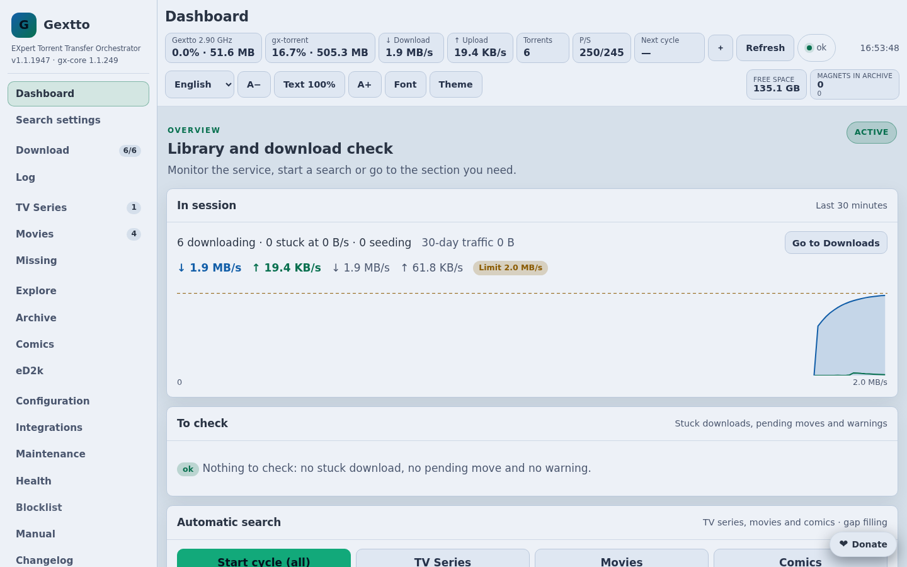

## Downloads

The torrents of the session as cards: progress, speed, time left, peers and
ratio, with the actions on each row and on the selection. Above them, the
manual search across archive, indexers, web engines and eD2k.

The **Bandwidth** menu says what applies now and where it comes from, and makes
a temporary exception — Auto or a limit — in one click.

## Torrent details

A click on the name opens the details: general data, trackers, content, peers,
limits, storage, the piece map and the history.

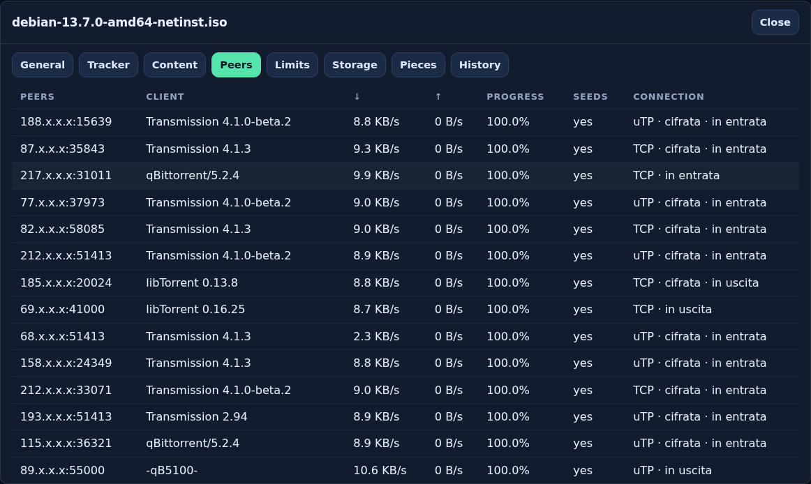

## Library

The TV series and the movies Gextto follows, with quality, language and
completeness. Titles are added from TMDB or by hand.

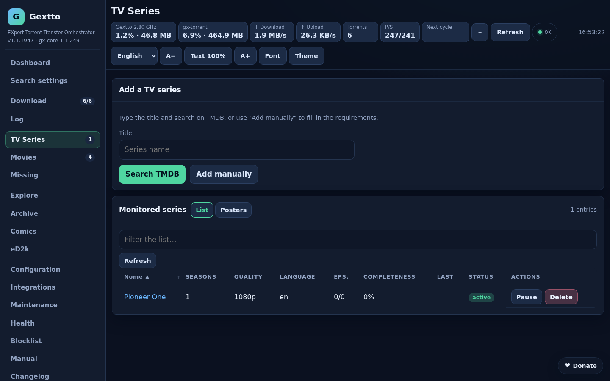

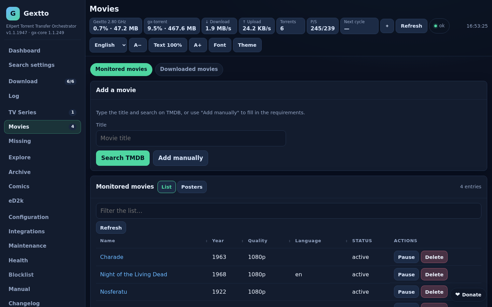

## Settings

Every option has its description, its default and its own Save; the sections
on the left follow what you want to do, and the search finds an option by name
or key.

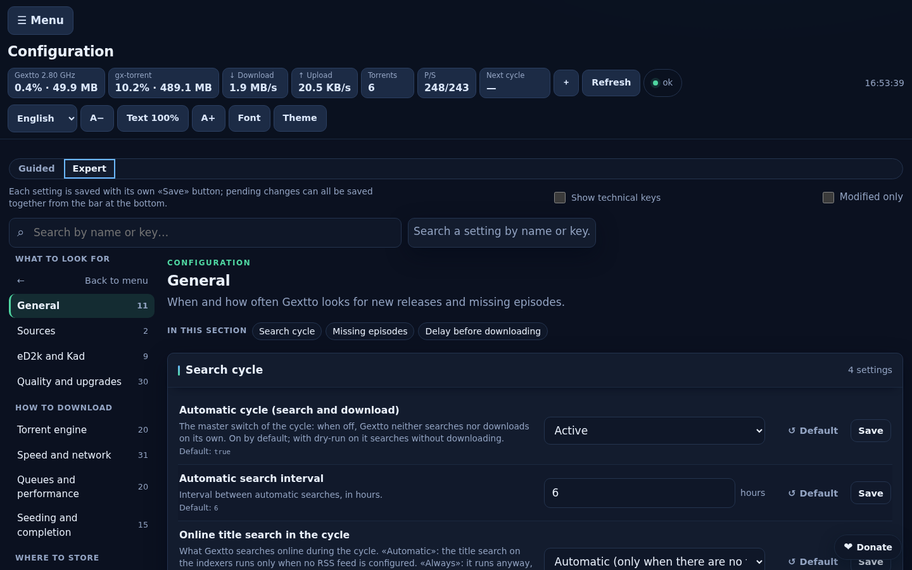

One choice for the speed rule; the rows that depend on it appear only when
they matter.

## First start

The wizard on the first start: access and password, folders, sources, the
first title and the activation.

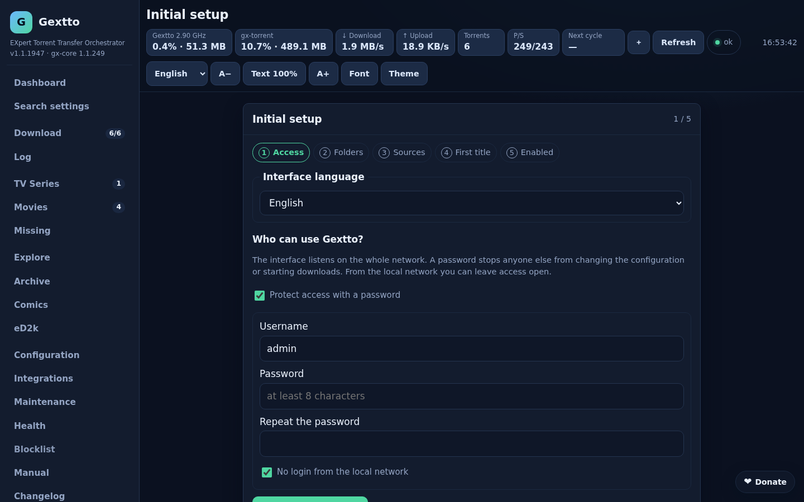

## Maintenance, health and log

Backups, cleaning, renaming and updates in one place.

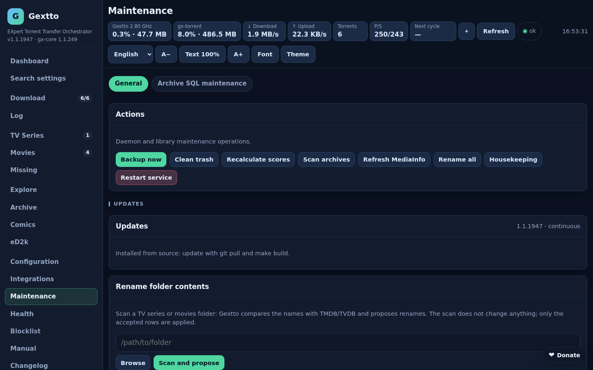

The state of the service: paths, disks, the torrent engine, the network and the
sources that are failing.

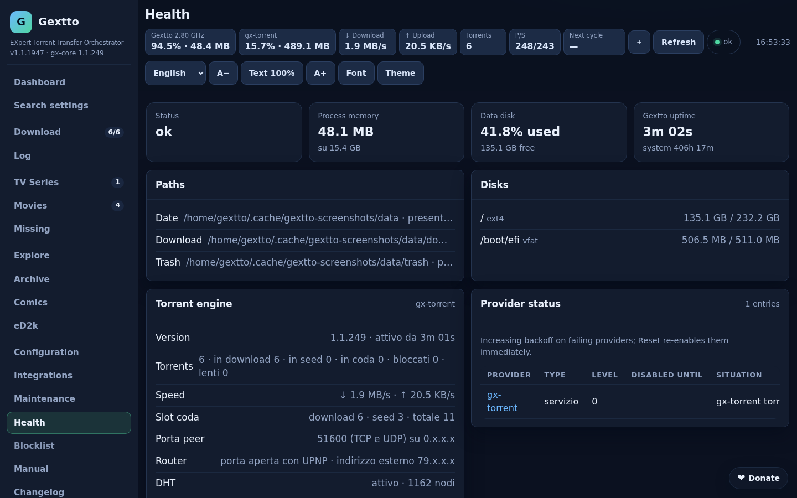

The daemon log, with filter, level and automatic refresh.

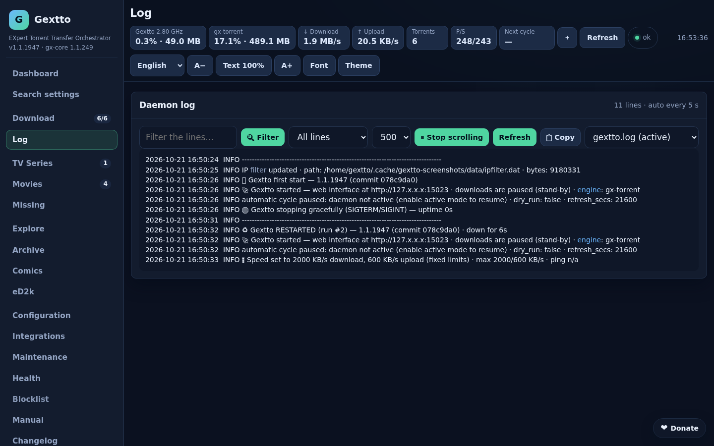

## Integrations

Simkl, Jellyfin, Plex and the other services Gextto talks to.

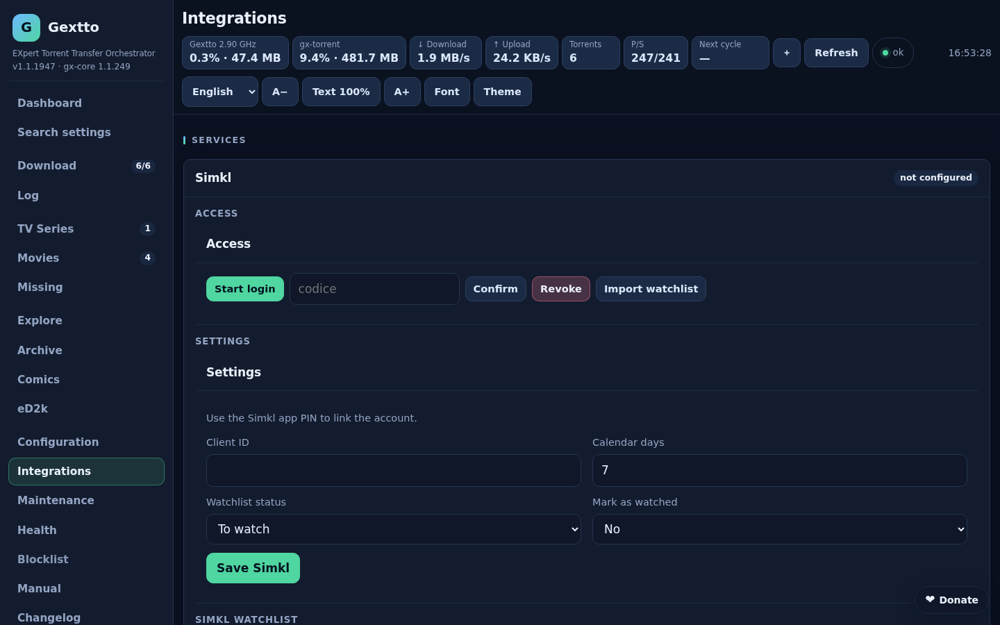

## On a phone

The same pages reflow into cards, with the main sections in the bottom bar and
the actions within thumb reach. The web UI can be installed as an app (PWA).

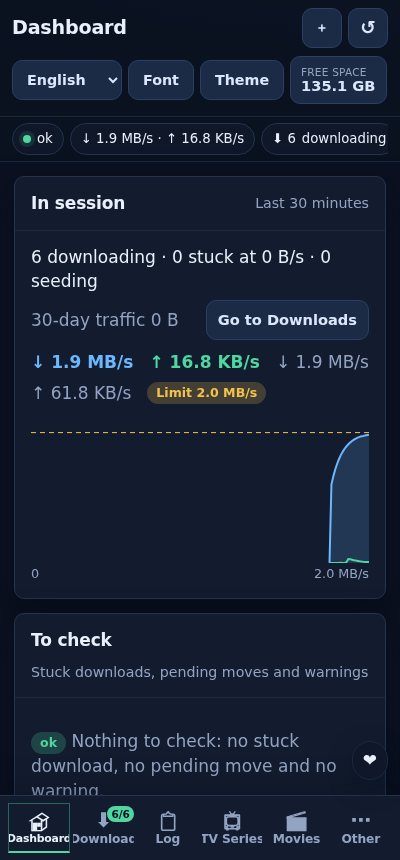

## gx-torrent

The page of the engine, the same daemon that runs on its own as a standalone
client on Linux and Windows: filters by state and tracker, sortable columns and
the transfer graph.

## Other languages

The interface speaks Italian, English, German, French, Spanish and Polish.

| | |
|---|---|
|  |  |
| **Deutsch** | **Français** |
|  |  |
| **Español** | **Polski** |
