# Gextto — visita guidata

> **English:** [TOUR.en.md](TOUR.en.md) · Torna al [README](../README.it.md)

Le schermate principali di Gextto e del suo motore, gx-torrent. Ogni immagine
viene da un'istanza di prova che scarica torrent pubblici e legali (Debian,
Ubuntu Server e i film open di Blender *Big Buck Bunny*, *Sintel*, *Tears of
Steel* e *Cosmos Laundromat*), con una piccola libreria di una serie Creative
Commons e film di pubblico dominio. Le immagini si generano con
`make screenshots`; gli indirizzi dei peer sono mascherati.

## Dashboard

La sessione a colpo d'occhio: cosa sta scaricando, il traffico in tempo reale
rispetto al limite in vigore, cosa va controllato e i pulsanti per avviare un
ciclo di ricerca.

La stessa pagina con il tema chiaro; il pulsante Tema passa tra chiaro, scuro e
la scelta del sistema.

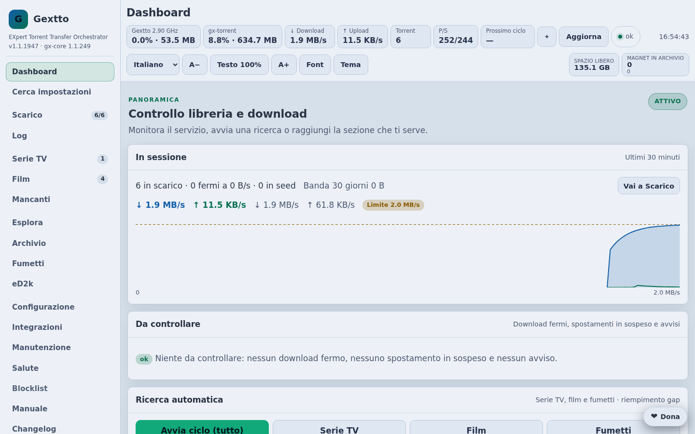

## Scarico

I torrent della sessione come schede: avanzamento, velocità, tempo rimanente,
peer e rapporto, con le azioni sulla riga e sulla selezione. Sopra, la ricerca
manuale su archivio, indexer, motori web ed eD2k.

Il menu **Banda** dice cosa vale adesso e da dove viene, e fa un'eccezione
temporanea — Auto o un limite — con un clic.

## Dettagli del torrent

Un clic sul nome apre i dettagli: dati generali, tracker, contenuto, peer,
limiti, storage, la mappa dei pezzi e la cronologia.

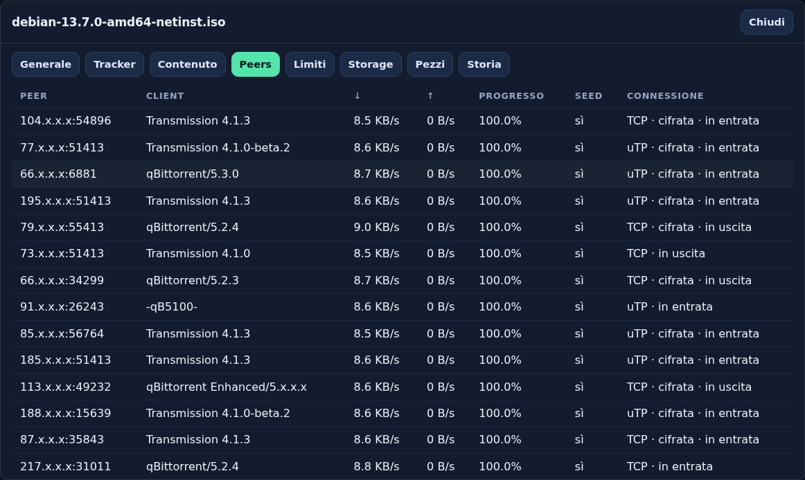

## Libreria

Le serie TV e i film che Gextto segue, con qualità, lingua e completezza. I
titoli si aggiungono da TMDB o a mano.

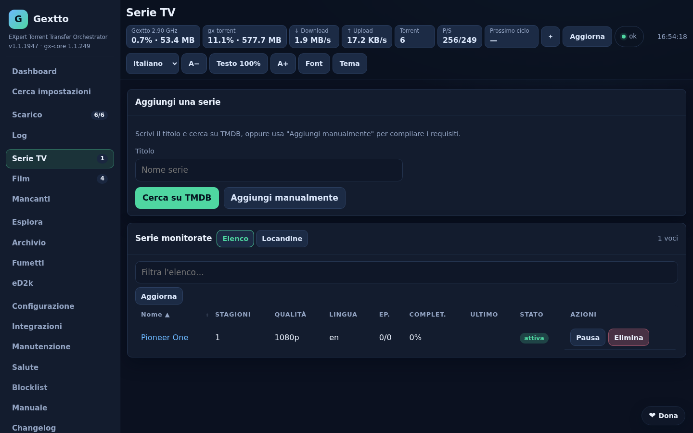

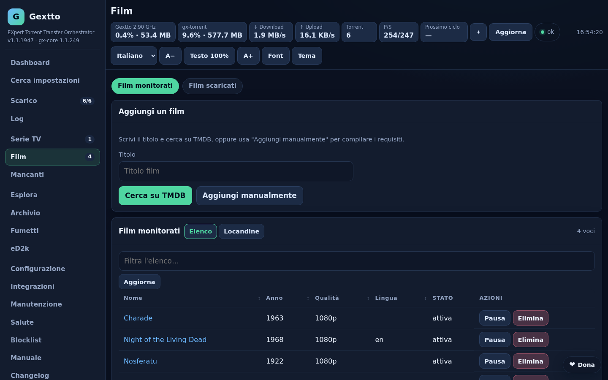

## Configurazione

Ogni opzione ha la sua descrizione, il valore predefinito e il proprio Salva; le
sezioni a sinistra seguono quello che vuoi fare, e la ricerca trova un'opzione
per nome o chiave.

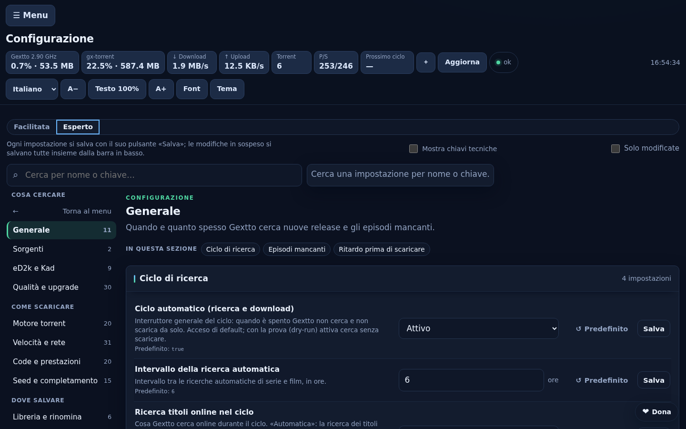

Una sola scelta per la regola della velocità; le righe che ne dipendono
compaiono solo quando servono.

## Primo avvio

La procedura del primo avvio: accesso e password, cartelle, fonti, il primo
titolo e l'attivazione.

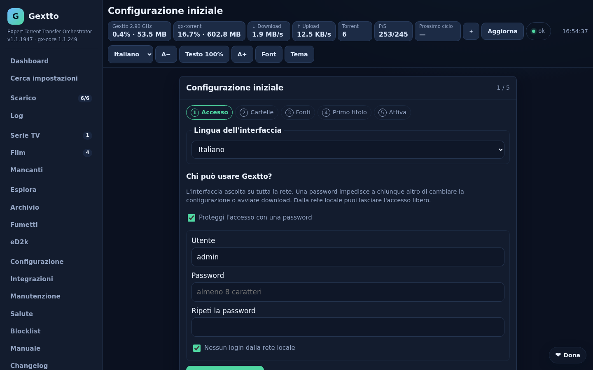

## Manutenzione, salute e log

Backup, pulizia, rinomina e aggiornamenti in un posto solo.

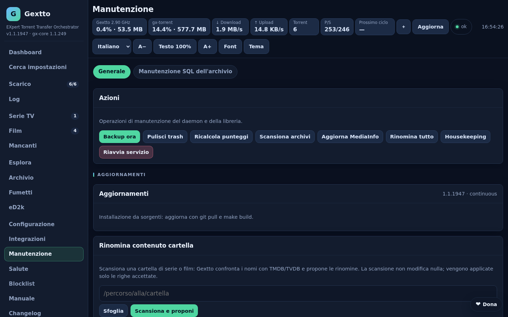

Lo stato del servizio: percorsi, dischi, il motore torrent, la rete e le fonti
che stanno fallendo.

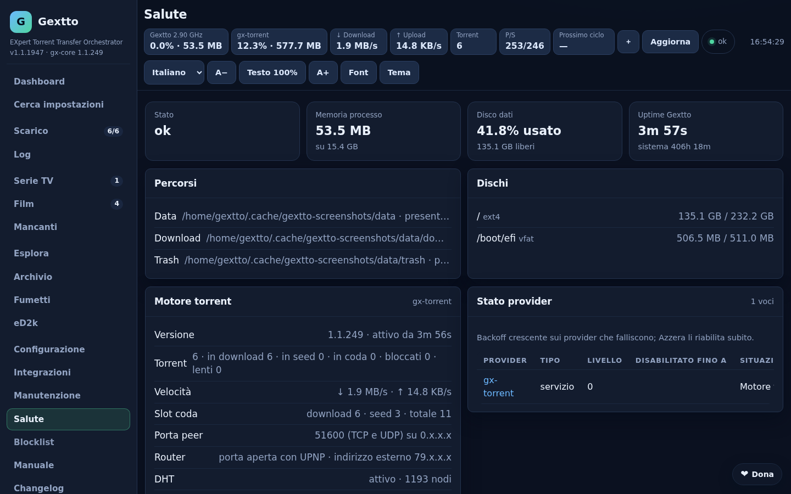

Il log del demone, con filtro, livello e aggiornamento automatico.

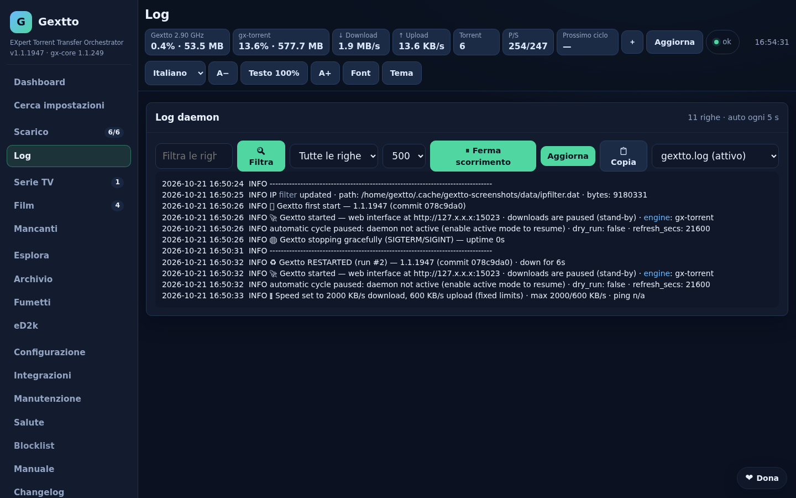

## Integrazioni

Simkl, Jellyfin, Plex e gli altri servizi con cui Gextto parla.

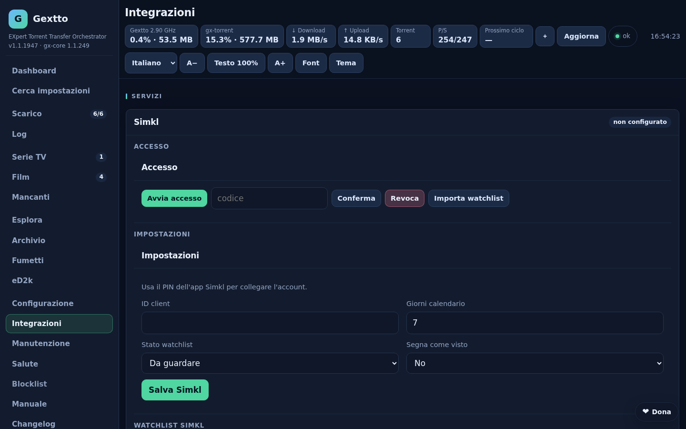

## Sul telefono

Le stesse pagine diventano schede, con le sezioni principali nella barra in
basso e le azioni a portata di pollice. L'interfaccia web si installa anche come
app (PWA).

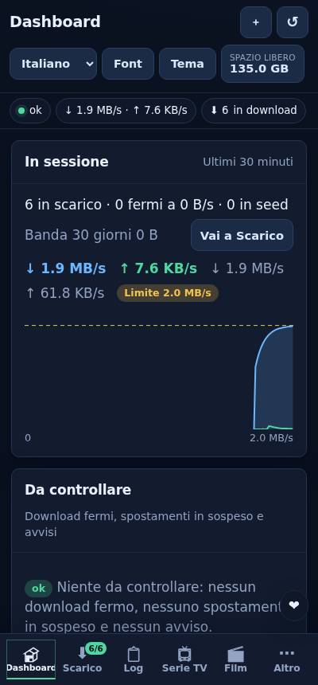

## gx-torrent

La pagina del motore, lo stesso demone che gira anche da solo come client
autonomo su Linux e Windows: filtri per stato e tracker, colonne ordinabili e il
grafico del traffico. L'immagine è in inglese.

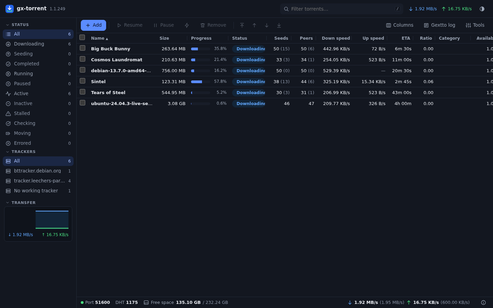

## Altre lingue

L'interfaccia parla italiano, inglese, tedesco, francese, spagnolo e polacco.

| | |
|---|---|
| 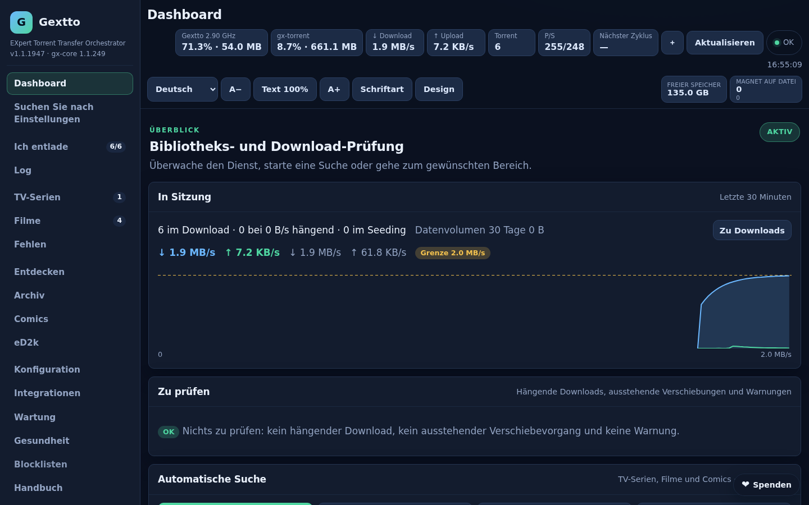 | 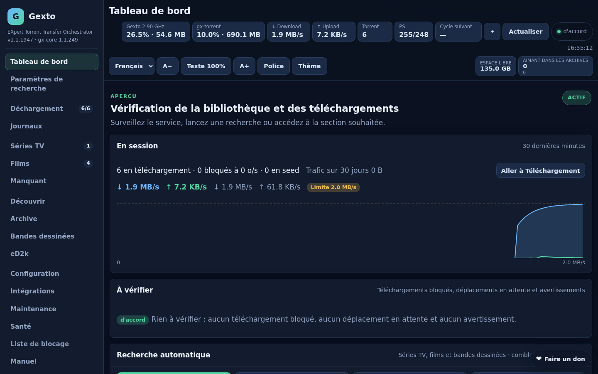 |
| **Deutsch** | **Français** |
| 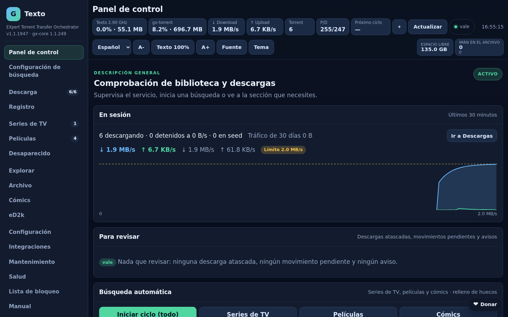 | 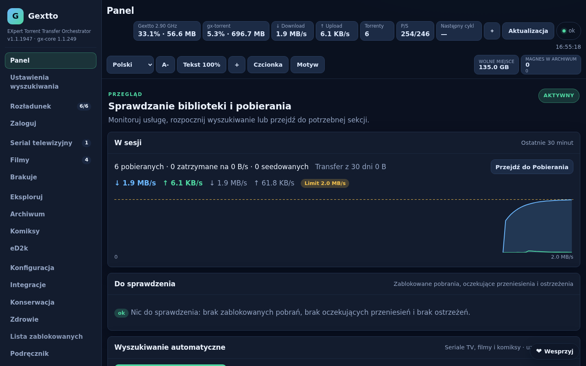 |
| **Español** | **Polski** |
