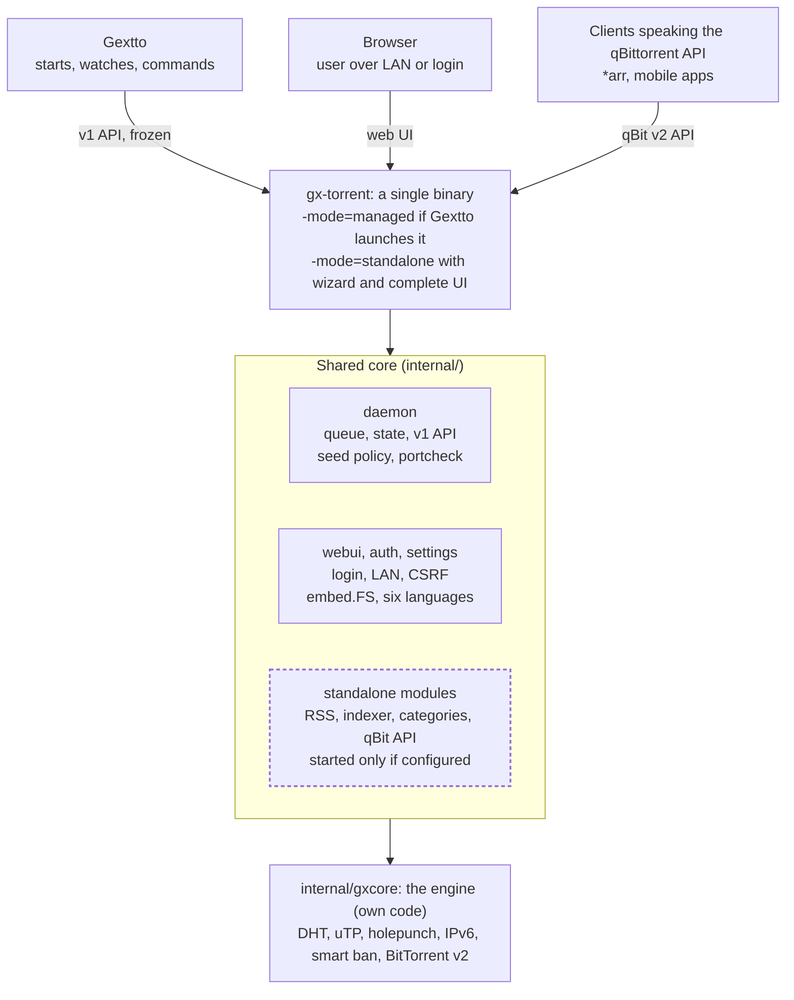

# gx-core: the standalone torrent client (the `gx-torrent` binary)

gx-core is Gextto's torrent engine **and** a torrent client that runs on its own. It is
**one binary**, `gx-torrent`, with two modes: it is the engine when Gextto launches it,
and a complete standalone client (web page, search, RSS, categories, settings) when it
is launched on its own. The engine itself is our own code in-tree, the internals of the
daemon are in [`gx-torrent.md`](gx-torrent.md), the inventory of the engine's areas in
[`../internal/gxcore/GEXTTO.md`](https://github.com/buzzqw/gextto/blob/main/internal/gxcore/GEXTTO.md) and the numbers in
[`measurements.md`](measurements.md).

## Index

1. [What gx-core is](#1-what-gx-core-is)
2. [Running it standalone](#2-running-it-standalone)
3. [Security model](#3-security-model)
4. [Architecture and boundaries](#4-architecture-and-boundaries)
5. [The RSS manager and Wanted](#5-the-rss-manager-and-wanted)
6. [What is missing and what is decided](#6-what-is-missing-and-what-is-decided)
7. [References](#7-references)

---

## 1. What gx-core is

**Names.** The **product** is gx-core; the **binary** is `gx-torrent` (Gextto's managed
path does not change: adapter, `fingerprint`, systemd unit and scope); the **engine** is
`internal/gxcore`, inside the main module — no module of its own, no `replace`. The name
**gx-nox** is only the historical name of the standalone mode.

**One binary, two modes**, decided at startup and never changed while running:

- `-mode=managed`, passed by `gxtorrent_runtime.go`: Gextto is in charge (queue, slots,
  categories, RSS, search, limits) and the standalone functions are switched off;
- `-mode=standalone`: gx-torrent is in charge and brings its own wizard, login,
  persistent settings and complete page;
- without a flag: **managed if `-fingerprint` is present**, otherwise standalone.

The rule of power is single: **in managed, Gextto commands; in standalone, gx-torrent
commands**. Standalone functions are not duplicated when Gextto is there, they are
switched off. The alternative — a second project with a copy of the engine — was
rejected: two code trees would diverge, every fix would have to be ported twice, and
Gextto would end up with the worse of the two engines.

**What standalone adds**, all of it living under `/ui` or `/api/v2` so that the frozen
v1 API used by Gextto is only *added to*, never changed: persistent settings from the
page (`settings.json`), the first-run wizard, login and sessions, categories and tags
with the announced client identity (gx-core with the real version by default, or
a qBittorrent/Transmission/Rain/anacrolix preset), a path per category with a
category manager in the settings page, the virtualised torrent table (above 500 rows; the first
300 with *Show more* remain the no-JavaScript fallback), the bandwidth
scheduler with
alternative limits (**one choice per day — Off, Limit or Auto**, where Auto lifts the
cap so the auto-speed/peak observer can measure the line), the global seeding limits
(share ratio, seeding time and inactive seeding time, as qBittorrent's preferences),
the content layout of new torrents (Original, Subfolder, NoSubfolder),
**completion actions** (move the finished data to a folder, optionally one
subfolder per category, and run an operator command with the torrent details in
the environment), the RSS manager with the *Series & movies* page (the *Wanted*
route), the **real episode list** from TVmaze (opt-in: it tells the page which
episodes exist and when they aired, not only what the feeds happened to show),
**quality profiles** with allowed resolutions and a cutoff, the **upgrade**
of an episode already taken when a better release appears (the previous torrent
is dropped from the session but its files are kept), the Torznab indexer search
with a parallel fan-out and sortable rich results, the installable page (web app
manifest and service worker for the shared assets),
and the **qBittorrent-compatible Web API** (`/api/v2/auth`, `/api/v2/torrents/*`,
`/api/v2/app/*`) that clients speaking that protocol can use.

**Zero cost when standalone is not used.** In a Go binary, unused code weighs only on
disk: Linux loads a page of the executable when it is executed, so RSS, indexer and
wizard compiled but never called do not enter memory. What would cost is anything that
starts by itself, so every standalone module follows five rules: no work in `init()` or
in package variables (templates, catalogues, regexes and HTTP clients are built at first
use with `sync.Once`), no goroutine or ticker when the module is switched off (the RSS
poller, the indexer check and the scheduler start only if `settings.json` has something
configured, and never in managed), no database or file opened in advance, routes always
registered but answering 404 or the wizard when the module is off, and assets in
`embed.FS` read only when a browser asks for them.

Two tests guard that promise: `footprint_test.go` always runs (goroutines and startup
time bounded, no growth when idle) and the opt-in harness (`GX_FOOTPRINT=1`,
`footprint_optin_test.go`) starts the built binary and compares idle RSS, threads,
startup time and CPU over 60 s against the baseline
`cmd/gx-torrent/testdata/footprint.json` (25% tolerance, `GX_UPDATE_FOOTPRINT=1` to
update it), slow and hardware-dependent by design, so it stays out of the normal suite.

## 2. Running it standalone

**Settings.** In standalone the settings live in `settings.json` in the data folder and
are changed from the page `/ui/settings`, which is **authoritative**: a value written
there wins over the startup flag. In managed the file is not read and the flags passed by
Gextto remain sovereign, which is what keeps the `fingerprint` stable (Gextto does not
restart the daemon on every save). The wizard (`setup.go`) covers language, folders,
access, ports with a port test, and the optional indexers; the download folder can also
be chosen with the `/ui/browse-dir` selector.

**Page and UI.** HTML, CSS and JS live in `internal/webui/assets` with `embed.FS`, live
updates over SSE (`/ui/live`) as Gextto's UI does; no framework with a Node build, so the
binary stays compilable with a plain `go build`. From `/ui/settings` one sets folders,
network and ports, protocols, queue and cache, bandwidth, the scheduler and the automatic
speed, language and notifications. The page is split into seven tabs (folders and files,
network, bandwidth, queue, library, interface, system): each panel shows only its groups,
the search box at the top filters across all of them and one Save applies the whole form.

**Packaging.** A dedicated archive `gx-torrent-linux-<arch>.tar.gz` (binary, `run.sh`,
`gx-torrent.service`, `install-service.sh`/`uninstall-service.sh`, `README`, `VERSION`,
`LICENSE`, `THIRD-PARTY-NOTICES`, checksum) is produced by
`scripts/package-gx-torrent.sh` and published in the release beside Gextto's archives;
for Windows, `scripts/package-gx-torrent-windows.sh` produces
`gx-torrent-windows-<arch>.zip` (amd64/arm64, `gx-torrent.exe` as a native service plus
`install-service.ps1`/`uninstall-service.ps1`), and the CI cross-compiles both the engine
and the daemon on every build so the support cannot regress. The standalone package is
**the same binary** Gextto uses as engine: the CI does not build a second product, it
publishes this one separately.

**API compatibility.** In standalone the daemon serves the qBittorrent-compatible
API: authentication, `app`, `transfer`, and for torrents `info`, `add`, `delete`,
`pause`, `resume`, `recheck`, `properties`, `files`, `trackers`, `reannounce`,
`setLocation` plus categories, tags, web seeds, the qBittorrent 5 calls
(`torrents/count`, `transfer/setSpeedLimitsMode`, the web seed editing), and the
RSS, search, sync and torrent-creator surfaces. The add call accepts both the
4.x `paused` flag and the 5.x `stopped` one, and `torrents/setShareLimits`
accepts the extra `shareLimitsMode` and `shareLimitAction` fields of 5.2/5.3
without rejecting older clients. A duplicate-only add returns `409 Conflict`,
and operational mutation errors are reported instead of a false `200`. It is
verified against Gextto's own qBittorrent client (`internal/qbittorrent`), which
acts as an automatic test bench, and it is what lets existing clients of that
protocol use gx-core without patches. In
managed the whole `/api/v2` is not mounted: Gextto is the single master. The
layer advertises the **4.6 / API 2.9.3** level (configurable `app/version`), accepts
the **qBittorrent 5 API key** (`X-Api-Key` or `Authorization: Bearer`) from
*Settings → Network*, and fills the fields the WebUI clients read (`download_path`,
`last_activity`, per-torrent ratio and seeding limits, `super_seeding`,
`trackers_count`, `magnet_uri`, `is_private`, `total_uploaded`/`total_downloaded`,
a richer `sync` `server_state`); the 5.x additions are `app/processInfo` and
`torrents/setComment`. It is a **compatibility layer, not a 100% clone**: the
remaining gaps are listed in §6. On the
token-protected v1 side the daemon also serves `GET /api/v1/metrics` (Prometheus) and
`GET /api/v1/events` (Server-Sent Events), in both modes, beside the frozen resources
Gextto uses.

## 3. Security model

In managed the daemon has one mechanism: the **shared token** (`X-Gx-Token`) Gextto
passes it. Standalone adds real authentication, and the two never mix: the v1 API stays
token-based, the standalone surface uses the login.

**Login.** Username and password (bcrypt), sessions with `Secure` and `HttpOnly` cookies,
expiry and revocation; a new password closes the sessions.

**LAN without password: default yes, with three protections.** Without them any page
opened from a PC on the LAN could add or delete torrents, so:

- **CSRF**: POSTs without an `Origin`/`Referer` equal to the host of the UI are refused
  (or a form token is required), and `Sec-Fetch-Site: cross-site` is refused on
  its own: it is set by the browser and the page cannot suppress it, while
  `Referer` disappears with `Referrer-Policy: no-referrer`;
- **DNS rebinding**: only requests whose `Host` is a local IP or a configured name are
  accepted;
- **what counts as LAN** is read **from the socket** (RFC 1918, link-local, loopback,
  IPv6 ULA); `X-Forwarded-For` counts **only from declared proxies**, otherwise a reverse
  proxy would make the whole Internet look like LAN.

In managed none of this activates: the wizard and the login stay off, Gextto is in
charge.

**A peer does not choose our network.** The addresses a peer names are not
trusted: a PEX entry or a BEP 55 `connect` that points at loopback, a link-local
or an unspecified address is dropped, because dialling it on request would turn
the client into a scanner of its own host and router; a private LAN address is
kept (BEP 40 ranks it and two peers on the same network legitimately exchange
it), and the operator's manual peers are never filtered. The operator's IP
filter reaches the DHT too, not only the peers: a blocked host never becomes a
routing-table node and its packets are dropped unread. Both rules follow
libtorrent 2.1.1 (*"validate peer-supplied endpoints against local addresses"*,
*"apply IP filter to DHT node"*).

**A peer's fault costs one connection.** The bytes a peer, a tracker or a web seed sends
are a stranger's, and a bug in a parser or in a handler must not take the daemon down
with every torrent it is running: the read and write loops of a connection, the
handshake, the tracker announcers, the listener and the torrent's message handlers run
behind the `safego` guard (`internal/gxcore/internal/safego`), which logs the fault, runs
the cleanup (the socket is closed, the peer dropped) and lets the session go on. The one
thing the guard never swallows is a deliberate **health-check panic** (`safego.Invariant`):
when the session finds state it can no longer trust, the dump and the exit are the point.
Other engines published several remote-crash advisories in 2026 for exactly this shape —
a peer message that reached a panicking assumption on a goroutine with no recover — and
the tests here pin both halves: a fault is contained, an invariant still stops the
process (`internal/gxcore/internal/safego/safego_test.go`,
`peerreader.Run`'s panic test, `btconn`'s handshake test).

## 4. Architecture and boundaries

The engine and the queue logic are internal packages; above them a single `main` chooses
the mode at startup. The dashed box is the code that in managed is never started.

**Boundaries.** The **v1 API is frozen**: it is added to, not changed, and contract tests
(`cmd/gx-torrent/contract_test.go`) run at every build to prove that Gextto's path is
untouched — that test is the gate that makes everything else harmless. The **mode** is
decided at startup and never changed. The **shared modules** — `internal/queue`,
`internal/webui`, `internal/rss`, `internal/torznab` — are shared by the two uses: they
cannot live in Gextto's root package, which the daemon cannot import without dragging
all of Gextto along. The
**engine** is our own code and stays so: what it still needs is written here, not
copied.

## 5. The RSS manager and the single acquisition page

**One place decides what to download.** In standalone the page `/ui/wanted`
(*Series & movies*) is that place: a title is added there, with its type, seasons,
language, quality profile, category and save path, and the daemon searches feeds and
indexers for what is missing. The series name is suggested from indexer results and from
what the feeds and the archive contain (episodes, season packs, complete packs), with
the archived episodes of that name underneath, each with resolution and language;
choosing one fills the name and the language from a release that exists. When nothing
looks like a series the clean name of the matching releases is proposed, cut at year,
resolution and source/codec tags, never a raw release title. A season pack counts as
its whole season. Even with no feed configured the page drives the indexers, records in
`state.json` what appeared and what was taken, and runs a throttled **gap search** for
missing episodes; **Search all now** forces a check.

The states are deliberately plain: **Downloaded**, **Downloading**, **Missing** (a
release was seen by a feed or an indexer but was not taken) and **Up to date** (nothing
missing among what has been seen, which is not a claim about the whole series unless the
real episode list is enabled). A **Paused** title is not searched. The row counts
episodes, shows a chip per season and offers the per-episode grid inline; an episode in
the session links to its torrent. The legend says what "Missing" means, so the page does
not guess a season is complete.

**Feeds and indexers feed that decision.** `/ui/rss` keeps the feed manager (RSS,
Atom, Torznab, HTML listings and BEP 46 DHT feeds), the Torznab indexers with a
connection test, and the options (check interval, archive retention, FlareSolverr,
setup import/export). Feeds fill the archive and answer searches; they do not decide on
their own. The indexer types have preset URLs and the feed form is essential by design:
a name and a URL, with an optional folder and bulk paste.

**Rules are the advanced remainder.** Ordered **PASS/FAIL rules** (first match wins)
still exist for the cases a title does not cover: take everything a feed publishes, or
reject a term. They keep regex, include/exclude filters, size, seeds/peers, age,
`require_episode`, **smart-episode** (REPACK/PROPER aware), actions (folder, category,
tag, pause, sequential, first/last, top), the persisted history and the live preview.
They are now edited in the *Advanced: feed rules* section at the bottom of
`/ui/wanted`, not in a tab of `/ui/rss`, and a rule is off until the operator enables
it. Titles are decided first: a release a title claims is never also taken by a rule.
The rule editor no longer offers series or movie presets, and a release in a feed offers
*Add to Series & movies*, which opens the title dialog with the name already filled:
there is one way to say that a title is wanted.
At the one-time move, enabled rules were switched off and the page reported the count;
the rules themselves were kept so they can be inspected, deleted or deliberately
re-enabled. The qBittorrent-compatible RSS API still exposes rules for existing clients.

A feed with no rule and no filter of its own only grows the archive: that is the
intended default, not a missing setting. Links on a feed that name a covering rule open
that rule in the advanced section of the titles page.

## 6. What is missing and what is decided

**Completion actions.** The standalone closes the acquisition loop without
Gextto: when a download completes it can **move the data to a completion
folder** (optionally one subfolder per category) and **run an operator
command** with `GX_HASH`, `GX_NAME`, `GX_PATH`, `GX_CATEGORY` and `GX_SIZE` in
the environment. The move happens first and the torrent keeps seeding from the
new folder; the command is not built from the torrent name, so a hostile title
cannot inject arguments. Both actions are off by default. Renaming into a media
library with metadata (the way Gextto does) remains Gextto's job: the standalone
offers the generic hook, not a second library manager.

**Episode knowledge and upgrades.** The real episode list is opt-in
(*Settings → Series and movies*): when on, the series title is sent to the
public TVmaze API, its already-aired episodes are added to the ledger and an
episode that never appeared in a feed still counts as missing. Quality profiles
name the accepted resolutions and a cutoff; with a cutoff, a better release of
an episode already taken is downloaded until the cutoff is reached. The upgrade
is non-destructive: the old torrent leaves the session, its files stay on disk.

**Open.**

- **qBittorrent API completeness**: the layer speaks the 4.6 level (Web API
  2.9.3), the qBittorrent 5 API key, `app/processInfo` and `torrents/setComment`,
  and fills the fields the clients read. Seeding time and inactive seeding time
  round-trip in exact minutes, both when the torrent is added and when
  `torrents/setShareLimits` is called; the frozen `/api/v1` still reports
  `seed_days` in days, so Gextto and the adapter are unaffected. In the RSS
  corner the feed `uid` follows the feed through a rename, a move and an address
  change, `lastMatch` and `previouslyMatchedEpisodes` carry the daemon's own
  record, and a rule action round-trips through `torrentParams` with its tags.
  A 100% clone would still need the full preferences round-trip, the remaining
  5.x fields, the exact status codes, the per-feed refresh interval and the
  search plugins.

**Download-client compatibility matrix.** All four request managers are tested
against the standalone daemon with Gextto's own qBittorrent client, which replays
the sequence each of them uses. The matrix is versioned by the API level, not by
an unverified application build.

| Client | API used | Sequence covered | Notes |
| --- | --- | --- | --- |
| Sonarr | qBittorrent API v2, 4.6 / Web API 2.9.3 | version probe, category, magnet add with category and save path, `torrents/info`, sync, share limits, delete | The original end-to-end sequence, still pinned. |
| Radarr | qBittorrent API v2, 4.6 / Web API 2.9.3 | same sequence with a movie category | `content_path` and category paths are read from `torrents/info`. |
| Lidarr | qBittorrent API v2, 4.6 / Web API 2.9.3 | same sequence with a music category | Uses the same version probe and add flow. |
| Readarr | qBittorrent API v2, 4.6 / Web API 2.9.3 | same sequence with a book category | **API v2 only.** Readarr builds that speak only the legacy qBittorrent API v1 are not supported: `/api/v1` is gx-torrent's native, frozen API and cannot be reused without putting two masters on the same queue. |

The same tests assert that `seeding_time_limit` and
`inactive_seeding_time_limit` return the exact minutes sent by the client, and
that `-2` (global) and `-1` (infinite or disabled) round-trip as sentinels.
- **Rate-based choking and anti-leech**: to be validated with the deterministic harness
  and the real-swarm campaign before touching the algorithm
  ([`measurements.md`](measurements.md#real-swarms-and-the-home-line)).
- **Container image**: the `Dockerfile` is built and smoke-tested in CI (job
  `container image`); publishing it to a registry is not done.
- **Distribution targets**: Linux (amd64/arm64) and Windows are covered; macOS is not
  decided.
- **Password hash**: bcrypt, the same as Gextto; argon2id is stronger but is not used
  anywhere.
- **Where the shared modules live**: inside this repository or in a module of its
  own.
- **i18n**: the six languages of the page are assumed to be enough for the standalone
  product; extending the catalogue is not decided.
- **WebTorrent/WebRTC** and **share mode**: out of scope by decision, so they are not
  kept in the [open items](todo.md).

**Risks and countermeasures.** A regression on Gextto's path is prevented by the v1
contract tests, by a `fingerprint` independent of `settings.json` and by switching the
standalone functions off in managed; two masters of the same queue are prevented by the
mode decided at startup; the LAN without password is protected as in §3; the UI is kept
out of Go strings by `embed.FS` and Playwright tests; a costly porting from another
engine is done one algorithm at a time, with before/after measurement; and future
third-party work is rewritten rather than copied.

## 7. References

- [`GXCORE-MANUAL.it.md`](GXCORE-MANUAL.it.md) / [`GXCORE-MANUAL.en.md`](GXCORE-MANUAL.en.md) — user manual with real screenshots, from the Docker start to Series & movies, profiles and integrations.
- [`docs/gx-torrent.md`](gx-torrent.md) — technical reference of the daemon and the engine.
- [`docs/todo.md`](todo.md) — the open items in priority order and the gate that unblocks each.
- [`docs/measurements.md`](measurements.md) — the harnesses, the numbers and how they are
  taken.
- [`docs/bep.md`](bep.md) — BEP status and the BitTorrent v2 rules.
- [`internal/gxcore/GEXTTO.md`](https://github.com/buzzqw/gextto/blob/main/internal/gxcore/GEXTTO.md) — inventory of the engine's
  features.
- [`docs/ARCHITECTURE.md`](ARCHITECTURE.md) — map of Gextto's code.
