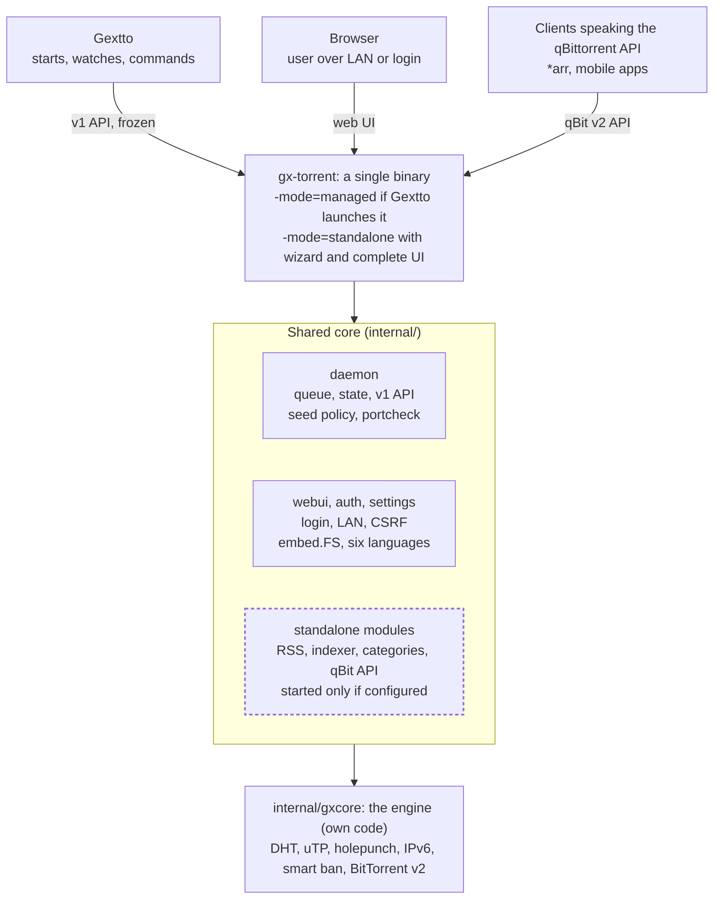

# gx-core: the standalone torrent client (the `gx-torrent` binary)

gx-core is Gextto's torrent engine **and** a torrent client that runs on its own. It is
**one binary**, `gx-torrent`, with two modes: it is the engine when Gextto launches it,
and a complete standalone client (web page, search, RSS, categories, settings) when it
is launched on its own. The engine itself is our own code in-tree
([`evoluzione.md`](evoluzione.md) §7), the internals of the daemon are in
[`gx-torrent.md`](gx-torrent.md), the inventory of the engine's areas in
[`../internal/gxcore/GEXTTO.md`](../internal/gxcore/GEXTTO.md) and the numbers in
[`measurements.md`](measurements.md).

## Index

1. [What gx-core is](#1-what-gx-core-is)
2. [Running it standalone](#2-running-it-standalone)
3. [Security model](#3-security-model)
4. [Architecture and boundaries](#4-architecture-and-boundaries)
5. [The RSS manager and Wanted](#5-the-rss-manager-and-wanted)
6. [What is missing and what is decided](#6-what-is-missing-and-what-is-decided)
7. [References](#7-references)

---

## 1. What gx-core is

**Names.** The **product** is gx-core; the **binary** is `gx-torrent` (Gextto's managed
path does not change: adapter, `fingerprint`, systemd unit and scope); the **engine** is
`internal/gxcore`, inside the main module — no module of its own, no `replace`. The name
**gx-nox** is only the historical name of the standalone mode.

**One binary, two modes**, decided at startup and never changed while running:

- `-mode=managed`, passed by `gxtorrent_runtime.go`: Gextto is in charge (queue, slots,
  categories, RSS, search, limits) and the standalone functions are switched off;
- `-mode=standalone`: gx-torrent is in charge and brings its own wizard, login,
  persistent settings and complete page;
- without a flag: **managed if `-fingerprint` is present**, otherwise standalone.

The rule of power is single: **in managed, Gextto commands; in standalone, gx-torrent
commands**. Standalone functions are not duplicated when Gextto is there, they are
switched off. The alternative — a second project with a copy of the engine — was
rejected: two code trees would diverge, every fix would have to be ported twice, and
Gextto would end up with the worse of the two engines.

**What standalone adds**, all of it living under `/ui` or `/api/v2` so that the frozen
v1 API used by Gextto is only *added to*, never changed: persistent settings from the
page (`settings.json`), the first-run wizard, login and sessions, categories and tags
with a path per category, the table window (300 rows with *Show more*), the bandwidth
scheduler with
alternative limits (**one choice per day — Off, Limit or Auto**, where Auto lifts the
cap so the auto-speed/peak observer can measure the line), the RSS manager with the *Wanted* page, the Torznab indexer search,
and the **qBittorrent-compatible Web API** (`/api/v2/auth`, `/api/v2/torrents/*`,
`/api/v2/app/*`) that clients speaking that protocol can use.

**Zero cost when standalone is not used.** In a Go binary, unused code weighs only on
disk: Linux loads a page of the executable when it is executed, so RSS, indexer and
wizard compiled but never called do not enter memory. What would cost is anything that
starts by itself, so every standalone module follows five rules: no work in `init()` or
in package variables (templates, catalogues, regexes and HTTP clients are built at first
use with `sync.Once`), no goroutine or ticker when the module is switched off (the RSS
poller, the indexer check and the scheduler start only if `settings.json` has something
configured, and never in managed), no database or file opened in advance, routes always
registered but answering 404 or the wizard when the module is off, and assets in
`embed.FS` read only when a browser asks for them.

Two tests guard that promise: `footprint_test.go` always runs (goroutines and startup
time bounded, no growth when idle) and the opt-in harness (`GX_FOOTPRINT=1`,
`footprint_optin_test.go`) starts the built binary and compares idle RSS, threads,
startup time and CPU over 60 s against the baseline
`cmd/gx-torrent/testdata/footprint.json` (25% tolerance, `GX_UPDATE_FOOTPRINT=1` to
update it), slow and hardware-dependent by design, so it stays out of the normal suite.

## 2. Running it standalone

**Settings.** In standalone the settings live in `settings.json` in the data folder and
are changed from the page `/ui/settings`, which is **authoritative**: a value written
there wins over the startup flag. In managed the file is not read and the flags passed by
Gextto remain sovereign, which is what keeps the `fingerprint` stable (Gextto does not
restart the daemon on every save). The wizard (`setup.go`) covers language, folders,
access, ports with a port test, and the optional indexers; the download folder can also
be chosen with the `/ui/browse-dir` selector.

**Page and UI.** HTML, CSS and JS live in `internal/webui/assets` with `embed.FS`, live
updates over SSE (`/ui/live`) as Gextto's UI does; no framework with a Node build, so the
binary stays compilable with a plain `go build`. From `/ui/settings` one sets folders,
network and ports, protocols, queue and cache, bandwidth and the scheduler, language and
notifications.

**Packaging.** A dedicated archive `gx-torrent-linux-<arch>.tar.gz` (binary, `run.sh`,
`gx-torrent.service`, `install-service.sh`/`uninstall-service.sh`, `README`, `VERSION`,
`LICENSE`, `THIRD-PARTY-NOTICES`, checksum) is produced by
`scripts/package-gx-torrent.sh` and published in the release beside Gextto's archives;
for Windows, `scripts/package-gx-torrent-windows.sh` produces
`gx-torrent-windows-<arch>.zip` (amd64/arm64, `gx-torrent.exe` as a native service plus
`install-service.ps1`/`uninstall-service.ps1`), and the CI cross-compiles both the engine
and the daemon on every build so the support cannot regress. The standalone package is
**the same binary** Gextto uses as engine: the CI does not build a second product, it
publishes this one separately.

**API compatibility.** In standalone the daemon serves the qBittorrent-compatible
API: authentication, `app`, `transfer`, and for torrents `info`, `add`, `delete`,
`pause`, `resume`, `recheck`, `properties`, `files`, `trackers`, `reannounce`,
`setLocation` plus categories, tags, web seeds, the qBittorrent 5 calls
(`torrents/count`, `transfer/setSpeedLimitsMode`, the web seed editing), and the
RSS, search, sync and torrent-creator surfaces. It is verified against Gextto's own
qBittorrent client (`internal/qbittorrent`), which acts as an automatic test bench, and
it is what lets existing clients of that protocol use gx-core without patches. In
managed the whole `/api/v2` is not mounted: Gextto is the single master. On the
token-protected v1 side the daemon also serves `GET /api/v1/metrics` (Prometheus) and
`GET /api/v1/events` (Server-Sent Events), in both modes, beside the frozen resources
Gextto uses.

## 3. Security model

In managed the daemon has one mechanism: the **shared token** (`X-Gx-Token`) Gextto
passes it. Standalone adds real authentication, and the two never mix: the v1 API stays
token-based, the standalone surface uses the login.

**Login.** Username and password (bcrypt), sessions with `Secure` and `HttpOnly` cookies,
expiry and revocation; a new password closes the sessions.

**LAN without password: default yes, with three protections.** Without them any page
opened from a PC on the LAN could add or delete torrents, so:

- **CSRF**: POSTs without an `Origin`/`Referer` equal to the host of the UI are refused
  (or a form token is required);
- **DNS rebinding**: only requests whose `Host` is a local IP or a configured name are
  accepted;
- **what counts as LAN** is read **from the socket** (RFC 1918, link-local, loopback,
  IPv6 ULA); `X-Forwarded-For` counts **only from declared proxies**, otherwise a reverse
  proxy would make the whole Internet look like LAN.

In managed none of this activates: the wizard and the login stay off, Gextto is in
charge.

## 4. Architecture and boundaries

The engine and the queue logic are internal packages; above them a single `main` chooses
the mode at startup. The dashed box is the code that in managed is never started.

**Boundaries.** The **v1 API is frozen**: it is added to, not changed, and contract tests
(`cmd/gx-torrent/contract_test.go`) run at every build to prove that Gextto's path is
untouched — that test is the gate that makes everything else harmless. The **mode** is
decided at startup and never changed. The **shared modules** — `internal/queue`,
`internal/webui`, `internal/rss`, `internal/torznab` — are shared by the two uses;
extracting RSS and search from Gextto's root package was a **code** consequence, not a
choice of will, because the root package could not be imported by the daemon without
dragging all of Gextto along. The **engine** is our own code and stays so
([`evoluzione.md`](evoluzione.md) §7): what it still needs is written here, not copied.

## 5. The RSS manager and Wanted

The RSS manager is meant to be complete in one place rather than split across a feed
reader and a separate rule engine: **ordered PASS/FAIL rules** (first match wins) with
regex, include/exclude filters, size, seeds/peers, age, `require_episode`,
**smart-episode** (never twice, REPACK/PROPER aware), actions (folder, category, tag,
pause, sequential, first/last, top), a persisted history, a worker, notifications on
match and error, and feeds also built from search results.

In place: RSS/Atom/Torznab parsing, the ordered rules, the filters above, the actions,
the persisted history, the management page `/ui/rss` with the articles matching per rule
and a manual Add, and the **Wanted** page `/ui/wanted`. Editing is guided: a dropdown of
indexer types with preset URLs, an essential feed form (name and URL), an editor of the
rules with move up/down and disable, `episode_filter` and an `ignore_days` cooldown.

**Wanted** holds the titles to search for (quality dropdown, series/movie type, optional
folder and category): the series name is suggested from the indexer results and from what
the feeds and the archive contain (episode names, season packs, "complete" packs), and
when nothing looks like a series — a movie, a special — the **clean name** of the
matching releases is proposed, cut at year, resolution and source/codec tags, never a raw
release title. A season pack (`S04`, `Season 4`, `COMPLETE`) counts as its whole
season and is downloaded when the season is wanted. The engine searches the indexers and the feeds for every title even with
no feed configured, records in `state.json` what appeared and what was taken, and runs a
throttled **gap search** for the missing episodes; **Check feeds** forces a check at
once.

Each wanted row says honestly what the operator has, never guessing a season is
complete: it counts the episodes **downloaded**, the ones **downloading** in the session
and the ones **seen but not downloaded**, with a chip per season (a season only partly
seen is not collapsed to a bare `S01`). The **Episodes** button opens the per-episode
grid inline, and an episode already in the session links to its torrent; a movie shows
its single release with the same states. This is why the row needs no "Missing" claim:
the state vocabulary is explained by a legend on the page.

## 6. What is missing and what is decided

**Still open.**

- **Post-processing on completion**: notifications are complete (webhook, Telegram,
  e-mail; events `download_complete`, `feed_match`, `feed_error`); Gextto's completion
  post-processing — rename and move into the library — is not part of the standalone.
- **Rate-based choking and anti-leech**: to be validated with the deterministic harness
  and the real-swarm campaign before touching the algorithm
  ([`measurements.md`](measurements.md) §4.6).
- **Container image**: the `Dockerfile` is built and smoke-tested in CI (job
  `container image`); publishing it to a registry is not done.
- **Distribution targets**: Linux (amd64/arm64) and Windows are covered; macOS is not
  decided.
- **Password hash**: bcrypt today, the same as Gextto; argon2id was floated as a
  stronger option but is not adopted anywhere.
- **Where the shared modules live**: inside this repository (today) or in a module of its
  own.
- **i18n**: the six languages of the page are assumed to be enough for the standalone
  product; extending the catalogue is not decided.
- **WebTorrent/WebRTC** and **share mode**: not needed for now
  ([`evoluzione.md`](evoluzione.md) §6).

**Risks and countermeasures.** A regression on Gextto's path is prevented by the v1
contract tests, by a `fingerprint` independent of `settings.json` and by switching the
standalone functions off in managed; two masters of the same queue are prevented by the
mode decided at startup; the LAN without password is protected as in §3; the UI is kept
out of Go strings by `embed.FS` and Playwright tests; a costly porting from another
engine is done one algorithm at a time, with before/after measurement; and future
third-party work is rewritten rather than copied
([`evoluzione.md`](evoluzione.md) §7).

## 7. References

- [`docs/gx-torrent.md`](gx-torrent.md) — technical reference of the daemon and the engine.
- [`docs/evoluzione.md`](evoluzione.md) — the state of the product and the engine, the
  open items with their gate.
- [`docs/measurements.md`](measurements.md) — the harnesses, the numbers and how they are
  taken.
- [`docs/bep.md`](bep.md) — BEP status and the BitTorrent v2 rules.
- [`internal/gxcore/GEXTTO.md`](../internal/gxcore/GEXTTO.md) — inventory of the engine's
  features.
- [`docs/ARCHITECTURE.md`](ARCHITECTURE.md) — map of Gextto's code.
