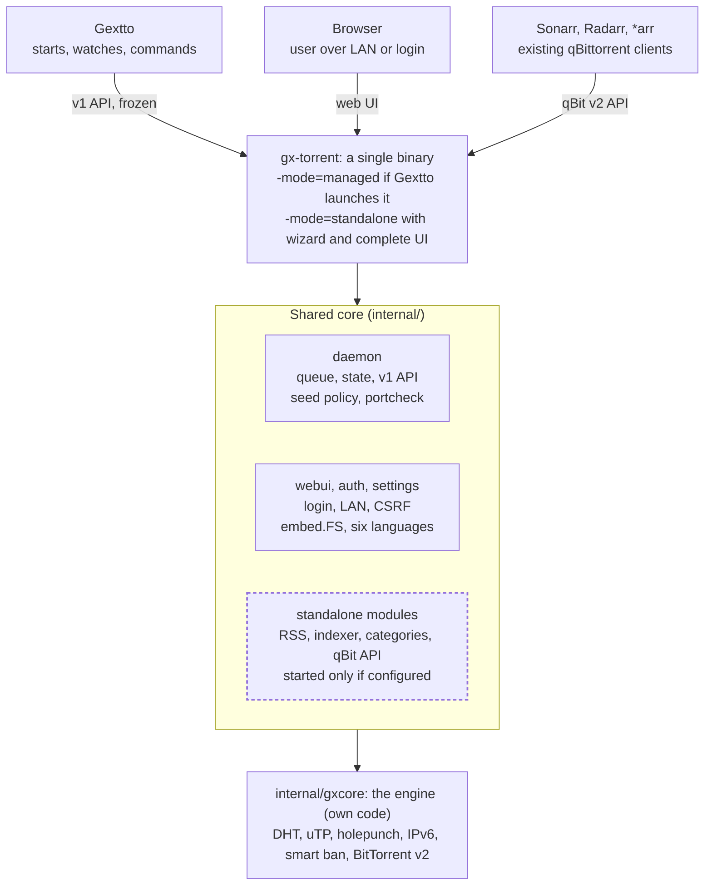

# gx-torrent evolved: from Gextto engine to standalone torrent client

Complete analysis of the question: **is it better to evolve `gx-torrent` into a
standalone client or to create a new `gx-nox` project?** Date: **2026-10-10**.

This document is the **decision and the plan**. The current state of the engine is in
[`docs/gx-torrent.md`](gx-torrent.md); the engine backlog and the measurements in
[`docs/evoluzione.md`](evoluzione.md) (§4–§7); the inventory of the engine's
features in [`internal/gxcore/GEXTTO.md`](../internal/gxcore/GEXTTO.md).

> [!NOTE]
> Extracted from the strategic plan in [`evoluzione.md`](evoluzione.md), which
> now points here. The technical document `gx-torrent.md` describes **what
> exists**; this one describes **where we want to go**, and it stays separate so
> as not to mix the two plans.
>
> **Name:** the product name is **gx-core** (decided 2026-10-10). The binary
> stays `gx-torrent` and "gx-nox" is only the historical name of the standalone
> mode; the engine is `internal/gxcore`.

## Index

1. [Summary](#1-summary)
2. [Question, requirements and criteria](#2-question-requirements-and-criteria)
3. [Current state](#3-current-state)
4. [Gap analysis](#4-gap-analysis)
5. [The three paths](#5-the-three-paths)
6. [Decision (ADR)](#6-decision-adr)
7. [Target architecture](#7-target-architecture)
8. [Zero cost when standalone is not used](#8-zero-cost-when-standalone-is-not-used)
9. [Security model](#9-security-model)
10. ["Better than qBittorrent" requirement](#10-better-than-qbittorrent-requirement)
11. [Cherry-picking from the engine and licences](#11-cherry-picking-from-the-engine-and-licences)
12. [Roadmap and gates](#12-roadmap-and-gates)
13. [Requirements → solution](#13-requirements--solution)
14. [Risks and mitigations](#14-risks-and-mitigations)
15. [Open questions](#15-open-questions)
16. [References](#16-references)

---

## 1. Summary

**Answer: it is worth evolving `gx-torrent`, not creating a new `gx-nox`.** A
single binary with two modes: `-mode=managed` when Gextto launches it (Gextto is
in charge) and `-mode=standalone` when it is a product of its own (gx-torrent is
in charge). "gx-nox" can remain the **public name** of the standalone mode, but it is not a
second project.

The decisive reason is not the initial effort, it is **requirement 5** (in
prospect: cherry-picking by value from libtorrent/anacrolix). That path
turns the engine into your own code: with two projects there would be **two
divergences of the same engine**, and every porting would have to be done twice.
Sooner or later `gx-torrent` would fall behind and Gextto would end up with the
worse of the two engines.

**Requirement 1** (perfect compatibility with Gextto) is the reason why the
new path is risky: it is guaranteed with **a single engine + contract tests
on the v1 API**, not with two code trees to be resynchronised by hand.

The starting point is further ahead than it seems: gx-torrent already has a REST API,
a web page in six languages, a queue, per-torrent limits, streaming, super-seeding,
holepunching, UPnP/NAT-PMP and port testing. To become an alternative to
qbittorrent-nox it mainly lacks **the things Gextto currently does in its place**
(authentication, settings from the UI, categories/tags, RSS, indexer search, wizard)
plus two engine gaps that a standalone cannot afford:
**IPv6** and **BitTorrent v2**.

Three conditions for the choice to hold (details in §6–§8):

- **A single rule of power**: in managed, Gextto is in charge (queue, categories, RSS
  remain its own); in standalone, gx-torrent is in charge. The standalone functions
  **switch off**, they do not get duplicated, when Gextto is present.
- **Refactor first, then features**: `cmd/gx-torrent` remains a single
  `package main` of 12,573 lines (20,742 with tests), but the reusable packages
  have already been extracted into `internal/` (`queue`, `webui`, `rss`, `torznab`).
- **The contract with Gextto becomes a test**: the responses of the v1 API used by
  `gxtorrent_engine.go` must be fixed in contract tests that run at every
  build. It is the gate that makes everything else harmless.

---

## 2. Question, requirements and criteria

### 2.1 The question

> Evolve `gx-torrent` into **also** a standalone torrent client: while keeping
> perfect compatibility with Gextto, when launched on its own it becomes the
> equivalent of `qbittorrent-nox`.

### 2.2 The requirements

The requirements have **different weights**: the first is a **constraint**, the
others are **goals**. Every choice that improves the standalone but touches the
Gextto path must be rejected or put behind a flag.

| # | Requirement | Type | Design implication |
| --- | --- | --- | --- |
| 1 | Works perfectly with Gextto | **constraint** | v1 API frozen; in managed no standalone function is active; `fingerprint` stable |
| 2 | Effective, powerful, frugal client, better than qbittorrent-nox | goal | measurements against qbittorrent-nox; no features that consume when unused |
| 3 | Excellent web interface, as easy and complete as qBittorrent | goal | UI as an application (assets, settings, categories/tags, RSS, search), not an operational page |
| 4 | First-run wizard | goal | language, folders, password, LAN without password (default yes), ports + port test, Jackett/Prowlarr/MIRCrew indexers |
| 5 | In prospect, cherry-pick by value from anacrolix/libtorrent | direction | engine treated as own code; a single engine shared by the two uses |

### 2.3 Evaluation criteria

To choose between the paths (§5) I use seven criteria, evaluated at equal
requirements:

1. **Compatibility with Gextto** (requirement 1): how well it is guaranteed by construction.
2. **Engine maintenance**: how many code trees must be kept.
3. **Propagation of fixes and improvements**: does a change reach both uses or
   must it be ported by hand?
4. **Weight of the managed binary**: what Gextto carries with it even if it does not use it.
5. **Attack surface in managed**: how much extra code is reachable.
6. **Design freedom** of the standalone API and UI.
7. **Time to the first usable standalone**.

---

## 3. Current state

gx-torrent is a pure-Go daemon (`CGO_ENABLED=0` build) with the **gx-core** engine
(`internal/gxcore`), with the **inventory of areas** in `GEXTTO.md`. Gextto starts it, watches it and
**reattaches it across restarts** via `fingerprint`. The daemon is already usable on its own
(`gx-torrent -listen … -data …`), even as a standalone client.

| Layer | Where | What already exists |
| --- | --- | --- |
| Engine | `internal/gxcore`, `internal/dht`, `anacrolix/utp` | single port, uTP, DHT, PEX, LSD, MSE, holepunch BEP 55, super-seeding BEP 16, hot web seeds and trackers, per-torrent limits, graduated file priority, windowed streaming, multi-format IP filter, proxy, VPN killswitch, preallocation, batched durability, opt-in mmap, hot-adjustable cache |
| Daemon | `cmd/gx-torrent` | dynamic queue with slots, seed ratio/days per torrent, tracker health, UPnP/NAT-PMP, `portcheck`, state in `state.json` |
| API | `cmd/gx-torrent/api.go` | REST v1 with `X-Gx-Token` header: health, stats, portcheck, torrents, add, actions, config, ipfilter |
| UI | `cmd/gx-torrent/ui.go` | table, filters by state, tabbed detail (general, files, peers, trackers, pieces), group actions, six languages; assets in `internal/webui/assets` (`embed.FS`) |
| Adapter | `gxtorrent_engine.go`, `gxtorrent_runtime.go` | `TorrentEngine` contract, `capabilityLevels` matrix, launch in a systemd scope |

The inventory of the engine's areas and their files is in
[`internal/gxcore/GEXTTO.md`](../internal/gxcore/GEXTTO.md).

Things currently tied **only** to Gextto: `-orphan-timeout`, `-fingerprint`,
`-gextto-log`, `-ipfilter-source`. In **standalone** the settings live in
`settings.json` (`cmd/gx-torrent/ui_settings.go`) and are changed from the page
`/ui/settings`, which is **authoritative**: a value written there wins over the startup
flag. In **managed** the file is not read and the flags passed by Gextto remain
sovereign.

---

## 4. Gap analysis

### 4.1 Functions that Gextto provided and that the standalone daemon has taken back

| Function | Today in Gextto | In gx-torrent | Where it lives |
| --- | --- | --- | --- |
| Login, sessions, password | UI v2 (`authEnabledSetting`, bcrypt) | done (`standalone_auth.go`: bcrypt login, sessions, LAN bypass) | `internal/webui` + `internal/auth` |
| Persistent settings from the UI | `uiweb_v2_settings*` | done (`settings.json`, page `/ui/settings`) | `settings.json` + `internal/settings` |
| First-run wizard | `uiweb_v2_setup.go` (527 lines, 5 steps: Access, Folders, Sources, First title, Activate) | done (`cmd/gx-torrent/setup.go`, `internal/webui/assets/setup.html`) | `internal/webui/setup` |
| Categories, tags, path per category | yes | done (`cmd/gx-torrent/ui_categories.go`) | `internal/gxcore` |
| RSS with download rules | `rss.go` (2,588 lines) | done (`internal/rss`, `cmd/gx-torrent/feed.go`, `ui_feeds.go`) | `internal/rss` (extracted) |
| Torznab/Prowlarr/Jackett/MIRCrew search | `websearch.go` (863), `torznab_caps.go` (243), `indexer_health.go` (121) | done (`internal/torznab`, `cmd/gx-torrent/ui_search.go`) | `internal/torznab` (extracted) |
| Bandwidth scheduler, alternative limits | yes | done (`cmd/gx-torrent/schedule.go`, `/ui/settings`) | `internal/gxcore` |
| Notifications, download-completion hooks | `notifier.go`, `hooks.go` | partial (webhook `cmd/gx-torrent/notify.go`; the completion hooks are missing) | `internal/gxcore` (optional) |
| Move on completion, temporary folder | `postprocess.go` | partial (temporary folder set by the wizard; the automatic move on completion remains manual) | `internal/gxcore` |

**A code constraint, not one of will**: search and RSS were in the **root
package** `gextto` (240 `.go` files) and could not be imported by the daemon without
dragging all of Gextto along. They have been **extracted into `internal/rss` and
`internal/torznab`**, so they are shared by the two products.

### 4.2 Engine gaps

- **IPv6**: **done** — single-port listener, uTP and DHT on dual-stack sockets;
  tracker `peers6` (BEP 7), PEX `added6`/`dropped6` (BEP 11), UDP trackers,
  `yourip`, CIDR blocklist and DHT discovery over IPv6 (BEP 32), **LSD also on the
  IPv6 group** `[ff15::efc0:988f]:6771` (`cmd/gx-torrent/lsd.go`, BEP 14).
- **BitTorrent v2**: **done** — the engine reads v1, the v1 part of hybrids and
  v2-only from `.torrent` and from magnet. SHA-256 Merkle trees, handshake with
  truncated hash (v2 reserved bit) and fetch of `piece layers` (`hash request`/`hashes`).
- **Quality**: smart ban of corrupt peers (**done**: session ban with
  expiry, `Session.BanIP`), adaptive depth of the request queue (**done**,
  with harness and latency isolation: §6.4 of `evoluzione.md`), rate-based
  choking (deterministic bench, §6), reader with readahead for streaming (**done**),
  **graduated file priority (done, §4.5)** and disk I/O (**opt-in mmap + batched
  durability done, §5; contiguous writes not necessary without measurements**). These are
  "cherry-picks" (§4.3), not blockers.

---

## 5. The three paths

- **A. Evolve gx-torrent**: same binary, `-mode=managed|standalone`, standalone
  functions switched off in managed.
- **B. New separate gx-nox**: a new repository or a new `cmd/`, a copy of the engine,
  independent evolution.
- **C. Shared core, two binaries**: `internal/gxcore` (the engine) + the core of the
  daemon (`internal/daemon`, today still inside `cmd/gx-torrent`) used by
  `cmd/gx-torrent` (slim, for Gextto) and `cmd/gx-nox` (complete).

| Criterion | A. Evolve | B. New gx-nox | C. Core + two binaries |
| --- | --- | --- | --- |
| Gextto compatibility (req. 1) | guaranteed by the existing tests | to be resynchronised by hand | guaranteed: Gextto uses the slim binary |
| Engine maintenance | one code tree | two trees that diverge | one tree |
| Propagation of fixes and improvements | they reach both | ported by hand | they reach both |
| Weight of the binary for Gextto | grows with UI, RSS, search | unchanged | unchanged |
| Attack surface in managed | more code, but switched off | unchanged | unchanged |
| Design freedom of the API and UI | bound by v1 | total | total above v1 |
| Time to the first usable standalone | the shortest | the longest | short, after the refactor |

**The real risk of B is requirement 5.** If `gx-nox` and `gx-torrent` are distinct
projects, every porting from the engine must be done twice, or `gx-torrent`
falls behind and Gextto ends up with the worse of the two engines. After a year the
second case is almost certain.

**Between A and C**: C would keep the RSS and search code out of the managed
daemon. The same result is achieved in A **if that code does not start until it is
needed** (§8): a single artefact to compile and distribute, and no risk that the two
binaries diverge. The refactor of phase 0 creates the core packages anyway,
so separating a second binary remains possible the day the measurements
justify it.

---

## 6. Decision (ADR)

**Status**: accepted (2026-10-10).

**Context**: a standalone client is also wanted, without breaking the use as
Gextto's engine.

**Decision**: **path A**. A single `gx-torrent` binary, two modes decided
at startup:

- `-mode=managed` (passed by `gxtorrent_runtime.go`): today's behaviour.
- `-mode=standalone`: wizard, login, persistent settings, complete UI.
- Without a flag: **managed if `-fingerprint` is present**, otherwise standalone.

"gx-nox" remains the **public name** under which the standalone presents itself to
users/documentation; it is not a second binary nor a second repository.

**Positive consequences**: a single code tree; fixes and optimisations reach
both; Gextto compatibility guaranteed by construction; time to the first
usable standalone minimal.

**Negative consequences / accepted costs**: the managed binary also contains the
standalone code (mitigated by the rules of §8); the standalone API and UI
coexist with the frozen v1 (mitigated by additivity).

**Rejected alternatives**: B because it doubles the engine maintenance precisely
while we want to unify it; C because the benefit (slim daemon) is already
obtained with the lazy startup of the modules, without introducing two binaries.

**What would reopen the decision**: if Gextto abandoned gx-torrent for
qBittorrent or libtorrent, the compatibility constraint would disappear and B would make sense again.

---

## 7. Target architecture

The engine and the queue logic become internal packages; above them sits a single
`main` that chooses the mode at startup. The dashed box is the code that
in managed is never started.

Gextto launches the binary with `-mode=managed` and speaks the v1 API; browsers and
*arr clients speak to the same binary launched in `-mode=standalone`. Every improvement
of the engine reaches both uses without any porting.

### 7.1 Detailed choices

- **Frozen v1 API**: it is added to, not changed; the standalone functions live
  under `/api/v2` or `/ui`. Contract tests on the v1 API used by
  `gxtorrent_engine.go`.
- **Mode**: decided at startup, **never changed while running**.
- **Settings**: a `settings.json` file in the data folder, written by the UI
  with atomic writes. In managed, the flags passed by Gextto **always win** over the
  file, so the `fingerprint` stays stable and Gextto does not restart the daemon on every
  save.
- **UI**: HTML, CSS and JS in `internal/webui/assets` with `embed.FS`, updates
  via SSE or polling as today (`/ui/live`). No framework with a Node build: the
  binary stays compilable with just `go build`, consistent with Gextto's UI
  (SSR + HTMX).
- **qBittorrent-compatible API** (`/api/v2/auth`, `/api/v2/torrents/*`,
  `/api/v2/app/*`): it is the feature that brings users, because Sonarr, Radarr,
  Prowlarr and mobile apps already speak it. Gextto has a complete qBittorrent
  client in `qbittorrent_engine.go`: it can be used as an **automatic test
  bench** of this API.
- **Indexers and RSS**: extracted from the root package into `internal/torznab` and
  `internal/rss`, shared by the two products.
- **Distribution**: static binary for amd64 and arm64, systemd unit, container
  image. The Gextto package continues to include only `gx-torrent`.

---

## 8. Zero cost when standalone is not used

**In a Go binary, unused code weighs only on disk; only what is started weighs on
CPU and RAM.** Linux loads the pages of the executable only when they are
executed: RSS, indexer and wizard compiled but never called do not enter
memory. The real risk is the things that **start by themselves at startup**.

### 8.1 Rules for every standalone module

1. **No work in `init()` nor in package variables.** Templates, catalogues,
   regexes and HTTP clients are built at first use with `sync.Once`. **Done**:
   `uiTemplate` in `ui.go` is compiled lazily (`sync.Once`) and the assets
   are in `internal/webui/assets` (`embed.FS`).
2. **No goroutine or ticker if the module is switched off.** The RSS poller, the
   indexer check and the scheduler start only if in `settings.json` there is
   at least one feed, indexer or rule. In managed they never start.
3. **No database or file opened in advance.** The RSS history and the search
   cache are opened at the first configured feed.
4. **HTTP routes are always registered**, but they respond 404 or redirect to the wizard
   if the module is switched off: registering a route costs a few bytes.
5. **UI assets with `embed.FS`**: they stay in the binary on disk and are read
   only when a browser requests them.

### 8.2 Guard tests

In the gate of phase 0 and of every phase after: a test starts the daemon in
**managed** mode and compares against the baseline four quantities — idle RSS (tolerance
5%), number of goroutines and threads, startup time, CPU over 60 seconds of
inactivity. If any of the four worsens, the build fails.

In practice, two levels:

- **always active** (`footprint_test.go`): goroutines and startup time bounded and
  no growth when idle: it catches the standalone modules that start by themselves;
- **opt-in** (`GX_FOOTPRINT=1`, `footprint_optin_test.go`): it starts the built
  binary, measures idle RSS, threads, startup time and CPU, and compares them
  with the baseline `cmd/gx-torrent/testdata/footprint.json` (tolerance 25%;
  `GX_UPDATE_FOOTPRINT=1` updates it). With `GX_QBT=/path/qbittorrent-nox` it also
  measures qBittorrent for comparison. It does not run in the normal suite: it is slow and
  depends on the hardware.

---

## 9. Security model

Today the daemon has a single mechanism: a **shared token** (`X-Gx-Token`). For
the standalone, real authentication and sessions are needed.

### 9.1 Access

- Username and password with **argon2id** hash (or bcrypt), sessions with `Secure`
  and `HttpOnly` cookies, expiry and revocation.
- The login applies to the standalone UI; the v1 API in managed stays with the token, which
  **does not** mix with the login.

### 9.2 LAN without password: default yes, but with three protections

Required by requirement 4 (default yes). Without protections, any site opened
from a PC on the LAN can add or delete torrents. Therefore:

- **CSRF**: reject POSTs without `Origin`/`Referer` equal to the host of the UI,
  or with a form token.
- **DNS rebinding**: accept only requests with a `Host` equal to a local IP or to
  configured names.
- **Definition of LAN**: source address RFC 1918, link-local, loopback and IPv6
  ULA, read **from the socket**. `X-Forwarded-For` is accepted **only from declared
  proxies**, otherwise a reverse proxy makes the whole Internet "LAN".

In managed these protections and the wizard do not activate (no login required
by the daemon: Gextto is in charge).

---

## 10. "Better than qBittorrent" requirement

"Better than qbittorrent-nox" must be **demonstrated with measurements**, not declared.
Proposed metrics, always compared against qbittorrent-nox (libtorrent 2.0) on the
same machine:

| Metric | Scenario | Goal |
| --- | --- | --- |
| Idle RSS | 0 active torrents, 500 seeding | ≤ qbittorrent-nox |
| CPU per Gbit/s | download over LAN from a local seed | ≤ 1.2× qbittorrent-nox |
| Startup time | 2,000 torrents with fast resume | ≤ qbittorrent-nox |
| Speed on a real swarm | 10 public torrents, median over 5 runs | ≥ 0.95× qbittorrent-nox |

**Where we can win**: idle memory, ease of installation (a static
binary, no Qt nor Boost), cold start, distribution (container, arm64).
**Where it is hard**: pure throughput and fine choking, where libtorrent has
years of advantage and Go pays for GC and a goroutine per peer. Honesty here is part of the
requirement: the measurements are published at every release, winning or not.

---

## 11. Cherry-picking from the engine and licences

The engine is already a solid and well-watched base. The two gaps that weighed
most for a standalone, IPv6 and BitTorrent v2, are **closed** (see §12);
everything else is quality that is brought in **one algorithm at a time**, measuring before and after. Memory considerations,
to be verified against the libraries' code before each porting.

| Area | gx-torrent (gx-core engine) | anacrolix/torrent | libtorrent 2.0 | qbittorrent-nox |
| --- | --- | --- | --- | --- |
| Language, licence | Go, EUPL-1.2 | Go, MPL-2.0 | C++, BSD-3 | C++/Qt, GPL-2+ |
| IPv6 | yes (dual-stack, DHT BEP 32, LSD v6 included) | yes | yes | yes |
| BitTorrent v2 / hybrids | yes (v2-only from `.torrent` and magnet, hybrids) | yes | yes | yes |
| uTP | yes (`anacrolix/utp`) | yes | yes, its own LEDBAT | yes |
| Holepunch BEP 55 | yes | yes | yes | yes |
| Streaming | graduated window + HTTP Range, seek and readahead | Reader with seek and readahead | per-piece deadline | yes |
| Storage | file, mmap (opt-in) | file, mmap, bolt, sqlite, pluggable | file, mmap (2.0) | libtorrent |
| WebTorrent | no | yes | no | no |
| Seed choking | engine defaults, measured correct | simple | more algorithms (rate-based, anti-leech) | libtorrent |
| Smart ban (corrupt pieces) | yes (session ban with expiry) | yes | yes | yes |
| qBittorrent-compatible API | yes (standalone, `/api/v2`) | no | — | it is the reference |

### 11.1 What to take, in order of value

| # | Feature | Source | Why | Cost |
| --- | --- | --- | --- | --- |
| 1 | IPv6 (listener, DHT BEP 32, trackers, PEX) | anacrolix, libtorrent | without IPv6 there is no parity with qBittorrent; many home peers are reachable only over v6 | high |
| 2 | Smart ban — **extension** (global and timed ban) | libtorrent, anacrolix | the engine **already banned** the peer that sends a corrupt piece in the single torrent (`bannedPeerIPs`); now the ban is **per session, with expiry** (`Session.BanIP`, 30 min) and applies to all torrents and connection points | done |
| 3 | Adaptive request queue depth | libtorrent, anacrolix | speed on distant peers depends on how many requests are in flight; now the depth grows by one per delivered block (`RequestQueue`) | done |
| 4 | Reader with readahead for streaming | anacrolix | the prefetch has priority over rarest-first (`SetFileReadaheadWindow`), instead of waiting by polling (200 ms, 2 min timeout) | done |
| 5 | BitTorrent v2 and hybrids | anacrolix | v2-only torrents already in circulation; merkle per file is needed | high |
| 6 | Rate-based choking and anti-leech | libtorrent | seeding quality; to be validated with the `unchoker/sim_test.go` harness | medium |
| 7 | Disk I/O: writing in contiguous blocks, hashing on a pool | libtorrent | CPU and disk wear on slow NAS | **mmap + `fdatasync` done (§5 of `evoluzione.md`); contiguous/pool hashing not necessary without measurements** |
| 8 | Share mode | libtorrent | already discarded for Gextto (§4.1: share mode skipped); for the standalone it counts as an option | low |
| 9 | WebTorrent | anacrolix | niche | high |

**Agreed shortlist (2026-10-10) for taking from anacrolix:** reader with
seek and readahead + **graduated piece priority**, **adaptive request queue**,
`anacrolix/dht` as a dependency (BEP 42/43/44), **tracker scrape**. Detail,
ways of taking (rewrite vs dependency) and verifications in
[`evoluzione.md` §4.3](evoluzione.md). Items 3 and 4 of the table above are
included; **scrape** is already implemented. Four other points (event bus,
`.torrent` creation from a folder, bad storage, BEP 14) in
[`evoluzione.md` §4.3](evoluzione.md).

### 11.2 Licences

Gextto is **EUPL-1.2**. From **libtorrent** (BSD-3) code can be ported with
attribution. From **anacrolix** (MPL-2.0) copied code stays MPL file by
file: it is better to **rewrite the algorithm** than to copy the files. From **qBittorrent**
(GPL) nothing is copied; reimplementing its Web API protocol is lawful.
`anacrolix/utp` is MPL-2.0 (unmodified dependency).

### 11.3 Engine as own code

Requirement 5 means treating the engine as own code. **Done
(2026-10-10):** the module is `github.com/buzzqw/gextto/internal/gxcore`, the
folder is under `internal/`, the network identity is "gx-core" and `GEXTTO.md` is
the inventory of the engine's features.

---

## 12. Roadmap and gates

Phase 0 adds no features but is the one that makes everything else possible
without touching Gextto. The engine phases (F4) can start from F1 in parallel,
because they live under the same core and also improve Gextto. No duration estimates:
complexity is indicated as S/M/L and depends on the time one dedicates to it.

| Phase | Content | Gate (closes when) | Complexity |
| --- | --- | --- | --- |
| **F0 · Refactor and contract** | core in `internal/`, v1 API contract tests, lazy `ui.go` template and `embed.FS` assets | Gextto unchanged, `make test` green, §8.2 guard test green | M |
| **F1 · Minimal standalone** | `settings.json`, login and secure LAN, wizard, port test, systemd unit | clean installation without Gextto, first download from the wizard | M |
| **F2 · Parity with qBittorrent's WebUI** | categories and tags, temporary folder, RSS, indexer search, scheduler, table virtualisation | complete qBittorrent feature checklist | L |
| **F3 · Ecosystem** | qBit v2 compatible API, standalone package, container image | Sonarr adds and imports an episode without patches | M |
| **F4 · Own engine** (in parallel from F1) | IPv6, smart ban, adaptive request queue, readahead, BitTorrent v2, possible move of `internal/gxcore` | measurements against qbittorrent-nox §10 | L |

Every phase closes **only** when its gate is verified. The F0 gate
also applies to all subsequent phases: **every commit must leave Gextto
unchanged**.

### 12.1 Implementation status

**Agreed next items** (in order of work), then we will talk again about the remaining
points:

| Item | Plan | Status |
| --- | --- | --- |
| Name and identity: product **gx-core**, engine in `internal/gxcore`, network identity "gx-core", **origin markers removed** from code comments, docs realigned | §15, §11.3 | done (`gx-torrent` binary unchanged) |
| F4 — IPv6: dual-stack sockets (TCP peer + UDP uTP/DHT), v6 resolution and addresses, tracker compact **`peers6`** (BEP 7), **PEX `added6`/`dropped6`** (BEP 11), v6 **UDP** trackers, `yourip` v6, v6 CIDR **blocklist**, **v6 DHT discovery** (BEP 32: library dual-stack, `want`, split `nodes`/`nodes6`) | §14, §4.1 | done (LSD v6 included) |
| F4 — BitTorrent v2 (BEP 52) | §11, §4.1 | **Done**: v2-only from `.torrent` and from **magnet** (`urn:btmh:`). v2 parsing, **per-file pieces** model (shorter queue), verification via SHA-256 **Merkle node**, identity truncated to 20 bytes, v2 reserved bit in the handshake, fetch of `piece layers` from peers with `hash request`/`hashes`/`hash reject`, end-to-end seed/leech tests (`.torrent` and magnet) |
| F0 — opt-in RSS/CPU harness against qbittorrent-nox | §8.2 | done (`TestFootprint` opt-in, baseline `testdata/footprint.json`) |
| F2 — bandwidth scheduler (alternative limits by schedule) | §12 | done |
| F2 — torrent table virtualisation | §12 | done (rendering window `?rows=` + *Show more*) |
| F4 — smart ban (bans the peer that sends blocks of a failed piece) | §12 | done (base in the engine + extension: session ban with expiry) |
| F2 — complete RSS manager (ordered PASS/FAIL rules, numeric filters, smart-episode, actions, pages `/ui/rss` and `/ui/wanted`, webhook notifications on match/error) | §12.2 | done |
| F2 — guided RSS/UI: feed editor (only name and source URL, without series/filter parameters that live in *Wanted* and rules) and indexers with presets (`ui_rss_edit.go`, `uiIndexerPresets`), ordered rules with up/down/disable, `episode_filter` in qBittorrent style (`internal/rss/episode_filter.go`), `ignore_days` cooldown (`internal/rss/rules.go`), smart-episode REPACK/PROPER (`cmd/gx-torrent/feed.go`), **Wanted list & page `/ui/wanted`** with quality dropdown, episode log, gap search and instant on-demand search (`cmd/gx-torrent/wanted.go`; suggestions `GET /ui/rss-suggest`/`GET /ui/wanted-search`), **Check feeds** button with real-time feedback, page `/ui/settings` (folders, network and ports, protocols, queue and cache, bandwidth, scheduler, language, notifications), folder selector `/ui/browse-dir` in the wizard | §12.2 | done |
| CI — publish the standalone gx-torrent (artefact/release usable as qbittorrent-nox) | §12.3 | done |

**Final point:** at the end, **in-depth review of all the code worked on**
in this session (IPv6/DHT BEP 32, BitTorrent v2, qBittorrent API and
RSS, container) before considering it closed.

**Open points:** none among the previous ones; the touches to the wizard are closed
(indexer/temporary folder) — the wizard uses the folder selector
`/ui/browse-dir` and the indexer presets (`uiIndexerPresets` in `setup.go`). The
**BitTorrent v2** (BEP 52) is complete, magnets included. In the code no origin
marker remains; the inventory of the engine's features is in
`internal/gxcore/GEXTTO.md`.

**Recurring checks:** at every cycle of changes, **Gextto's TUI** must
continue to work — `go test ./internal/tui/` and the integration test
`go test . -run TestTUILibraryClientAgainstTheRouter`, plus the `gexttod tui` smoke test
against the daemon; the managed path stays unchanged.

History (done):

| F0 item | Status |
| --- | --- |
| Queue logic extracted into `internal/queue` (with its tests) | done |
| v1 API contract tests (`cmd/gx-torrent/contract_test.go`) | done |
| `ui.go`: lazy template (`sync.Once`) and assets in `internal/webui/assets` (`embed.FS`) | done |
| §8.2 guard test (goroutines, startup time, absence of idle work) | done |
| F1: `-mode` managed/standalone (autodetect from `-fingerprint`) and `settings.json` store (base) | done |
| F1: CSRF/same-origin protection of the page in standalone | done |
| F1: DNS rebinding (`Host` IP/localhost) and LAN source classification | done |
| F1: login with password (bcrypt), sessions, LAN bypass without password | done |
| F1: LAN listening without token allowed in standalone (managed unchanged) | done |
| F1: first-run wizard (language, folder, password, LAN, port) | done |
| F3: qBittorrent-compatible API (auth, app, transfer, torrents info/add/delete/pause/resume/recheck/properties/files/trackers/reannounce/setLocation + categories/tags) | done |
| F3: compatibility verified with Gextto's qBittorrent client (`internal/qbittorrent`) | done |
| F3: app/preferences and other qBittorrent endpoints | done |
| F2: categories/tags in the page (side filter + editor in the detail) | done |
| F2: indexer search — Torznab client (`internal/torznab`) and endpoint `/ui/search` | done |
| F2: indexer search — box and results in the page | done |
| F2: RSS with rules (feeds, include/exclude, category/folder, persisted dedup) + box in the page | done |
| F2: Jackett/Prowlarr/MIRCrew via Torznab (search and feeds) | done |
| F1: wizard — optional indexers (Jackett/Prowlarr/MIRCrew) and temporary folder | done |

### 12.2 RSS manager (goal of excellence)

**Requirement (agreed):** gx-torrent's RSS manager/filter must be
**exceptional**: the best of qBittorrent, Deluge (YaRSS2) and BiglyBT, an
**integrated and complete** manager. The references are the sources of those projects:
qBittorrent `src/rss`, Deluge `deluge-yarss-plugin` (YaRSS2), BiglyBT
`BiglyBT-plugin-rssfeed` (see also `Help.stf`) and the *Subscriptions* of
BiglyBT. They must be studied before designing the advanced parts.

Capability matrix (source → gx-torrent goal):

| Capability | qBittorrent | Deluge/YaRSS2 | BiglyBT | gx-torrent (goal) |
| --- | --- | --- | --- | --- |
| Multiple feeds, folders | yes | yes | yes | yes |
| Per-feed and global interval, TTL | yes | yes (obey TTL) | yes | yes |
| **Ordered PASS/FAIL rules** (first match wins) | no | no | yes | **yes** |
| Regex on the title, must-not | yes | yes | yes | yes |
| `SxxExx` episodes, season pack, **smart episode** (only once) | yes | partial | yes | **yes** |
| Filters by size, seeders/peers, age | partial | no | yes | **yes** |
| Actions: folder, category, tag, pause, priority, sequential, per-torrent limits, top | yes | yes | yes | **yes** |
| Persisted download history (never twice) | smart episode only | last matched | yes | **yes** |
| Articles matching per rule | yes | yes | yes | **yes** |
| Feeds also from search results | plugin | no | yes | yes (`search` on indexers) |
| Notifications on match/error | mail | mail | yes | yes (webhook `notify-url`) |

Current status (base already in `internal/rss` and `feed.go`): RSS/Atom/Torznab parsing,
**ordered PASS/FAIL rules (first match)**, include/exclude filters, regex,
size, seeders/peers, age, `require_episode`, **smart-episode**, actions
(folder, category, tag, pause, sequential, first/last, top), persisted history,
worker, **management page `/ui/rss`** with matching articles
per rule and manual Add, and dedicated **Wanted page `/ui/wanted`** with gap search
and instant manual search. **Feeds load releases periodically**: the search
parameters and the series/movie watchlist are centralised in the **Wanted**
section, so the configuration is clear and filters are not duplicated. **Notifications on match/error**
are available via webhook (`-notify-url` / `GX_TORRENT_NOTIFY_URL`, events `feed_match` and `feed_error`).

Editing is **guided** (`cmd/gx-torrent/ui_rss_edit.go`): a dropdown menu of the indexer
type with preset URLs (`uiIndexerPresets`), an essential feed form
(name and RSS URL), an editor of the **ordered rules** with move up/down and
disable, `episode_filter` in qBittorrent style
(`internal/rss/episode_filter.go`) and `ignore_days` cooldown
(`internal/rss/rules.go`). The **smart-episode** also recognises REPACK/PROPER
(`cmd/gx-torrent/feed.go`). The **Wanted** list holds the titles to search for (with a
dropdown for qualities, series/movie type, optional folder and category): the
series name is suggested by the indexer results
(`GET /ui/rss-suggest`) and `GET /ui/wanted-search` proposes the names found in the
feeds, in the indexers and in the archive: the series names of the episodes
(`rss.FindEpisode`), plus those of the season packs (`S01`, `S03D01`, *Season 2*,
*Stagione 3*, complete packs); when nothing looks like a series (a movie, a
special) it proposes the **clean names** of the matching releases, cut at year,
resolution and source/codec tags (`releaseBaseName`), never a raw release title.
The counters only count what matches the query (a feed hands over its whole
content), and an indexer that fails is reported next to the counters even when
the others answered. The engine (`cmd/gx-torrent/wanted.go`) searches for every title
in the indexers and feeds, logs in `state.json` what has appeared and what has been
downloaded and searches for the missing episodes (gap search), even when there are no
feeds configured. The **Check feeds** button immediately forces the check of all feeds. From the
`/ui/settings` page one sets folders, network and ports, protocols, queue and cache,
bandwidth and scheduler, language and notifications; the download folder also from the
`/ui/browse-dir` selector.

### 12.3 CI: standalone gx-torrent

**Requirement (agreed):** GitHub's CI must **build and publish the standalone
`gx-torrent`**, so that a user can download it and use it as
`qbittorrent-nox`, without Gextto.

Current status: `scripts/build-release.sh` compiles `bin/gx-torrent` (its own build
number) and includes it in Gextto's archive
(`gextto-linux-<arch>[-libtorrent].tar.gz`, with the `./gx-torrent` control);
`release.yml` and `continuous.yml` publish those archives. The binary is therefore
**already distributed**, but **inside** Gextto's package, not as a product of its
own.

Implemented:

- `scripts/package-gx-torrent.sh` produces the dedicated archive
  `gx-torrent-linux-<arch>.tar.gz` (binary + `run.sh` + `gx-torrent.service` +
  `README.md` + `VERSION`), with checksum; verified locally (the binary in the
  package runs: `gx-torrent --version`);
- `build-release.sh` generates it in the pure-Go variant and checks its
  content;
- `release.yml` and `continuous.yml` upload the `gx-torrent-linux-<arch>` artefact
  (only the `go` variant) and publish it in the release (`dist/gx-torrent-linux-*`);
- the CI (`ci.yml`, `build-test` job) cross-compiles for **Windows** (amd64/arm64)
  both the `internal/gxcore` engine and the `cmd/gx-torrent` daemon, so that
  support does not regress; the `windows-platform` job runs the platform tests
  on `windows-latest` and `windows-service` (non-blocking) actually installs
  the service, starts it, queries `/api/v1/health` and stops it;
- `scripts/package-gx-torrent-windows.sh` produces `gx-torrent-windows-<arch>.zip`
  (amd64/arm64: `gx-torrent.exe` as a native service, `install-service.ps1`,
  `uninstall-service.ps1`, `README.txt`); `build-release.sh` generates it in the
  pure-Go variant and `release.yml`/`continuous.yml` publish it
  (`dist/gx-torrent-windows-*`). See `gx-torrent.md`, *Standalone use →
  Windows installation*.

**Clarification (agreed):** the standalone package is **the same binary**
that Gextto uses as engine (golden rule: a single code base). The CI does not build
a second product: it compiles `gx-torrent` and publishes it **separately** from Gextto's
archive, so the user downloads it and uses it as an autonomous daemon (like
qbittorrent-nox). No double maintenance.

To be verified: the first run in CI on **Debian 12 / Ubuntu 22.04**
(glibc 2.35), amd64 and arm64, and the possible container image.

---

## 13. Requirements → solution

| Requirement | How it is satisfied | Phase | Verification |
| --- | --- | --- | --- |
| 1. Gextto compatibility | a single engine; frozen v1 API; managed mode with standalone functions switched off; stable `fingerprint` | F0 | v1 API contract tests; `make test`; zero daemon restarts for UI saves |
| 2. Efficiency | lazy startup of the modules; adaptive cache; measurements against qbittorrent-nox | F1, F4 | the 4 metrics of §10 |
| 3. UI on par with qBittorrent | `embed.FS` assets, settings from the UI, categories/tags, RSS, search, charts, phone, dark theme | F2, F3 | qBittorrent checklist + Playwright tests (like `uiweb/v2/end2end`) |
| 4. Wizard | language, folders, access (LAN without password default yes + 3 protections), ports + port test, Jackett/Prowlarr/MIRCrew indexers | F1 | setup from scratch in less than 5 minutes |
| 5. Engine as own code | cherry-pick by value from anacrolix/libtorrent; licences respected | F4 | before/after measurement for every porting; engine inventory |

---

## 14. Risks and mitigations

| Risk | Effect | Countermeasure |
| --- | --- | --- |
| Regression in the Gextto path | downloads blocked on the main installation | v1 API contract tests; `fingerprint` independent of `settings.json`; standalone functions switched off in managed |
| Two masters of the same queue | torrents moved twice, limits overwritten | mode decided at startup, never changed while running |
| LAN without password exploited | an external site adds or deletes torrents from the user's browser | `Origin` and `Host` check, LAN read from the socket, `X-Forwarded-For` only from declared proxies |
| UI growing into a Go string | slow changes, visual regressions | assets in `embed.FS` and Playwright tests like those of `uiweb/v2/end2end` |
| Costly porting from the engine | IPv6 and v2 touch DHT, trackers, picker, storage | one porting at a time, with engine tests and before/after measurement |
| Licences | MPL code inside EUPL files | rewrite anacrolix's algorithms instead of copying them |
| Porting from other engines | any fixes from others are lost | check their commits by hand once a quarter |
| Extraction of RSS/search from the root package | broad refactor, possible instability in Gextto | extract into `internal/` with constant behaviour, with the existing tests as a safety net |

---

## 15. Open questions

Decisions to be made **before** F1/F2, not urgent in F0:

1. **Final name** — **decided (2026-10-10): `gx-core`**. Name ↔
   module map: the product/release is **gx-core**; the **binary stays `gx-torrent`**
   (Gextto's managed path does not change: adapter, fingerprint, systemd unit and scope
   systemd); the **engine** is `internal/gxcore` (the daemon's core, queue/state/v1
   API, stays where it is today until it is extracted: `internal/daemon`). "gx-nox"
   is only the historical name of the standalone mode, not a product of its own.
2. **Engine module** — **decided and done:** the engine is
   `github.com/buzzqw/gextto/internal/gxcore`, inside the main module, no
   longer a module of its own nor a `replace`.
3. **Where the shared modules live**: extract RSS/indexer into `internal/` inside
   the Gextto repo (shared by the two products) or into a separate module?
4. **Distribution targets**: Linux only (amd64/arm64) like gextto, or also
   Windows/macOS as a desktop client?
5. **i18n**: are the six languages of the web page enough for the standalone product, or
   is the catalogue extended?
6. **Authentication**: argon2id or bcrypt? (Proposal: argon2id, as Gextto already does.)

---

## 16. References

- [`docs/gx-torrent.md`](gx-torrent.md) — technical reference of the current engine.
- [`docs/evoluzione.md`](evoluzione.md) — §4–§7: engine gaps, optimisations,
  choking measurements; the standalone plan is this document.
- [`docs/bep.md`](bep.md) — BEP status and the BitTorrent v2 rules; v2 state also
  in [`docs/gx-torrent.md`](gx-torrent.md).
- [`internal/gxcore/GEXTTO.md`](../internal/gxcore/GEXTTO.md) — inventory of the
  engine's features.
- [`docs/ARCHITECTURE.md`](ARCHITECTURE.md) — map of Gextto's code.
- [`LICENSE`](../LICENSE) — EUPL-1.2.
